# Dispatch — Architecture & Internals Reference

**Comprehensive low-level technical documentation for the dispatch
FastAPI backend.** This is the reference doc — the one you read top-to-
bottom when you're about to make a non-trivial change, or when a new
engineer joins and you need them productive by Thursday.

| Doc | Audience | When to read |
|---|---|---|
| [`README.md`](README.md) | Anyone new | Quickstart, "what is this", local dev loop |
| [`GUIDE.md`](GUIDE.md) | Dispatcher | Day-to-day operating handbook |
| [`DEPLOY.md`](DEPLOY.md) | Operator | Fly.io deploy + secrets + push rollout runbook |
| [`SECURITY.md`](SECURITY.md) | Auditor / security review | Threat model + defense-in-depth posture |
| **`ARCHITECTURE.md`** *(this file)* | **Engineer touching the code** | **Reference: data model, every endpoint, state machines, internals** |

**Last verified against:** v1.5.0 (2026-11-18; the dispatch app is unchanged since v1.4.1, which added the request-size cap, `backup.py`, the pre-migration copy in `boot.py` and 30-day volume snapshots, apart from `app.version`). When you change the
shape of the system, update this doc in the same PR. See
[§ Maintenance Contract](#22-maintenance-contract) at the bottom.

Diagrams are Mermaid, derived from the code (not from older prose). They
render on GitHub.

---

## Table of contents

1. [System overview](#1-system-overview)
2. [Technology stack](#2-technology-stack)
3. [Project layout](#3-project-layout)
4. [Data model](#4-data-model)
5. [State machines](#5-state-machines)
6. [API reference](#6-api-reference)
7. [Authentication & authorization](#7-authentication--authorization)
8. [Broadcast lifecycle](#8-broadcast-lifecycle)
9. [Public-form intake](#9-public-form-intake)
10. [Twilio integration](#10-twilio-integration)
11. [Web push notifications](#11-web-push-notifications)
12. [Fare calculation](#12-fare-calculation)
13. [Middleware stack](#13-middleware-stack)
14. [Security architecture](#14-security-architecture)
15. [Database & migrations](#15-database--migrations)
16. [Notification providers](#16-notification-providers)
17. [PWA & Service Worker](#17-pwa--service-worker)
18. [Testing pyramid](#18-testing-pyramid)
19. [Configuration reference](#19-configuration-reference)
20. [Glossary](#20-glossary)
21. [Decision log](#21-decision-log)
22. [Maintenance contract](#22-maintenance-contract)

---

## 1. System overview

The dispatch backend is a single FastAPI process that owns four
surfaces: public intake (marketing-site forms, `/quote`, the `/osrm`
route proxy), the admin surface (dispatcher pages + REST), the driver
PWA, and the Twilio webhooks. All four sit on one core + ORM layer and
one SQLite file.

This system-context view shows every browser surface, the app, and every
external service it talks to (solid = request direction, dotted = push
delivery back to the device):

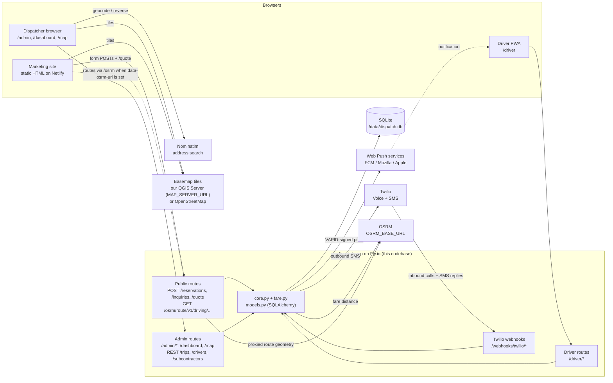

The site maps still call the public OSRM demo directly while their
`data-osrm-url` attribute is empty (the pre-launch default); setting it
to the dispatch origin's `/osrm` moves them onto the proxy (v1.1.15).

**Four user roles** intersect this process:

| Role | How they're authenticated | Surfaces they touch |
|---|---|---|
| **Anonymous** (marketing site visitor, Twilio edge) | None — public endpoints have honeypot + rate limit + signature validation where applicable | `POST /reservations`, `POST /inquiries`, `POST /quote`, `GET /osrm/route/v1/driving/{coords}`, `/webhooks/twilio/*`, `GET /health` |
| **Admin** (dispatcher: the head dispatcher) | Session cookie set by `POST /admin/login` (HMAC-signed, 24h lifetime) + CSRF token on every POST/PUT/PATCH/DELETE (all admin-gated paths, not just `/admin/*`, since v1.1.13) | `/admin/*`, `/dashboard`, `/map`, raw API (`/drivers`, `/subcontractors`, `/trips`, `GET`/`PATCH` on `/reservations` + `/inquiries`) |
| **Driver** (chauffeur) | Per-driver bearer token (`Driver.auth_token`, `secrets.token_urlsafe(32)`), sent either as `Authorization: Bearer ...` or as the `driver_token` cookie | `/driver`, `/driver/trips/{id}`, `/driver/login`, `/driver/location`, `/driver/push/*` |
| **Subcontractor** (Tier-1/2/3 partner) | None on REST — they accept/decline via inbound SMS to the Twilio number | Only ever sees their phone; communicates via `POST /webhooks/twilio/sms` matching on `From` |

**The two flows that matter most:**

1. **Booking flow** — guest fills out the marketing-site reserve form →
   `POST /reservations` lands a row with `status=PENDING_REVIEW` →
   dispatcher reviews, calls guest, confirms → `POST /admin/reservations/{id}/promote`
   creates a `Trip` with `status=REQUESTED` and links the reservation
   (`reservation.linked_trip_id`; reservation flips to `CONVERTED`).
2. **Dispatch flow** — dispatcher triggers a broadcast
   (`POST /admin/trips/{id}/action/broadcast`, or `POST /trips/{id}/broadcast`
   from `/map`) → `core.broadcast_trip` selects the N nearest available
   drivers within the radius, creates `TripBroadcast` rows, and pages each
   driver by push (v1.1.0 flag + subscription) or SMS → the first driver
   to accept (driver PWA button, `ACCEPT N` SMS reply, or
   `POST /trips/{id}/accept`) wins the atomic compare-and-set; losers are
   refused → driver walks status ACCEPTED → EN_ROUTE_PICKUP → ON_SCENE →
   IN_TRANSIT → COMPLETED. See [§8](#8-broadcast-lifecycle).

---

## 2. Technology stack

| Layer | Choice | Reason |
|---|---|---|
| Language | Python 3.11 (CI); `pyproject.toml` allows ≥3.10 | Type hints, typed ORM via SQLAlchemy 2.0 |
| Web framework | **FastAPI** ≥0.115 | Async, Pydantic schema integration, OpenAPI for free, mature for single-process apps |
| ASGI server | **uvicorn[standard]** ≥0.32 | Default FastAPI pairing |
| ORM | **SQLAlchemy 2.0** | Modern typed `Mapped[T]` columns; SQLite + Postgres both first-class |
| Migrations | **Alembic** ≥1.13 (v1.0.12+) | Production schema evolution; SQLite dev uses `create_all` |
| DB | **SQLite** on a Fly.io persistent volume | One file, full ACID, sufficient for Year-1 volume. Postgres migration documented in `DEPLOY.md` § SQLite→Postgres when triggered |
| Validation | **Pydantic 2.9+** | Request body validation; length caps; phone-number normalization; lat/lon range bounds via `Field(ge=/le=)` + `core.coords_in_range` (v1.1.7) |
| Auth — admin | Signed session cookie `{username}:{expiry}:{hmac}` — stdlib `hmac` + SHA-256 keyed by `ADMIN_SESSION_SECRET` (no itsdangerous); **bcrypt** password hash | Single user from env; no user table yet; rotation is a redeploy |
| Auth — driver | Per-driver `auth_token` (`secrets.token_urlsafe(32)`), exact-match lookup | Simple bearer; rotatable from admin surface; rotation also deletes the driver's push subscriptions |
| CSRF | Admin: HMAC-SHA256(`ADMIN_SESSION_SECRET`, session cookie). Driver: HMAC-SHA256(`DRIVER_CSRF_SECRET`, driver id). Both accept a `csrf_token` form field or `X-CSRF-Token` header | Defense-in-depth on cookie-auth writes; driver bearer auth exempt (can't be set cross-origin) |
| SMS | **Twilio** (REST API for outbound; webhook for inbound) | Industry standard; signature verification gates the inbound webhook |
| Voice | Twilio Programmable Voice with TwiML responses | Live-person-answers pipeline with caller-aware whisper; voicemail with transcription |
| Push | **pywebpush** ≥2.0 + **py-vapid** ≥1.9 (v1.1.0, flag-gated) | Self-hosted; no third-party data processor |
| Maps (dispatcher) | **Leaflet 1.9.4** (unpkg) on our own QGIS Server basemap (`MAP_SERVER_URL`) or, unset, OpenStreetMap tiles darkened by a CSS filter; Nominatim for address search | CARTO's free tiles now demand an API key (v1.3.0) |
| Routing (distance + map geometry) | **OSRM** via one `OSRM_BASE_URL` (public demo by default; self-hosted corridor image in [`osrm/`](osrm/README.md) for production) with **haversine** / straight-line fallback | OSRM for road-network reality. Fare backend calls it directly (stdlib `urllib`); browser maps go through the same-origin `/osrm` proxy (`httpx`, v1.1.15) |
| Ops CLI | **Typer** ([`cli.py`](cli.py)) | Talks to the DB directly via `SessionLocal` + `core.py` — not through the REST API |
| Security headers | Per-request CSP nonce (v1.0.13), HSTS, X-Frame-Options, etc. | Defense-in-depth |
| Static analysis | **bandit** ≥1.7, **pip-audit** ≥2.7, **GitGuardian** | bandit is a hard gate; pip-audit runs with `continue-on-error: true` (reported, not blocking) |
| Testing | **pytest** ≥8.3 in-process; **Playwright** for site + e2e | 1,084 pytest tests at v1.4.1 (738 unit/integration + 346 adversarial probes in 6 pentest suites); 37 e2e + 37 site Playwright tests |
| Container | **Docker** image ([`Dockerfile`](Dockerfile)) deployed on **Fly.io** ([`fly.toml`](fly.toml)), entrypoint [`boot.py`](boot.py) (v1.1.21) | Committed and boot-tested in CI (`dispatch-image.yml`) instead of generated by `flyctl launch`; see [§15.6](#156-production-boot-migrations-run-in-the-container) |

---

## 3. Project layout

Every file in the repository, what it does, and the rough size in lines.

```
livery-dispatch/
├── app.py                  ← FastAPI app, all 100 routes, middleware, boot guards (~3450 LOC)
├── core.py                 ← Business logic: broadcast, accept, sub cost, state machine + driver release, caller ID, quiet hours, voicemail parse (~840 LOC)
├── models.py               ← SQLAlchemy ORM models + enums (~485 LOC)
├── schemas.py              ← Pydantic request/response shapes + _normalize_phone (~540 LOC)
├── database.py             ← Engine, SessionLocal, get_session, init_db (~60 LOC)
├── admin_auth.py           ← Session cookie HMAC + bcrypt + admin CSRF token (~150 LOC)
├── admin_pages.py          ← Server-rendered HTML for /admin/* incl. sub settlement page + CSV, rate-card create/edit form (~2520 LOC)
├── dashboard.py            ← Server-rendered /dashboard view (meta-refresh) (~520 LOC)
├── driver_pages.py         ← Server-rendered /driver, /driver/trips/{id}, /driver/login; DRIVER_NEXT_STATUS; push on/off script (~690 LOC)
├── map_view.py             ← Server-rendered /map (Leaflet bootstrapping) + /map/data builder (~1700 LOC)
├── _styles.py              ← Shared Fireworks-aesthetic BASE_CSS string + formatters
├── fare.py                 ← Fare calculator: rate inputs + OSRM/haversine distance → FareBreakdown (~270 LOC)
├── osrm_proxy.py           ← GET /osrm/route/v1/driving/* — validated, corridor-bounded, cached OSRM proxy (v1.1.15)
├── osrm/                   ← Self-hosted corridor OSRM: Dockerfile (GA+FL extract, clipped) + fly.toml + README (v1.1.15)
├── anchors.py              ← Corridor text-label → (canonical, lat, lon) resolver, e.g. "JAX Terminal" → JAX
├── notifications.py        ← Provider abstraction: Console / Twilio (SMS) + WebPush
├── csp.py                  ← Per-request CSP nonce contextvar + helpers (v1.0.13)
├── recap.py                ← Daily recap aggregation (build_recap) behind `cli.py recap`
├── cli.py                  ← Typer ops CLI: drivers / trips / subs / reservations / inquiries / rates / recap
├── rate_defaults.py        ← planning_rate_cards(): the planning-grade SUV + Sprinter cards, shared by seed.py and `cli.py rates seed-defaults` (v1.1.18)
├── seed.py                 ← Dev seeding: drivers, subs, trips, and the rate cards from rate_defaults.py
├── boot.py                 ← Container entrypoint: chown the /data volume, drop root, back up if a migration is pending (v1.4.1), alembic upgrade head, exec uvicorn (v1.1.21)
├── backup.py               ← Consistent SQLite copies (backup API + integrity check) and their retention: `python backup.py`, and boot's pre-migration copy (v1.4.1)
├── Dockerfile              ← Production image: python:3.11-slim, runtime deps only, DISPATCH_ENV=production, one uvicorn worker on :8080 (v1.1.21)
├── fly.toml                ← Fly.io app: one always-on machine, dispatch_data volume at /data with 30 days of snapshots (v1.4.1), /health check (v1.1.21)
├── .dockerignore           ← Keeps tests, local DBs, .env files and osrm/ out of the image
├── alembic.ini             ← Alembic config (sqlalchemy.url read from env)
├── alembic/                ← Migration scripts + env.py
│   ├── env.py              ← Imports Base, sets target_metadata, reads DATABASE_URL
│   ├── script.py.mako      ← Migration template
│   └── versions/           ← Migration files (date-prefixed)
├── tests/
│   ├── conftest.py         ← In-memory SQLite engine (StaticPool), admin auto-fixture
│   ├── test_*.py           ← Unit + integration tests (26 files, 685 tests)
│   └── pentests/           ← Adversarial probes (6 suites, 345 total)
├── requirements-runtime.txt ← Runtime dependency floors (>=); the only file the image installs (v1.1.21)
├── requirements.txt        ← `-r requirements-runtime.txt` + pytest, bandit, pip-audit
├── pyproject.toml          ← Project metadata + pytest config
├── .env.example            ← Every env var with PROD-REQUIRED markers
├── README.md               ← Quickstart
├── GUIDE.md                ← Operator handbook
├── DEPLOY.md               ← Production deployment runbook
├── PRESENTATION.html       ← Slide-style overview of the dispatch system
└── ARCHITECTURE.md         ← This file
```

**Single-process architecture.** No worker queue, no Redis, no
microservices. Everything is a FastAPI handler. This is deliberate at
low volume.

---

## 4. Data model

Ten tables, all in [`models.py`](models.py). Every column listed.
SQLAlchemy 2.0 typed `Mapped[T]` syntax. Every table also has
`created_at` / `updated_at` (or the equivalents noted) defaulting to
`datetime.now(timezone.utc)` via `_utcnow()`.

This entity-relationship view shows the foreign keys between the ORM
models (key columns only; full column lists follow in §4.2–§4.11):

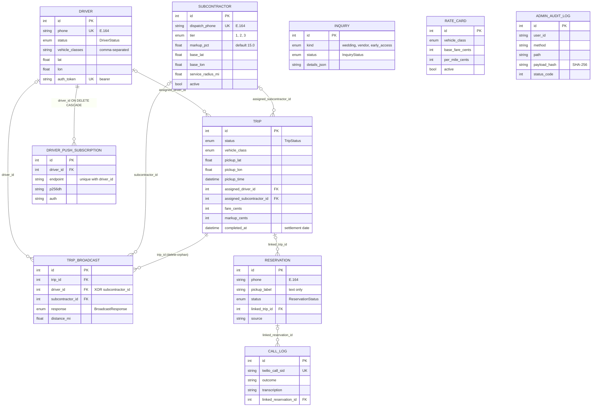

`INQUIRY`, `RATE_CARD` and `ADMIN_AUDIT_LOG` have no foreign keys.

### 4.1 Enums

| Enum | Values | Used by |
|---|---|---|
| `VehicleClass` | `SUV`, `SPRINTER`, `SEDAN` | `Trip.vehicle_class`, `RateCard.vehicle_class`, `Reservation.vehicle_class`, `Driver.vehicle_classes` / `Subcontractor.vehicle_classes` (comma-separated string) |
| `DriverStatus` | `OFFLINE`, `AVAILABLE`, `ON_TRIP`, `OFF_DUTY` | `Driver.status` |
| `TripStatus` | `REQUESTED`, `BROADCASTING`, `ACCEPTED`, `EN_ROUTE_PICKUP`, `ON_SCENE`, `IN_TRANSIT`, `COMPLETED`, `CANCELLED`, `NO_DRIVERS` | `Trip.status` |
| `BroadcastResponse` | `PENDING`, `ACCEPTED`, `DECLINED`, `EXPIRED` | `TripBroadcast.response` |
| `SubcontractorTier` | `TIER_1`, `TIER_2`, `TIER_3` (int enum) | `Subcontractor.tier` |
| `ReservationStatus` | `PENDING_REVIEW`, `CONFIRMED`, `DECLINED`, `CONVERTED`, `SPAM` | `Reservation.status` |
| `InquiryKind` | `WEDDING`, `VENDOR`, `EARLY_ACCESS` | `Inquiry.kind` |
| `InquiryStatus` | `PENDING_REVIEW`, `RESPONDED`, `CLOSED`, `SPAM` | `Inquiry.status` |

The string enums store their lowercase `.value` (e.g. `"broadcasting"`).

### 4.2 `Driver` (`drivers`)

The chauffeur. Each row = one human chauffeur.

| Column | Type | Notes |
|---|---|---|
| `id` | `Integer` PK | |
| `name` | `String(120)` | Display name |
| `phone` | `String(32)` UNIQUE | E.164 — matched against Twilio's inbound `From` header |
| `status` | `DriverStatus` | Default `OFFLINE` |
| `vehicle_classes` | `String(64)` | Comma-separated, e.g. `"suv,sprinter"`. Default `"suv"` |
| `lat`, `lon` | `Float` (nullable) | Last known location; populated by `/driver/location` PWA heartbeat (or dispatcher edits) |
| `auth_token` | `String(64)` UNIQUE (nullable) | Per-driver bearer (URL-safe 32 bytes). Minted on `POST /drivers`, lazily on first admin detail view for older rows; rotation via admin surface |
| `created_at`, `updated_at` | `DateTime` | Auto-managed |

**Relationships:** `broadcasts: list[TripBroadcast]` (back-populated).

**Methods:**
- `serves(vehicle_class)` — does this driver's `vehicle_classes` include the class?
- `ensure_auth_token()` — generate `auth_token` if null, return it. Caller must commit.

### 4.3 `Subcontractor` (`subcontractors`)

A partner company we broadcast overflow trips to. They handle their
own dispatching internally; we only know their dispatch desk phone.

| Column | Type | Notes |
|---|---|---|
| `id` | `Integer` PK | |
| `name` | `String(120)` | E.g. "Sample Northshore Cars" |
| `dispatch_phone` | `String(32)` UNIQUE | E.164 — sub's dispatch desk |
| `dispatch_email` | `String(160)` (nullable) | For non-time-sensitive coordination |
| `vehicle_classes` | `String(64)` | Comma-separated. Default `"suv"` |
| `tier` | `SubcontractorTier` | 1 = preferred, 2 = backup, 3 = last-resort. Default `TIER_1` |
| `markup_pct` | `Float` | Default 15.0 — our markup on top of their quote |
| `base_lat`, `base_lon` | `Float` (nullable) | Their home base; used for distance filtering. Null = included as last-resort with unknown distance |
| `service_radius_mi` | `Float` (nullable) | Sub's stated max coverage from base; null falls back to `BROADCAST_RADIUS_MI` |
| `active` | `Boolean` | Default `True`; set `False` to skip in broadcasts |
| `notes` | `String(500)` (nullable) | Dispatcher notes |
| `created_at`, `updated_at` | `DateTime` | |

**Relationships:** `broadcasts: list[TripBroadcast]` (back-populated).

### 4.4 `Trip` (`trips`)

The central booking object. One ride = one Trip row.

| Column | Type | Notes |
|---|---|---|
| `id` | `Integer` PK | |
| `passenger_name` | `String(120)` | |
| `passenger_phone` | `String(32)` | E.164 (normalized on create/promote/edit) |
| `pickup_label`, `dropoff_label` | `String(255)` | Human-readable address |
| `pickup_lat`, `pickup_lon`, `dropoff_lat`, `dropoff_lon` | `Float` | Required for broadcasting (geo-filter) and fare distance |
| `pickup_time` | `DateTime` | When the ride starts |
| `vehicle_class` | `VehicleClass` | SUV/Sprinter/Sedan |
| `notes` | `String(500)` (nullable) | Dispatcher notes |
| `status` | `TripStatus` | Default `REQUESTED`. State machine in [§5](#5-state-machines) |
| `assigned_driver_id` | FK→`drivers.id` (nullable) | First to accept wins |
| `assigned_subcontractor_id` | FK→`subcontractors.id` (nullable) | Set when overflow accepted |
| `fare_cents` | `Integer` (nullable) | Set by the admin quote action, the trip edit form, `PATCH /trips/{id}/status`, a sub accept that carries a cost (REST/CLI `sub-accept`, or an SMS `ACCEPT N <cost>` since v1.1.18), or `core.record_subcontractor_cost` afterwards (v1.1.18) |
| `markup_cents` | `Integer` (nullable) | Cost-plus markup logged whenever a sub's cost is recorded (at accept or later); null for own-fleet |
| `created_at`, `updated_at` | `DateTime` | |
| `completed_at` | `DateTime` (nullable) | **The settlement date** (v1.1.20). `core.update_trip_status` stamps it once, on entering `COMPLETED`, and clears it if a `force=True` override moves the trip back out. Settlement reads it instead of `updated_at`, so editing a finished trip no longer moves it between periods. Migration `5c1e7a9b3d42` added it and backfilled existing completed trips from `updated_at` |

**Relationships:** `broadcasts: list[TripBroadcast]` with
`cascade="all, delete-orphan"`.

**Invariants:** the table carries `CHECK (assigned_driver_id IS NULL OR
assigned_subcontractor_id IS NULL)` (`ck_trip_one_assignee`), so at most
one assignee can ever be set. The atomic accept ([§8](#8-broadcast-lifecycle))
is what sets exactly one of them when the trip becomes `ACCEPTED`.

### 4.5 `TripBroadcast` (`trip_broadcasts`)

One row per (trip, recipient) when a broadcast fires. Tracks who saw
the offer and how they responded.

| Column | Type | Notes |
|---|---|---|
| `id` | `Integer` PK | |
| `trip_id` | FK→`trips.id` | |
| `driver_id` | FK→`drivers.id` (nullable) | Set for own-fleet broadcasts |
| `subcontractor_id` | FK→`subcontractors.id` (nullable) | Set for overflow broadcasts |
| `distance_mi` | `Float` | Pickup-to-recipient haversine distance at broadcast time; `0.0` for a sub with no base location |
| `response` | `BroadcastResponse` | Default `PENDING` |
| `sent_at` | `DateTime` | |
| `responded_at` | `DateTime` (nullable) | When response flipped from PENDING (accept, decline, or sibling expiry) |

**Invariant**: `CHECK` constraint `ck_broadcast_recipient_xor` — exactly
one of `driver_id` / `subcontractor_id` is set per row. Property
`recipient_kind` returns `"driver"` or `"subcontractor"`.

### 4.6 `Reservation` (`reservations`)

A public-form booking request (or a voicemail-derived one). Text
addresses only (no coordinates). Promoted to a `Trip` by a dispatcher.

| Column | Type | Notes |
|---|---|---|
| `id` | `Integer` PK | |
| `name`, `email` | `String(200)` | |
| `phone` | `String(32)` | E.164 |
| `pickup_label`, `dropoff_label` | `String(500)` | Text only |
| `pickup_date` | `String(20)` (nullable) | YYYY-MM-DD (voicemail parse may store `today` / `tomorrow`) |
| `pickup_time_str` | `String(10)` (nullable) | HH:MM |
| `pickup_at` | `DateTime` (nullable) | Combined timestamp (preferred) |
| `passengers` | `String(20)` (nullable) | Free-text guest count |
| `vehicle_pref` | `String(40)` (nullable) | "escalade-esv", "sprinter-limited", "multi-vehicle", or empty |
| `vehicle_class` | `VehicleClass` (nullable) | Normalized from `vehicle_pref` on create (`escalade-esv` → SUV, `sprinter-limited` → SPRINTER, else null) |
| `flight` | `String(40)` (nullable) | Optional flight number |
| `notes` | `String(2000)` (nullable) | |
| `source` | `String(120)` (nullable) | e.g. "site:reserve", "twilio-voicemail:CAxxx" |
| `status` | `ReservationStatus` | Default `PENDING_REVIEW` |
| `linked_trip_id` | FK→`trips.id` (nullable) | Set on promote |
| `dispatcher_notes` | `String(2000)` (nullable) | |
| `created_at`, `updated_at` | `DateTime` | |

**Promotion semantics** are load-bearing: a reservation can be
promoted to at most one trip. Re-promotion is blocked 409 if status
is `CONVERTED`/`SPAM`/`DECLINED`. See
[§9.4 Reservation promotion](#94-reservation-promotion).

### 4.7 `Inquiry` (`inquiries`)

Non-reservation lead from the marketing site (wedding, vendor,
early-access). Lighter than `Reservation` — no trip conversion path.

| Column | Type | Notes |
|---|---|---|
| `id` | `Integer` PK | |
| `kind` | `InquiryKind` | wedding / vendor / early_access |
| `name`, `email` | `String(200)` | |
| `phone` | `String(32)` (nullable) | E.164 when present |
| `notes` | `String(2000)` (nullable) | |
| `details_json` | `String(4000)` (nullable) | Kind-specific JSON blob (serialized; exposed as `details` on the API) |
| `source` | `String(120)` (nullable) | |
| `status` | `InquiryStatus` | Default `PENDING_REVIEW` |
| `dispatcher_notes` | `String(2000)` (nullable) | |
| `created_at`, `updated_at` | `DateTime` | |

### 4.8 `RateCard` (`rate_cards`)

Per-vehicle-class pricing for the fare calculator. Lookups (admin quote
action without an explicit card, public `/quote`) pick the
**lowest-id** row with matching `vehicle_class` and `active=True`.

Cards come from three places (E6, v1.1.18): the dispatcher's
`/admin/rates/new` form, `python cli.py rates seed-defaults` (loads the
planning-grade SUV + Sprinter cards only when the table is empty, so it's
safe on production), and the dev-only `seed.py`. The last two share one
definition, `rate_defaults.planning_rate_cards()`. Before v1.1.18 only
`seed.py` could create a card, so a fresh production database had none
and `/quote` always soft-failed.

| Column | Type | Notes |
|---|---|---|
| `id` | `Integer` PK | |
| `name` | `String(120)` | Human label (e.g. "v1 SUV") |
| `vehicle_class` | `VehicleClass` | |
| `base_fare_cents` | `Integer` | Flat trip start fee |
| `per_mile_cents` | `Integer` | Distance component |
| `per_hour_cents` | `Integer` | Time component (duration = miles ÷ 45 mph + 0.25 h) |
| `airport_meet_surcharge_cents` | `Integer` | Added when the quote is an airport meet — see [§12.1](#121-the-quote-function) |
| `after_hours_surcharge_cents` | `Integer` | Added when `pickup_time` hour is 22:00–05:59 |
| `peak_week_multiplier` | `Float` | Applied to the base + distance + time subtotal when `is_peak_week=True` and the multiplier is > 1.0. The admin create and edit forms clamp it to ≥ 1.0 |
| `minimum_fare_cents` | `Integer` | Floor — quote bumps up to this if calc falls below |
| `active` | `Boolean` | Nothing enforces one active card per class; the lowest id wins |
| `notes` | `String(1000)` (nullable) | |
| `created_at`, `updated_at` | `DateTime` | |

### 4.9 `CallLog` (`call_logs`)

One row per inbound Twilio voice call. Populated by the voice webhook
chain (`/voice` → `/dial-status` → `/voicemail`).

| Column | Type | Notes |
|---|---|---|
| `id` | `Integer` PK | |
| `twilio_call_sid` | `String(64)` UNIQUE (nullable) | Twilio's call identifier; the upsert key for webhook retries |
| `from_phone`, `to_phone` | `String(32)` | E.164, or `"(unknown)"` |
| `direction` | `String(16)` | Default `"inbound"` |
| `outcome` | `String(20)` | Values written by the webhooks: `ringing`, `after_hours`, `answered`, `voicemail`, `failed`. Column default `answered` |
| `started_at`, `ended_at` | `DateTime` | `ended_at` set when the dial completes as answered |
| `duration_seconds` | `Integer` (nullable) | Not written by the current webhooks |
| `recording_url` | `String(500)` (nullable) | Twilio's recording URL |
| `recording_duration_seconds` | `Integer` (nullable) | |
| `transcription` | `String(4000)` (nullable) | Truncated to 4000 chars |
| `linked_reservation_id` | FK→`reservations.id` (nullable) | Set when a voicemail transcript auto-creates a Reservation (or by the dispatcher on the call edit form) |
| `dispatcher_notes` | `String(2000)` (nullable) | |
| `created_at`, `updated_at` | `DateTime` | |

### 4.10 `AdminAuditLog` (`admin_audit_log`)

Append-only log of every `POST`/`PATCH`/`DELETE` under `/admin/`.
Body is hashed (SHA-256) — not stored — to avoid PII bloat. v0.9.26.
The REST mutations (`/trips`, `/drivers`, ...) are **not** audited.

| Column | Type | Notes |
|---|---|---|
| `id` | `Integer` PK | |
| `timestamp` | `DateTime` | |
| `user_id` | `String(100)` (nullable) | Admin username from the session cookie; null for `POST /admin/login` before a session exists |
| `method` | `String(10)` | |
| `path` | `String(500)` | E.g. `/admin/trips/17/edit` |
| `payload_hash` | `String(64)` (nullable) | SHA-256 hex of body bytes; null on empty body |
| `status_code` | `Integer` | HTTP status returned (includes CSRF 403s from the inner middleware) |

### 4.11 `DriverPushSubscription` (`driver_push_subscriptions`)

Web Push subscription (RFC 8030 / VAPID). One row per (driver,
endpoint) — a chauffeur with phone + tablet has two rows. v1.1.0.

| Column | Type | Notes |
|---|---|---|
| `id` | `Integer` PK | |
| `driver_id` | FK→`drivers.id` `ON DELETE CASCADE`, indexed | |
| `endpoint` | `String(500)` | Push service URL (FCM / Mozilla / Apple) |
| `p256dh` | `String(120)` | Base64url ECDH public key |
| `auth` | `String(48)` | Base64url 16-byte auth secret |
| `user_agent` | `String(300)` (nullable) | Captured from `User-Agent` header |
| `created_at`, `last_seen_at` | `DateTime` | `last_seen_at` refreshes on every row update (`onupdate`) |
| `last_success_at` | `DateTime` (nullable) | Bumped on successful push delivery |

**Unique constraint:** `(driver_id, endpoint)` (`uq_push_driver_endpoint`)
— re-subscribing from the same device upserts. **Cascade-delete** when
parent `Driver` row is deleted; ALSO deleted in bulk by
`POST /admin/drivers/{id}/action/rotate-token` (rotating the token
revokes trust on every subscribed device).

---

## 5. State machines

### 5.1 Trip status

Defined in [`core.py:347 VALID_TRANSITIONS`](core.py) and enforced by
`core.update_trip_status`. This diagram is generated edge-for-edge from
that dict:

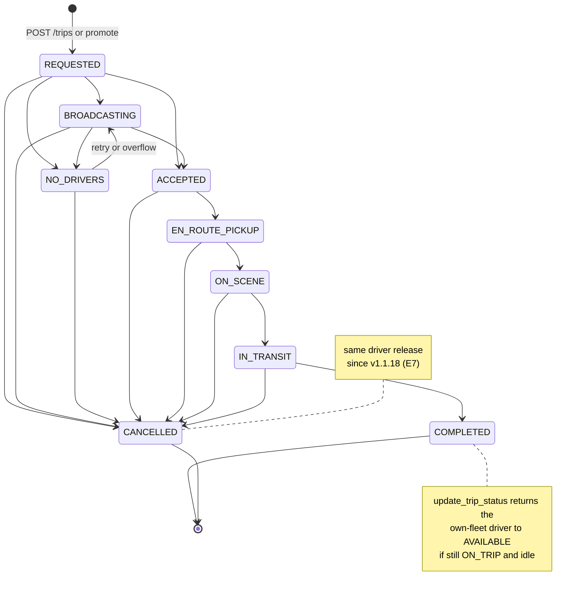

| From | Allowed next |
|---|---|
| `REQUESTED` | `BROADCASTING`, `ACCEPTED`, `CANCELLED`, `NO_DRIVERS` |
| `BROADCASTING` | `ACCEPTED`, `NO_DRIVERS`, `CANCELLED` |
| `NO_DRIVERS` | `BROADCASTING` (retry), `CANCELLED` |
| `ACCEPTED` | `EN_ROUTE_PICKUP`, `CANCELLED` |
| `EN_ROUTE_PICKUP` | `ON_SCENE`, `CANCELLED` |
| `ON_SCENE` | `IN_TRANSIT`, `CANCELLED` |
| `IN_TRANSIT` | `COMPLETED`, `CANCELLED` |
| `COMPLETED` | terminal |
| `CANCELLED` | terminal |

Illegal transitions raise `ValueError("Invalid transition: X → Y")`
from `core.update_trip_status`. Callers map that to: 409 on
`PATCH /trips/{id}/status`; a 303 flash ("Update failed" / "Failed") on
`POST /admin/trips/{id}/edit`, `/action/complete` and `/action/cancel`.
Self-transitions (X → X) are illegal too, which is why the admin edit
form only calls `update_trip_status` when the submitted status differs
from the current one (a fare-only edit is written directly).

**`force=True`:** `update_trip_status(..., force=True)` skips the check
entirely. It exists as an admin-recovery hook, but **no HTTP route or
CLI command passes it today** — every status write that goes through
`update_trip_status` is guarded.

**Writes that bypass `update_trip_status`:** `core.broadcast_trip` /
`core.broadcast_to_subcontractors` set `BROADCASTING` directly, or
`NO_DRIVERS` when they find no candidate **and** no broadcast on the trip
is still `PENDING` (E8, v1.1.18; see [§8](#8-broadcast-lifecycle)). And
`core.accept_trip*` sets `ACCEPTED` inside the atomic UPDATE ([§8](#8-broadcast-lifecycle)). Accept is
itself restricted to `REQUESTED`/`BROADCASTING` by its WHERE clause.
**Broadcast is guarded too (E3, v1.1.17).** `core.broadcast_trip` and
`core.broadcast_to_subcontractors` call `_ensure_broadcastable` first and
raise `TripNotBroadcastable` (a `ValueError`) unless the trip is in
`BROADCASTABLE_STATUSES` = `REQUESTED` / `BROADCASTING` / `NO_DRIVERS`. That's
exactly the states that may sit in or move to `BROADCASTING` per
`VALID_TRANSITIONS`, and a test derives the set from the machine. Nothing
is sent and no `TripBroadcast` row is written. The REST endpoints answer
409, the admin actions redirect with a `Failed: …` flash, and the CLI exits 1.
Before v1.1.17 a direct `POST /trips/{id}/broadcast` on an `ACCEPTED` trip
silently rewound it to `BROADCASTING` and re-paged drivers.

### 5.2 Driver `next_status`

Defined in [`driver_pages.py:57 DRIVER_NEXT_STATUS`](driver_pages.py).
Forward-only — the only path a chauffeur can drive themselves.

| From | One-tap label | Next |
|---|---|---|
| `ACCEPTED` | "Mark on the way" | `EN_ROUTE_PICKUP` |
| `EN_ROUTE_PICKUP` | "Mark arrived" | `ON_SCENE` |
| `ON_SCENE` | "Start trip" | `IN_TRANSIT` |
| `IN_TRANSIT` | "Mark complete" | `COMPLETED` |

`POST /driver/trips/{id}/status/{status}` returns 403 unless the caller
is the assigned driver, 400 for an unknown status or anything other
than the single next step, then calls `core.update_trip_status` (which
re-checks `VALID_TRANSITIONS`). On `COMPLETED` (and on `CANCELLED`, which
only the dispatcher can set), `core.update_trip_status` returns the
assigned own-fleet driver to `AVAILABLE` under the rules in
[§5.3](#53-driver-status). Subcontractor-handled trips don't have an
internal driver state to flip.

### 5.3 Driver status

No formal state machine — the dispatcher can set any value (admin
driver edit form, `PATCH /drivers/{id}/status`, `cli.py drivers status`).
Drivers cannot change their own status from the PWA. Two transitions
happen automatically:

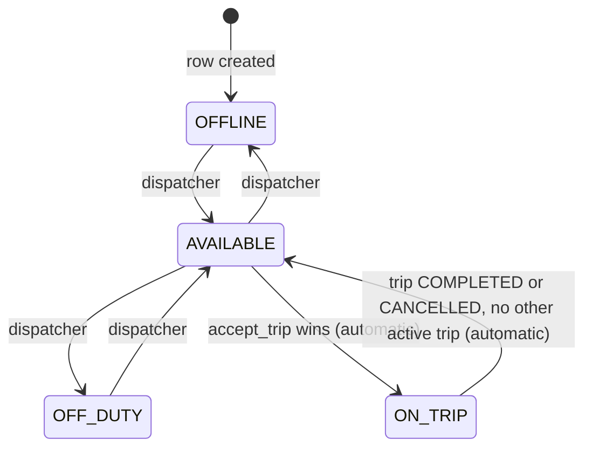

The broadcast loop only considers drivers in `AVAILABLE` status, and
`accept_trip` refuses a driver who isn't `AVAILABLE`.

**Driver release (E7, v1.1.18).** When `update_trip_status` moves a trip
to `COMPLETED` **or `CANCELLED`**, it calls `_release_driver_if_idle`.
That flips the assigned driver to `AVAILABLE` only if both hold:

- the driver is still `ON_TRIP`. A driver the dispatcher set to
  `OFF_DUTY` or `OFFLINE` mid-trip stays that way, so nobody who signed
  off gets paged again;
- no *other* trip assigned to them is `ACCEPTED`, `EN_ROUTE_PICKUP`,
  `ON_SCENE` or `IN_TRANSIT`. This guards a dispatcher-assigned second
  trip.

Before v1.1.18 only `COMPLETED` released the driver. A cancelled trip left
its driver `ON_TRIP` for good, silently dropping them out of every later
broadcast until the dispatcher reset them by hand.

### 5.4 Reservation status

Status writes on reservations are mostly unguarded: the confirm /
decline / spam actions and the edit form set the value directly. Only
two rules are enforced — promote is refused from `CONVERTED`, `SPAM` or
`DECLINED` (409), and a manual flip to `CONVERTED` with no linked trip
is refused (409, edit form and `PATCH /reservations/{id}`). The intended
lifecycle:

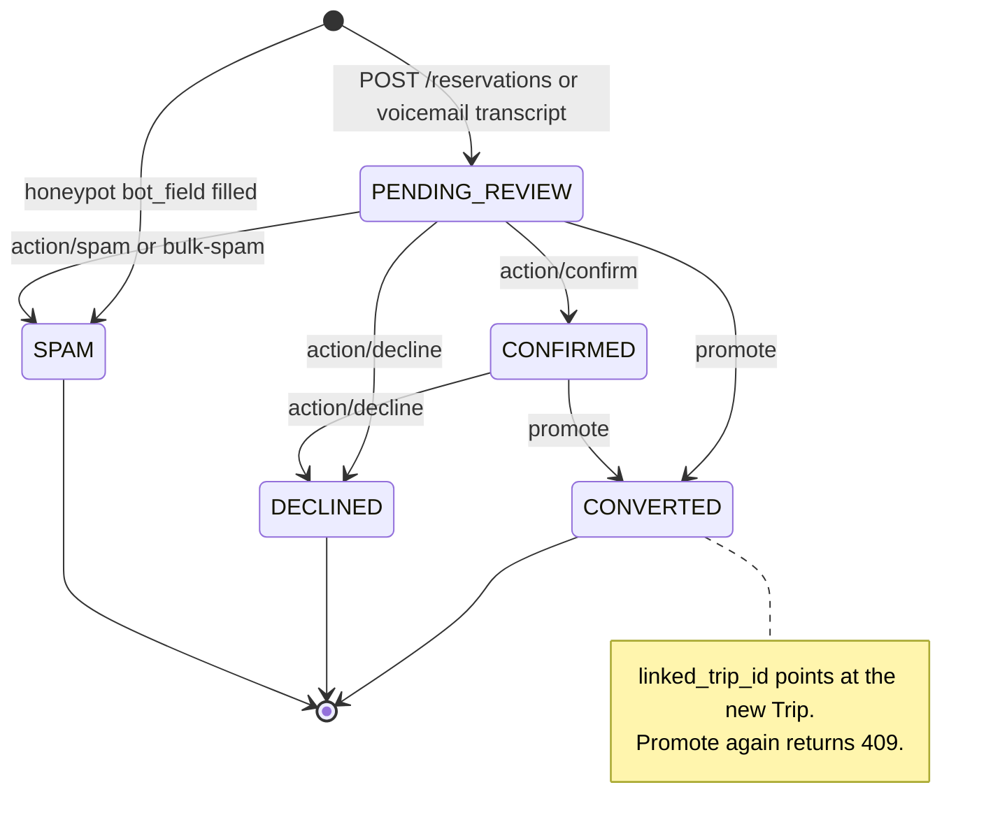

`POST /admin/reservations/bulk-spam` only flips rows that are still
`PENDING_REVIEW`. The promote path itself is drawn in
[§9.4](#94-reservation-promotion).

### 5.5 Inquiry status

Inquiries never become trips; they get a human reply and close. The
edit form and `PATCH /inquiries/{id}` can set any status; the two
action buttons are the usual path:

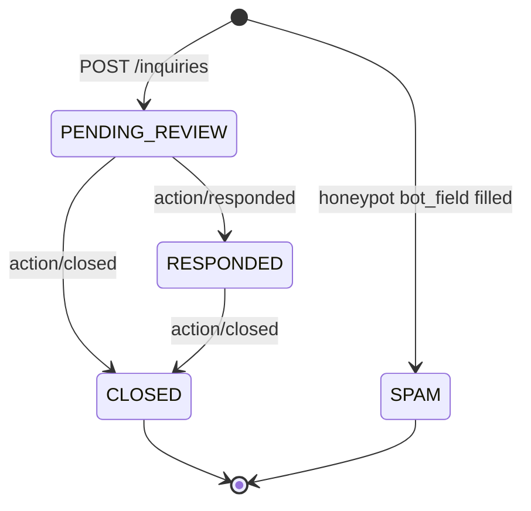

---

## 6. API reference

100 routes total (`APIRoute` count; v1.1.18 added the two `/admin/rates/new`
routes and `/admin/trips/{id}/action/sub-cost`). Outside production FastAPI also
serves `/docs`, `/docs/oauth2-redirect`, `/redoc` and `/openapi.json`;
since v1.1.17 (E2) they don't exist when `DISPATCH_ENV=production`. Grouped by
surface. **Auth column key:** `pub` = public (no auth), `adm` = admin
session cookie required, `drv` = driver bearer token required, `twi` =
Twilio signature verified. Every `adm` POST/PUT/PATCH/DELETE also needs
the admin CSRF token ([§7.1](#71-admin-auth-cookie-session)).

Admin HTML routes answer an unauthenticated request with
`307 → /admin/login` when the `Accept` header contains `text/html`,
`401` JSON otherwise. Admin form POSTs use PRG: `303` back to a detail
page with an `?ok=` flash message.

### 6.1 Public

| Method + Path | Auth | Purpose |
|---|---|---|
| `GET /health` | pub | Returns `{status, service, version}` (`version` = `app.version`) |
| `GET /` | pub | `307` redirect to `/dashboard` (which then sends an unauthenticated browser on to `/admin/login`) |
| `POST /reservations` | pub | Marketing-site reserve form lands here. Rate-limited, honeypot-gated. [§9.1](#91-post-reservations) |
| `POST /inquiries` | pub | Wedding/vendor/early-access forms. Rate-limited, honeypot-gated. [§9.2](#92-post-inquiries) |
| `POST /quote` | pub | Non-binding fare estimate; resolves text labels via [`anchors.py`](anchors.py). Rate-limited. [§9.3](#93-post-quote) |
| `GET /osrm/route/v1/driving/{coords}` | pub | Same-origin OSRM route proxy for `/map` + the site maps (v1.1.15, [`osrm_proxy.py`](osrm_proxy.py)). 2–10 `lon,lat` waypoints inside `CORRIDOR_BBOX`; allow-listed params (`overview`, `geometries`, `steps`, `alternatives`); upstream URL rebuilt from parsed floats; 24h LRU cache (`X-Cache: HIT/MISS`); over limit → 429, timeout → 504, upstream failure → 502, `OSRM_BASE_URL=""` → 503, OSRM `NoRoute` → 400 `{code}`. Own rate-limit bucket. Not in OpenAPI. [§12.5](#125-same-origin-osrm-proxy) |

### 6.2 Admin auth + chrome

| Method + Path | Auth | Purpose |
|---|---|---|
| `GET /admin/login` | pub | Login form (HTML); `303 → /dashboard` if already signed in |
| `POST /admin/login` | pub | Verify username + bcrypt password; set session cookie; `303 → /dashboard`. Rate-limited (`LOGIN_RATE_*`). 400 empty / 401 bad credentials / 429 over limit |
| `POST /admin/logout` | pub | Clear session cookie; `303 → /admin/login` |
| `GET /dashboard` | adm | Auto-refreshing (meta-refresh, 30s) overview: active trips, pending reservations + inquiries, drivers, subcontractors |
| `GET /map` | adm | Leaflet live map of drivers, sub bases + active trips; click-to-dispatch. Renders `<meta name="csrf-token">` |
| `GET /map/data` | adm | JSON snapshot for `/map` polling (every 12s) |
| `GET /admin/audit` | adm | Last 200 admin write actions (`AdminAuditLog`) |

### 6.3 Admin — trips

| Method + Path | Purpose |
|---|---|
| `GET /admin/trips` | List with status + vehicle-class filter chips |
| `GET /admin/trips/{id}` | Detail page with action buttons + edit form |
| `POST /admin/trips/{id}/edit` | Update fields (labels, coords — 422 out of range, phone — 422 if not E.164, time, class, notes, fare). A changed status goes through `core.update_trip_status` (guarded, no `force`) |
| `POST /admin/trips/{id}/action/broadcast` | Own-fleet broadcast via `core.broadcast_trip`. With no eligible driver the flash always reads "…trip set to no_drivers.", even when E8 kept a trip with pending offers `BROADCASTING` |
| `POST /admin/trips/{id}/action/broadcast-overflow` | Subcontractor overflow broadcast via `core.broadcast_to_subcontractors`. With no eligible sub the flash adds "Earlier offers are still open." when any offer is still `PENDING` (E8; wording generalised in v1.1.19) |
| `POST /admin/trips/{id}/action/sub-cost` | Record an overflow sub's quoted cost via `core.record_subcontractor_cost` (E9, v1.1.18). Form field `quoted_cost_dollars` (`$` and `,` stripped). Success flash `Sub cost $X + markup $M → fare $F.`; a refusal or unparseable amount redirects with a `Failed:` flash. The "Record sub cost" form shows on trips assigned to a sub and not cancelled |
| `POST /admin/trips/{id}/action/complete` | `update_trip_status(COMPLETED)` — guarded, so only succeeds from `IN_TRANSIT` (flash on failure). Releases the driver ([§5.3](#53-driver-status)) |
| `POST /admin/trips/{id}/action/cancel` | `update_trip_status(CANCELLED)` — succeeds from any non-terminal status. Releases an idle `ON_TRIP` driver since v1.1.18 (E7) |
| `POST /admin/trips/{id}/action/quote` | Compute and save fare via [`fare.quote_for_trip_and_card`](fare.py) (chosen card or lowest-id active card for the class) |

### 6.4 Admin — reservations

| Method + Path | Purpose |
|---|---|
| `GET /admin/reservations` | List with filter chips + bulk-select |
| `GET /admin/reservations/{id}` | Detail page |
| `POST /admin/reservations/{id}/edit` | Update status, `linked_trip_id`, dispatcher notes. Manual flip to `CONVERTED` without a linked trip → 409 |
| `POST /admin/reservations/{id}/action/confirm` | Status → `CONFIRMED` (unconditional) |
| `POST /admin/reservations/{id}/action/decline` | Status → `DECLINED` (unconditional) |
| `POST /admin/reservations/{id}/action/spam` | Status → `SPAM` (unconditional) |
| `POST /admin/reservations/bulk-spam` | Multi-select bulk spam-flag (`ids` form values); only `PENDING_REVIEW` rows flip |
| `GET /admin/reservations/{id}/promote` | Promote form (pre-fills from reservation fields). 409 for `CONVERTED`/`SPAM`/`DECLINED` |
| `POST /admin/reservations/{id}/promote` | Creates `Trip` (status `REQUESTED`), links via `linked_trip_id`, flips reservation → `CONVERTED`. Blocked 409 for already-promoted/declined/spam. [§9.4](#94-reservation-promotion) |

### 6.5 Admin — inquiries

| Method + Path | Purpose |
|---|---|
| `GET /admin/inquiries` | List with kind + status filters and `?q=` search |
| `GET /admin/inquiries/{id}` | Detail |
| `POST /admin/inquiries/{id}/edit` | Status + dispatcher notes |
| `POST /admin/inquiries/{id}/action/responded` | Status → `RESPONDED` |
| `POST /admin/inquiries/{id}/action/closed` | Status → `CLOSED` |

### 6.6 Admin — drivers

| Method + Path | Purpose |
|---|---|
| `GET /admin/drivers` | List with status filter |
| `GET /admin/drivers/{id}` | Detail (shows full `auth_token` so dispatcher can hand to chauffeur; mints one first if the row has none) |
| `POST /admin/drivers/{id}/edit` | Update status, vehicle_classes, lat/lon |
| `POST /admin/drivers/{id}/action/rotate-token` | Re-mint `auth_token`; **deletes all push subscriptions** for this driver (v1.1.0) |

### 6.7 Admin — subcontractors

| Method + Path | Purpose |
|---|---|
| `GET /admin/subcontractors` | List with active + tier filter chips |
| `GET /admin/subcontractors/{id}` | Detail |
| `POST /admin/subcontractors/{id}/edit` | Update tier, vehicle_classes, markup_pct, service_radius_mi, active, notes |
| `GET /admin/subcontractors/{id}/settlement` | HTML settlement view; `?days=` (default 30, `0` = all time) or `?date_from=` / `?date_to=` |
| `GET /admin/subcontractors/{id}/settlement.csv` | CSV export, same filters; `Content-Disposition` filename carries sub + period |

### 6.8 Admin — rates + calls

| Method + Path | Purpose |
|---|---|
| `GET /admin/rates` | List, with a **+ New rate card** button. The empty state says live quotes will soft-fail and points at the form and `cli.py rates seed-defaults` |
| `GET /admin/rates/new` | Blank rate-card form (E6, v1.1.18). Declared before `/admin/rates/{id}` so `new` isn't parsed as an id |
| `POST /admin/rates/new` | Create a card with the same clamping as edit (cents ≥ 0, multiplier ≥ 1.0, name cut to 120 chars); `303 → /admin/rates/{id}` "Rate card created." A blank name or unknown `vehicle_class` redirects back to the form with a `Failed:` flash |
| `GET /admin/rates/{id}` | Detail |
| `POST /admin/rates/{id}/edit` | Update fields (cents clamped ≥ 0, multiplier ≥ 1.0) |
| `GET /admin/calls` | Call log list |
| `GET /admin/calls/{id}` | Call detail (recording link, transcript, linked reservation) |
| `POST /admin/calls/{id}/edit` | Dispatcher notes + `linked_reservation_id` |

### 6.9 Driver

All `drv` except login/logout and the three PWA shell assets, which are
public. Cookie-auth POST/DELETE need the driver CSRF token
([§7.2](#72-driver-auth-per-driver-bearer-token)).

| Method + Path | Purpose |
|---|---|
| `GET /driver/login` | Login form (token input) |
| `POST /driver/login` | Verify token; set `driver_token` cookie; `303 → /driver`. Rate-limited (login bucket) |
| `POST /driver/logout` | Clear cookie; `303 → /driver/login` |
| `GET /driver` | Dashboard (active trip + pending broadcasts + Notifications block) |
| `GET /driver/trips/{id}` | Trip detail (passenger info, native-map links, status buttons). 403 unless assigned or broadcast to this driver |
| `POST /driver/trips/{id}/accept` | `core.accept_trip` (atomic). Success or conflict both `303 → /driver` with a flash — no 409 on this route |
| `POST /driver/trips/{id}/decline` | `core.decline_trip`; `303 → /driver` with a flash |
| `POST /driver/trips/{id}/status/{status}` | Forward-only status walk (`DRIVER_NEXT_STATUS`); assigned driver only |
| `POST /driver/location` | GPS heartbeat (lat/lon JSON, `X-CSRF-Token` on cookie auth) — PWA pings every 30s while on a trip |
| `GET /driver/manifest.json` | W3C Web App Manifest (PWA install) — public |
| `GET /driver/sw.js` | Service Worker (cached shell + push handler) — public |
| `GET /driver/icon.svg` | Brass-on-dark app icon — public |
| `GET /driver/push/vapid-key` | Returns `{ publicKey, enabled }` for client subscribe (v1.1.0) |
| `POST /driver/push/subscribe` | Persist subscription (upserts on (driver_id, endpoint)) |
| `DELETE /driver/push/subscribe` | Remove subscription identified by endpoint |

### 6.10 Webhooks (Twilio)

All gated by `_verify_twilio_signature` whenever `TWILIO_AUTH_TOKEN` is
set (403 on failure). See [§10](#10-twilio-integration).

| Method + Path | Purpose |
|---|---|
| `POST /webhooks/twilio/voice` | Inbound call entry → returns TwiML to dial dispatcher, after-hours message, or voicemail |
| `POST /webhooks/twilio/whisper` | "Whisper" step that identifies caller to the dispatcher before connecting |
| `POST /webhooks/twilio/dial-status` | Post-dial callback (answered / no-answer / busy / canceled / failed); non-answered falls through to voicemail TwiML |
| `POST /webhooks/twilio/voicemail` | Transcription callback; creates `Reservation` from transcript if non-empty; 204 |
| `POST /webhooks/twilio/voicemail-done` | Recording-finished callback (thank-you + hang up) |
| `POST /webhooks/twilio/sms` | Driver/sub ACCEPT/DECLINE SMS reply parser; JSON `WebhookAck` |

### 6.11 Raw REST API (admin-gated)

JSON routes, listed in OpenAPI. In the running system they're used by
the dispatcher `/map` page (click-to-dispatch calls `POST /trips` then
`POST /trips/{id}/broadcast`) and by the e2e suite. **`cli.py` does not
call them** — it opens `SessionLocal` and calls `core.py` directly. All
require admin auth; every mutation requires the admin CSRF token
(v1.1.13).

```
POST   /drivers                       ← 409 on duplicate phone; mints auth_token
GET    /drivers
GET    /drivers/{id}
PATCH  /drivers/{id}/status           ← status + optional lat/lon
POST   /drivers/{id}/location         ← dispatcher-side; the PWA uses /driver/location
POST   /subcontractors                ← 409 on duplicate dispatch_phone
GET    /subcontractors                ← ?active_only=true
GET    /subcontractors/{id}
PATCH  /subcontractors/{id}
POST   /trips                         ← creates REQUESTED; never auto-broadcasts
GET    /trips                         ← ?status=
GET    /trips/{id}
POST   /trips/{id}/broadcast          ← 409 when no candidate (no_drivers unless offers are still pending)
POST   /trips/{id}/broadcast-overflow ← 409 when no candidate sub (same E8 rule)
POST   /trips/{id}/accept             ← ?driver_id= ; ValueError → 409
POST   /trips/{id}/decline            ← ?driver_id= ; ValueError → 409
POST   /trips/{id}/sub-accept         ← ?subcontractor_id= + optional {quoted_cost_cents}
POST   /trips/{id}/sub-decline        ← ?subcontractor_id=
PATCH  /trips/{id}/status             ← {status, fare_cents}; guarded, illegal → 409
GET    /trips/{id}/broadcasts
GET    /reservations                  ← ?status= (POST is the public form)
GET    /reservations/{id}
PATCH  /reservations/{id}             ← 409 on unknown linked_trip_id or bare CONVERTED
GET    /inquiries                     ← ?status= &kind= (POST is the public form)
GET    /inquiries/{id}
PATCH  /inquiries/{id}
```

---

## 7. Authentication & authorization

The dispatch surface has **two independent authentication domains**
that don't cross each other: the admin session (cookie only) and the
per-driver token (bearer header or cookie).

### 7.1 Admin auth (cookie session)

**Module:** [`admin_auth.py`](admin_auth.py). Credentials come from env
(`ADMIN_USERNAME`, `ADMIN_PASSWORD_HASH`); there is no user table.

This sequence shows the login handshake that mints the session cookie:

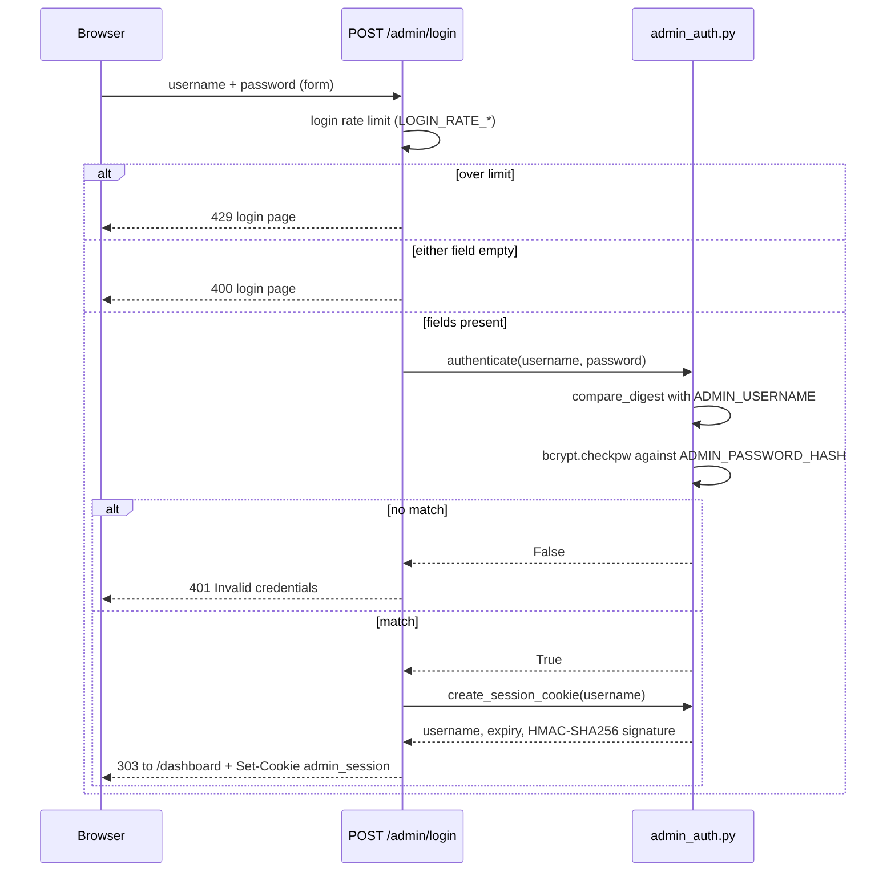

The cookie value is `{username}:{expiry_unix}:{hex_hmac}` signed with
`ADMIN_SESSION_SECRET`; attributes are `HttpOnly`, `SameSite=Lax`,
`Secure` (production only), `Max-Age` 24h, `Path=/`. On every later
request `_admin_auth_middleware` re-verifies the HMAC and expiry via
`get_admin_user`, mints the CSRF token for page rendering, and enforces
CSRF on writes.

**CSRF posture (admin):** Every POST/PUT/PATCH/DELETE on an
admin-gated route requires a matching token — `/admin/*` forms **and**
the REST surface (`/trips`, `/drivers`, `/subcontractors`, `PATCH
/reservations/{id}`, `PATCH /inquiries/{id}`). The predicate is
`_csrf_required(method, path)` in `app.py`: it reuses
`_route_requires_admin`, so anything admin-gated is CSRF-gated and the
public form POSTs (`/reservations`, `/inquiries`, `/quote`) stay
token-free. (Before v1.1.13 the check was `/admin/*`-only.) `/admin/login`
and `/admin/logout` are exempt. Token is HMAC-SHA256(`ADMIN_SESSION_SECRET`,
session cookie value), so a new login invalidates old tokens.

This sequence shows both ways a token can arrive on an admin write, and
why a request with no session gets 401 before any CSRF message:

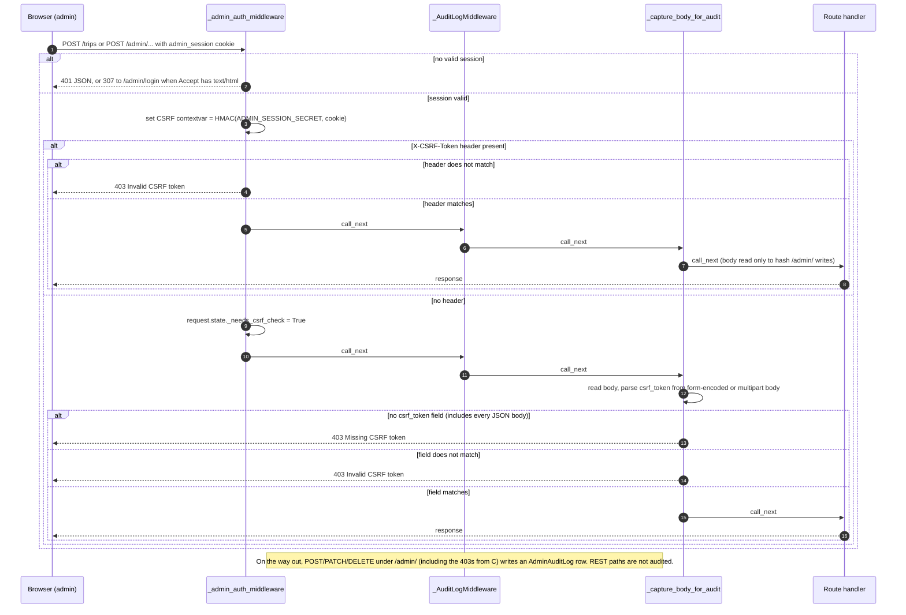

Client-side: `admin_pages._doc_open()` renders `<meta name="csrf-token">`
and `_doc_close()` emits a nonce'd inline script that appends a hidden
`csrf_token` input to every `form[method="post"]`. `/map` renders the
same meta tag and its two REST writes (`POST /trips`, `POST
/trips/{id}/broadcast`) send it as `X-CSRF-Token`. The pytest admin
fixture sets the header on every request. Contract pinned by
`tests/test_csrf_rest_surface.py`.

**Authentication gate** is in
[`app.py:_admin_auth_middleware`](app.py). Path-based — anything
matching `_route_requires_admin(method, path)` triggers the gate:

| Path | Admin-gated? |
|---|---|
| `/health`, `/`, `/admin/login`, `/admin/logout`, `/docs`, `/openapi.json`, `/redoc` | No (`_AUTH_EXEMPT`) |
| `/driver/*`, `/webhooks/*` | No (own auth) |
| `/admin/*`, `/map*`, `/dashboard` | Yes |
| `/trips*`, `/subcontractors*`, `/drivers*` | Yes |
| `/reservations`, `/inquiries`, `/quote` (exact) | Only for `GET` — `POST` is the public form |
| `/reservations/*`, `/inquiries/*` | Yes, every method (closed an unauthenticated IDOR; `tests/test_idor.py`) |
| anything else (`/driver`, `/osrm/*`, ...) | No |

`/docs`, `/redoc` and `/openapi.json` are auth-exempt, which is why
they are **disabled in production** (E2, v1.1.17): the `FastAPI(...)`
constructor passes `docs_url` / `redoc_url` / `openapi_url` = `None` when
`DISPATCH_ENV=production`, so the paths 404 instead of publishing the
route map. Dev and tests keep them. Pinned by
`tests/test_prod_hardening.py::test_docs_disabled_in_production`.

### 7.2 Driver auth (per-driver bearer token)

**Module:** [`app.py:get_authenticated_driver`](app.py) (a FastAPI
dependency on every `/driver/*` route that needs identity) plus
`verify_csrf_token` on every state-changing driver route.

`POST /driver/login` takes the token from a form, applies the login
rate limit (429), rejects an empty value (400) or an unknown token (401,
uniform "Token not recognized"), and on success sets
`driver_token=<token>` (`HttpOnly`, `SameSite=Lax`, `Secure` in
production, 30 days, `Path=/driver`) with a `303 → /driver`. There is no
token expiry; rotation from the admin surface is the revocation path.

This flowchart shows how every later driver request is authenticated
and, for writes, CSRF-checked:

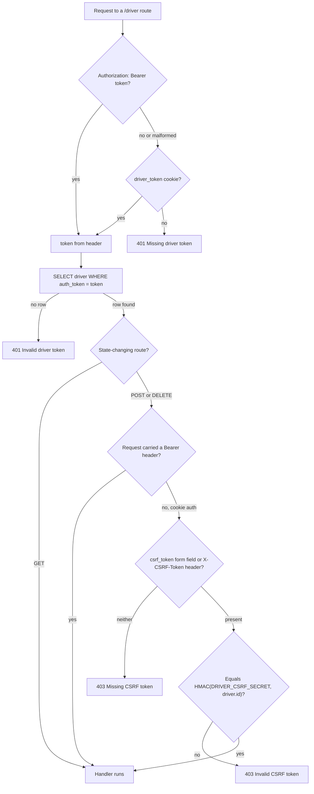

**CSRF posture (driver):** Cookie-auth POSTs/DELETEs to `/driver/*`
require the `X-CSRF-Token` header (JSON endpoints: `/driver/location`,
`/driver/push/subscribe`) OR the `csrf_token` form field (HTML form
posts: accept, decline, status). Bearer-auth requests skip CSRF —
`Authorization` headers can't be set cross-origin so the attack surface
is closed by browser policy. Pages render the token into
`<meta name="csrf-token">` and hidden form inputs.

Token is HMAC-SHA256(`DRIVER_CSRF_SECRET`, driver_id). **Bound to
driver id, not session** — driver A's CSRF token cannot authorize a
POST as driver B even if A's bearer is somehow stolen. Without
`DRIVER_CSRF_SECRET` the secret is random per process (dev only; the
production boot guard requires it).

**Trip visibility:** `driver_pages.driver_can_see_trip` lets a driver
open `/driver/trips/{id}` only if they're the assigned driver or a
`TripBroadcast` row exists for them on that trip (any response state);
otherwise 403.

### 7.3 Documented gaps

Pinned by `test_documented_gap_*` tests in
[`tests/test_security.py`](tests/test_security.py). As of v1.1.16:

- **None remaining**. The original gaps were:
  - No auth at all (closed v1.0.0 admin + v0.9.9 driver)
  - No CSRF (closed v1.0.0 + v0.9.14; widened to the whole admin REST surface v1.1.13)
  - Twilio unsigned (closed v0.9.5; hardened v1.0.0)
  - Rate limit missing (closed v0.9.18)
  - Audit log missing (closed v0.9.26)

Each was kept under the `documented_gap_` prefix even after closing
so the audit trail stays greppable. **Don't delete those tests** —
they're proof of when each gap was closed.

### 7.4 Public surfaces

`POST /reservations`, `POST /inquiries`, `POST /quote`,
`GET /osrm/route/v1/driving/{coords}` and `/webhooks/twilio/*` are
intentionally unauthenticated. Defenses:

| Defense | Surface | Where |
|---|---|---|
| Per-IP rate limit (shared bucket, 5 / 60s default) | `/reservations`, `/inquiries`, `/quote` | `app.py:_public_form_rate_limited` |
| Per-IP rate limit (own bucket, 60 / 60s default) + corridor bbox + param allow-list | `GET /osrm/*` | `app.py:_osrm_proxy_rate_limited`, `osrm_proxy.py` — stops the proxy being a free general-purpose routing relay |
| Honeypot field | `/reservations`, `/inquiries` | `bot_field` non-empty → status `SPAM`, still 201, no dispatcher SMS |
| E.164 phone normalization | `/reservations`, `/inquiries` (and every admin phone field) | `schemas.py:_normalize_phone` |
| Twilio signature | `/webhooks/twilio/*` | `app.py:_verify_twilio_signature` |
| Pydantic schema (types + `max_length` caps) | All public POSTs | `schemas.py` |

Rate limiters are in-process sliding windows keyed on `_client_ip()`:
the header named by `CLIENT_IP_HEADER` (Fly: `Fly-Client-IP`), falling back
to `request.client.host` (v1.1.17, E5). They reset on restart.

---

## 8. Broadcast lifecycle

The central operational flow. Lives in
[`core.py:broadcast_trip`](core.py) (own fleet) and
[`core.py:broadcast_to_subcontractors`](core.py) (overflow).
Own-fleet broadcast is always the dispatcher's first move; overflow is
the explicit fallback.

This sequence shows an own-fleet broadcast and two drivers racing to
accept it (the dispatcher could equally start it from `/map` via
`POST /trips/{id}/broadcast`):

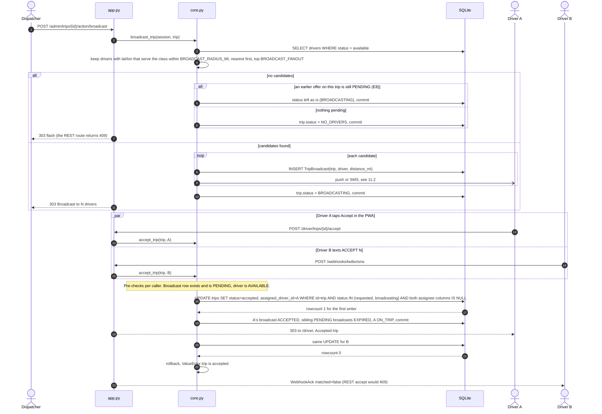

**Why the atomic compare-and-set is load-bearing:** two drivers
hitting `Accept` within milliseconds is the canonical race. A Python
check-then-write (`if trip.status == BROADCASTING: trip.status = ACCEPTED`)
loses to that race; both check, both write, both think they have the
trip. The atomic UPDATE makes the DB serialize. Whoever's row got
updated wins; the other sees rowcount=0, `_raise_if_unacceptable`
rolls back and raises `ValueError("Trip N is in status accepted;
cannot accept")`. **Don't replace this with Python logic.** See
[`core.py:accept_trip`](core.py). When the loser arrives after the
winner committed, it usually fails the earlier pre-check instead
(its broadcast row is already `EXPIRED`) — same outcome.

How each entry point surfaces a lost race or bad pre-check:
`POST /trips/{id}/accept` → 409; `POST /driver/trips/{id}/accept` →
`303 → /driver` with "Could not accept: ..."; SMS → 200 `WebhookAck`
with `matched=false`.

**Expiry is at accept time.** `_expire_sibling_broadcasts` marks every
still-`PENDING` sibling `EXPIRED` in the winner's transaction. There is
no timeout job; offers don't auto-expire. (`ACCEPT_WINDOW_SECONDS` sat in
`.env.example` until v1.1.18, but no code ever read it.) A driver decline
(`decline_trip`) just marks that one row `DECLINED`; the trip stays
`BROADCASTING` for the others.

**An empty broadcast doesn't strand open offers (E8, v1.1.18).** When
either broadcast function finds no candidate, it sets `NO_DRIVERS` only if
`core.has_pending_offers(trip)` is false, meaning no `TripBroadcast` on
the trip is still `PENDING`. Otherwise it leaves the status alone
(`BROADCASTING`). This matters because the atomic accept only claims a
`REQUESTED` / `BROADCASTING` trip. Before v1.1.18, an overflow that found
no sub flipped a trip with open own-fleet offers to `NO_DRIVERS`, and every
pending driver's ACCEPT then failed. A re-broadcast to the own fleet that
found no eligible driver did the same. Either way the REST route still answers
409, now worded "trip status is X", plus "(earlier offers are still open)"
when any offer on the trip is still pending. The admin flashes match since
v1.1.19: the overflow flash adds "Earlier offers are still open.", and the
own-fleet flash reads "No more available drivers in radius; earlier offers
are still open." instead of claiming `no_drivers`. `cli.py` prints the real
status.

**Subcontractor overflow** mirrors the same pattern via
`broadcast_to_subcontractors` and `accept_trip_subcontractor`. This
sequence shows the overflow hand-off and where the cost-plus markup is
computed:

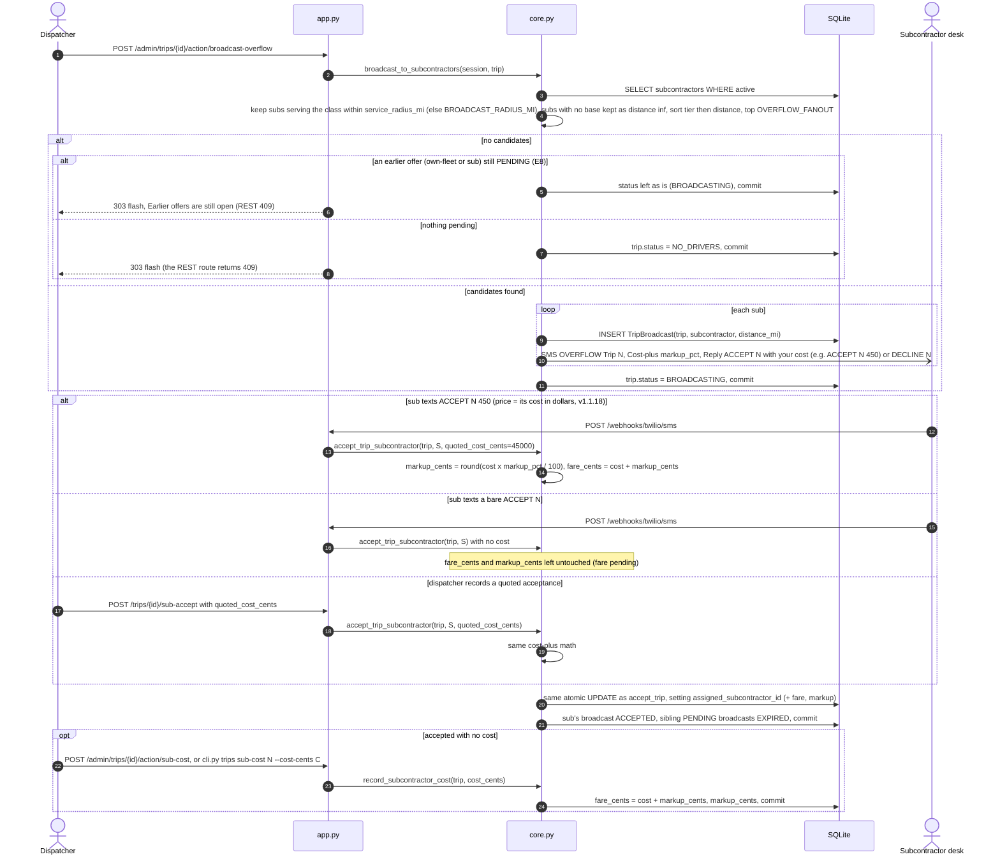

The mutual-exclusion clause (`assigned_driver_id IS NULL AND
assigned_subcontractor_id IS NULL`) in both UPDATEs is what prevents
own-fleet and overflow from both claiming the same trip; the
`ck_trip_one_assignee` CHECK constraint backs it at the schema level.
`accept_trip_subcontractor` also refuses an inactive sub. The quoted
path is also reachable from `cli.py trips sub-accept --quoted-cost-cents`.

**Where a sub's cost comes from (E9, v1.1.18).** At accept time: the SMS
price (`ACCEPT 12 450`, [§10.3](#103-inbound-sms-driversub-acceptdecline)),
or the REST / CLI `sub-accept` with `quoted_cost_cents`. Afterwards: a
bare SMS `ACCEPT 12` still accepts with the fare pending, and the
dispatcher records the cost later with `core.record_subcontractor_cost`
([§12.6](#126-subcontractor-cost-plus-fare)). A second `sub-accept` can't
do that, because the sub's broadcast is no longer `PENDING` ("Broadcast
already accepted").

---

## 9. Public-form intake

### 9.1 `POST /reservations`

[`app.py:create_reservation`](app.py).

1. Pydantic `ReservationCreate` validation (runs before the handler,
   so a malformed body is a 422 that never touches the rate bucket):
   `max_length` caps on every field, phone normalized to E.164 via
   `_normalize_phone`.
2. Rate limit check (shared public-form bucket) → 429.
3. Honeypot check: `bot_field` non-empty → `status=SPAM` (still 201).
4. `vehicle_pref` → `vehicle_class` (`escalade-esv` → SUV,
   `sprinter-limited` → SPRINTER, anything else → null).
5. INSERT `Reservation` (`PENDING_REVIEW` unless spam).
6. If not spam: `_notify_dispatcher` SMS "NEW RESERVATION #N ..." —
   only when `DISPATCHER_PHONE` is set; provider errors are swallowed.
7. Return 201 + `ReservationOut` JSON.

The marketing site's `js/reserve.js`
intercepts form submit when `data-dispatch-url` is set; falls back to
Netlify Forms on any error.

### 9.2 `POST /inquiries`

[`app.py:create_inquiry`](app.py). Same shape as `/reservations` (rate
limit → honeypot → INSERT → dispatcher SMS "NEW INQUIRY #N (kind)" →
201) but for the three Inquiry kinds (wedding, vendor, early-access).
One `Inquiry` table with `kind` discriminator; the request's `details`
dict is JSON-encoded into `details_json` and parsed back into `details`
on every response. `phone` is optional.

### 9.3 `POST /quote`

[`app.py:create_quote`](app.py). Public, unauthenticated, non-binding
fare estimate; no DB writes.

This flowchart shows every exit, including the three soft-fails that
still return 200:

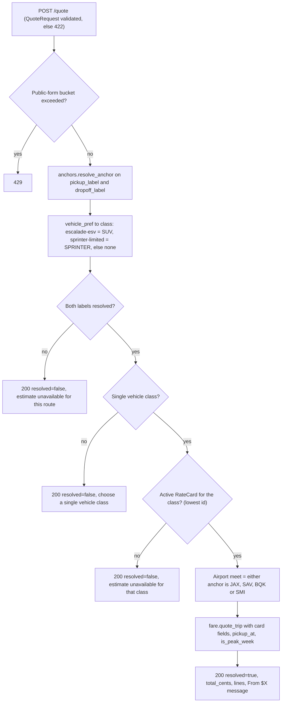

Apart from 422 (validation) and 429 (rate limit) it always returns
200 — soft-fails carry a human message in the same JSON shape. The
reserve form renders the message either way; the dispatcher's
confirmation call is the binding step. The resolved message reads
"From $X — estimate, dispatcher confirms by phone." with X rounded to
the dollar.

### 9.4 Reservation promotion

`GET /admin/reservations/{id}/promote` → form pre-filled from the
reservation (name, phone, labels, notes, vehicle, time).
`POST /admin/reservations/{id}/promote` takes **every** trip field from
that form — `passenger_name`, `passenger_phone`, both labels, both
lat/lon pairs (text-only reservations can't carry coords, so the
dispatcher supplies them), `pickup_time`, `vehicle_class`, `notes`. A
missing required field is a FastAPI 422.

This flowchart shows the promote guard and write path:

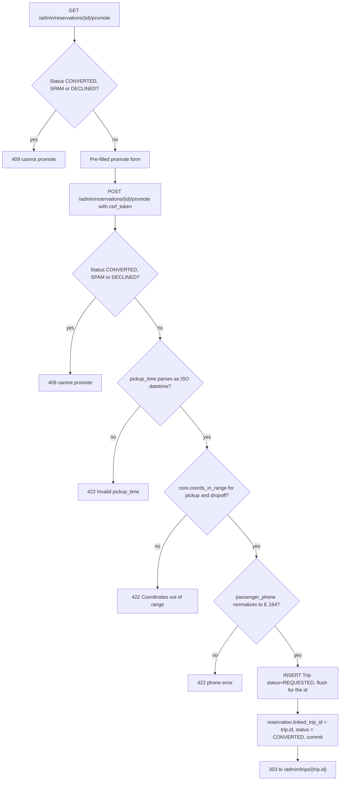

One reservation → at most one trip: after the first promote the
reservation is `CONVERTED` and both the GET and the POST return 409.

---

## 10. Twilio integration

[`app.py`](app.py): voice in `twilio_voice_webhook`, `twilio_whisper`,
`twilio_dial_status`, `twilio_voicemail_webhook`,
`twilio_voicemail_done`; SMS in `twilio_sms_webhook`. Caller
identification, quiet hours and transcript parsing live in
[`core.py`](core.py) (`identify_caller`, `is_quiet_hours`,
`parse_voicemail_transcript`).

### 10.1 Inbound call routing (live-person-answers)

Premium black-car standard: **a human voice on first ring**, not an
AI front-line. This flowchart shows how `POST /webhooks/twilio/voice`
decides what TwiML to return:

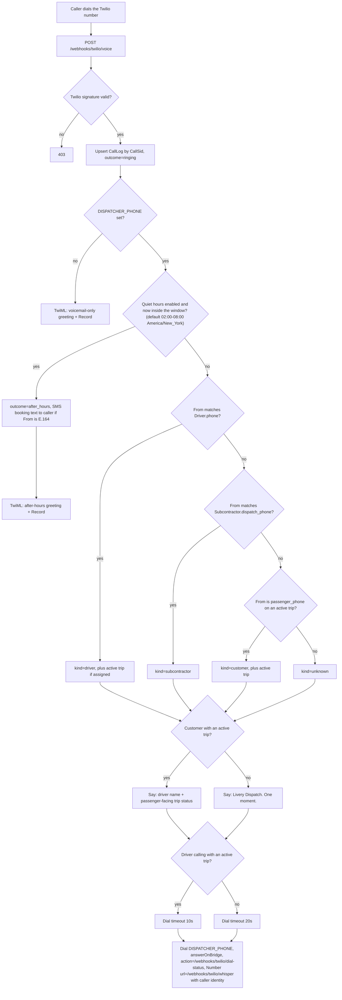

`identify_caller` returns `unknown` for any `From` that doesn't start
with `+`. "Active trip" means `ACCEPTED`, `EN_ROUTE_PICKUP`, `ON_SCENE`
or `IN_TRANSIT`. Quiet hours are skipped only when `QUIET_HOURS_ENABLED`
is `false` (case-insensitive); a window that wraps midnight works, and
`QUIET_HOURS_START == QUIET_HOURS_END` means no quiet window. **Don't
widen quiet hours past 02:00–08:00 without reconfirming** — 18:00–02:00
is peak business.

What happens after the `<Dial>` (and after either `<Record>` branch
above) is driven by Twilio callbacks. This sequence shows the answered
path and the voicemail path:

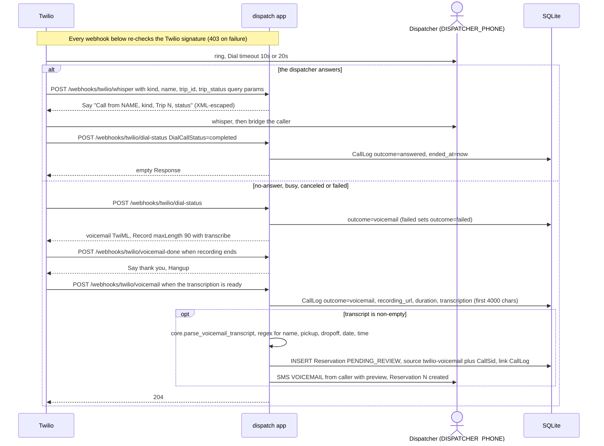

`parse_voicemail_transcript` is a regex heuristic (no LLM, no anchor
lookup): "my name is / this is / I'm" for the name, "pick up at / from"
and "going to / drop off / heading to" for the labels, "today /
tomorrow / tonight" for the date, "at / around / for 7pm" for the time.
Input is capped at 5000 chars and every field is control-character
stripped and length-capped below its column. Unparsed fields fall back
to placeholders ("Voicemail from +1...", "(see transcription — phone
callback required)"); a non-E.164 caller gets phone `+10000000000`.
If the transcription callback arrives for an unknown `CallSid`, a
`CallLog` row is created on the spot.

### 10.2 Outbound SMS

Always via `notifications.get_provider().send_sms(to, body)`. With
`NOTIFICATION_PROVIDER=twilio` that's the Twilio REST client; the
console provider just prints (dev/test only — refused in production by
the boot guard). Callers: broadcast loops (drivers + subs), dispatcher
alerts (`_notify_dispatcher`, needs `DISPATCHER_PHONE`), and the
after-hours text to callers.

### 10.3 Inbound SMS (driver/sub ACCEPT/DECLINE)

Drivers and subcontractor desks reply `ACCEPT 17` / `DECLINE 17` to
the broadcast SMS. Since v1.1.18 (E9) a sub can add its quoted cost in
dollars: `ACCEPT 17 450`, `accept 17 $450.50` or `ACCEPT 17 at 450`. This
flowchart shows how `POST /webhooks/twilio/sms` routes the reply:

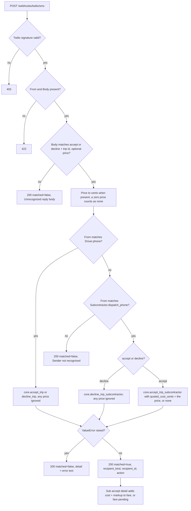

The body regex (`_REPLY_RE` in `app.py`) is

```
^\s*(accept|decline)\W*(\d+)(?:\s+(?:at\s+)?\$?(\d{1,5}(?:\.\d{1,2})?))?\s*$
```

case-insensitive, so `Accept-1` and ` accept1 ` still match. The price is
optional: whitespace, an optional `at`, an optional `$`, then up to five
digits and two decimals. There are no thousands separators, so
`ACCEPT 17 $1,200` doesn't match at all and comes back "Unrecognized reply
body".

**What the price means:**

- **Subcontractor `ACCEPT`:** the price is the sub's quoted cost. It goes to
  `accept_trip_subcontractor(..., quoted_cost_cents=...)`, which writes
  `markup_cents = round(cost × markup_pct / 100)` and
  `fare_cents = cost + markup_cents` inside the atomic accept. The ack
  `detail` ends `; cost $X + markup → fare $Y`.
- **Bare subcontractor `ACCEPT`:** still accepts, with no fare written.
  The `detail` ends "; no price in reply — fare pending, record the sub's
  cost on the trip page" ([§12.6](#126-subcontractor-cost-plus-fare)). A
  follow-up text with the price is refused, because the sub's broadcast
  is no longer `PENDING`.
- **Driver reply or any `DECLINE`:** the price is ignored. Drivers don't
  quote.
- **A price of zero** counts as no price.

The ack is JSON for logs and tests, not TwiML, so nothing is texted back
to the sender. **Soft-fail semantics:** logical errors (trip already
accepted, broadcast not pending, etc.) return 200 with `matched: false` so
Twilio doesn't retry; only a bad signature (403) or a missing
`From`/`Body` (422) is an HTTP error.

---

## 11. Web push notifications

v1.1.0 (flag-gated). [§ DEPLOY.md "Step-by-step push rollout"](DEPLOY.md)
has the 90-minute operational runbook.

### 11.1 Architecture

This sequence shows how a chauffeur's device opts in, and since v1.1.18
(E10) opts back out, from the driver dashboard (script in
[`driver_pages.py`](driver_pages.py)):

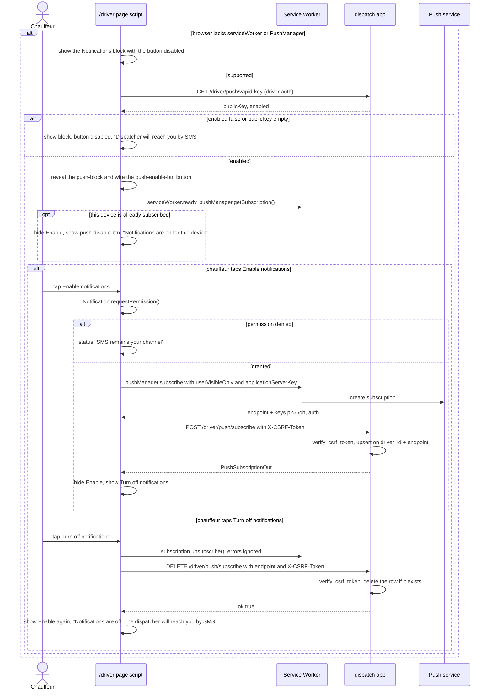

`DELETE /driver/push/subscribe` removes the row for a given endpoint and
answers `{"ok": true}` whether or not a row existed. Before v1.1.18 no
page script called it, so a chauffeur couldn't turn push off. The
dashboard now renders a hidden **Turn off notifications** button
(`#push-disable-btn`) that the script shows when the device already has a
subscription. Stale rows are still also cleaned up by the 410/404
handling in [§11.2](#112-broadcast-integration) and by token rotation.

The turn-off script doesn't check the DELETE's status code. A network
failure shows "Could not turn off notifications. Try again.", but an HTTP
error such as a CSRF 403 is shown as success. By then the browser
subscription is already gone, so the leftover row only fails at the next
push, which deletes it (404/410) and falls back to SMS.

### 11.2 Broadcast integration

Inside `core.broadcast_trip`, each candidate driver is paged by push,
SMS, or both-fallback. This flowchart shows the per-driver decision:

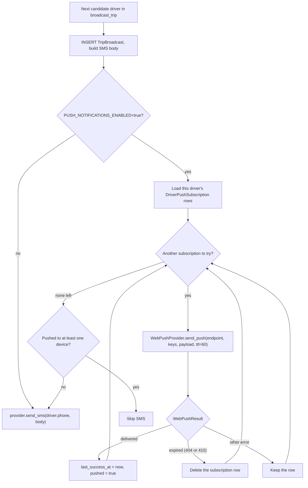

| Condition | Channel |
|---|---|
| `PUSH_NOTIFICATIONS_ENABLED=false` | SMS only (current behavior preserved) |
| Flag on + push delivered to at least one of the driver's devices | Push only — SMS skipped |
| Flag on + every subscription expired (410/404) | Rows deleted inline; SMS fallback |
| Flag on + push transient error on every device | SMS fallback |
| Flag on + driver has no subscription | SMS (unchanged behavior) |

The push payload is `{trip_id, vehicle_class, pickup_label,
dropoff_label, pickup_time, distance_mi, title, body}`. Overflow
broadcasts to subcontractors are always SMS.

**Cascade-delete on token rotation:**
`POST /admin/drivers/{id}/action/rotate-token` issues
`DELETE FROM driver_push_subscriptions WHERE driver_id = ?` in the same
transaction as the new token. Rotating the bearer revokes device trust;
the same logic applies to each device's push subscription.

### 11.3 Service Worker push handler

[`app.py:_DRIVER_SW_JS`](app.py) (abridged):

```javascript
self.addEventListener('push', (event) => {
  let payload = {};
  try { payload = event.data ? event.data.json() : {}; }
  catch (err) { payload = { title: 'Livery Dispatch', body: 'New broadcast.' }; }
  const title = payload.title || 'Livery Dispatch — New Trip';
  event.waitUntil(
    self.registration.showNotification(title, {
      body: payload.body || 'Tap to review.',
      icon: '/driver/icon.svg',
      badge: '/driver/icon.svg',
      tag: 'broadcast-' + (payload.trip_id || 'unknown'),
      renotify: true,
      requireInteraction: true,
      data: { trip_id: payload.trip_id },
    })
  );
});

self.addEventListener('notificationclick', (event) => {
  event.notification.close();
  const tripId = event.notification.data && event.notification.data.trip_id;
  const url = tripId ? ('/driver/trips/' + tripId) : '/driver';
  // Focus an open /driver tab and navigate it; else open a new window.
  ...
});
```

### 11.4 VAPID

Self-hosted. `pywebpush` signs each push with the VAPID private key.
The push service (FCM / Mozilla autopush / Apple push) validates the
signature against the public key the browser registered at subscribe
time. Rotating the keypair invalidates every existing subscription.

`VAPID_CONTACT_EMAIL` is required per RFC 8292 — sent as the `sub`
claim in every push so the push service knows who to contact in case
of abuse. A bare address is auto-prefixed with `mailto:`.
`send_push` returns `delivered=False` (never raises) when the flag is
off, VAPID credentials are missing, or `pywebpush` isn't installed.

---

## 12. Fare calculation

[`fare.py`](fare.py) is pure with respect to the database — no DB
reads or writes, no side effects. Its only I/O is the optional OSRM
HTTP call for road distance.

### 12.1 The quote function

```python
def quote_trip(
    *,
    pickup_lat: float, pickup_lon: float,
    dropoff_lat: float, dropoff_lon: float,
    pickup_time: datetime | None = None,
    base_fare_cents: int = 0,
    per_mile_cents: int = 0,
    per_hour_cents: int = 0,
    minimum_fare_cents: int = 0,
    airport_meet_surcharge_cents: int = 0,
    after_hours_surcharge_cents: int = 0,
    peak_week_multiplier: float = 1.0,
    is_airport_meet: bool = False,
    is_peak_week: bool = False,
    rate_card_id: int | None = None,
    rate_card_name: str | None = None,
) -> FareBreakdown: ...

def quote_for_trip_and_card(trip, rate_card, *, is_peak_week: bool = False) -> FareBreakdown: ...
```

`quote_trip` is keyword-only and takes raw rate inputs (no ORM
coupling). `quote_for_trip_and_card` is the admin wrapper: it reads
the fields off a `Trip` and a `RateCard` and decides `is_airport_meet`
by keyword heuristic on the pickup label + notes ("airport",
"terminal", "meet and greet", "jax", "sav", "bqk", ...). The public
`/quote` instead sets `is_airport_meet` when either resolved anchor is
an airport (`anchors.is_airport`).

Returns `FareBreakdown(total_cents, lines, distance_miles,
duration_hours, rate_card_id, rate_card_name)`; `lines` is the
itemized `(label, cents)` list the admin UI renders — "Base fare",
"Distance (N mi)", "Time (N hr)", "Peak week (×M)",
"Airport meet-and-greet", "After-hours surcharge",
"Minimum fare bump". `as_text()` produces the one-line flash summary.

### 12.2 Distance providers

This flowchart shows how `quote_trip` gets its distance and then
composes the total:

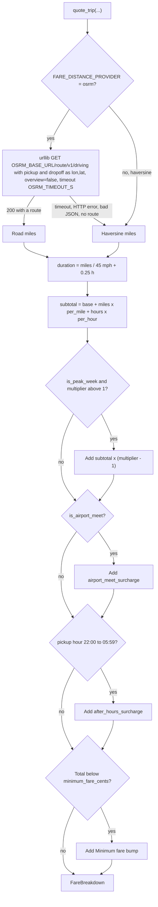

| Provider | When | Where |
|---|---|---|
| **OSRM** | Default (`FARE_DISTANCE_PROVIDER` unset or `osrm`) | `fare.osrm_distance_miles`: HTTP GET to `OSRM_BASE_URL/route/v1/driving/{lon,lat};{lon,lat}?overview=false`, timeout `OSRM_TIMEOUT_S`. Returns `None` on any failure → haversine |
| **Haversine** | Tests, OSRM outages | `FARE_DISTANCE_PROVIDER=haversine`. Pure math (`core.haversine_miles`), no network |

`OSRM_BASE_URL` and `OSRM_TIMEOUT_S` are read once at import
(`fare._OSRM_BASE`, `fare._OSRM_TIMEOUT_S`); changing them needs a
restart. The `/osrm` proxy reads the same two module attributes, so
one variable drives both consumers.

### 12.3 Anchor resolver

[`anchors.py`](anchors.py). Maps corridor text labels to coordinates.

```python
ANCHORS: dict[str, tuple[float, float]] = {
    "JAX": (30.4941, -81.6878),   # Jacksonville International
    "SAV": (32.1276, -81.2025),   # Savannah / Hilton Head International
    "BQK": (31.2589, -81.4664),   # Brunswick Golden Isles
    "SI":  (31.1807, -81.3506),   # Sea Island: The Cloister (OSM, 2026-11-17)
    "JKL": (31.0577, -81.4068),   # Jekyll Island Club + Westin Jekyll
    ...                           # 17 anchors: airports, resorts, town centers
}
_ALIASES: dict[str, str] = {      # normalized alias → canonical key
    "jacksonville airport": "JAX",
    "the lodge at sea island": "SI",
    ...
}
AIRPORT_ANCHORS = frozenset({"JAX", "SAV", "BQK", "SMI"})
```

`resolve_anchor(text)` normalizes (lowercase, separators → spaces,
whitespace collapsed), tries an exact alias hit, then scans aliases
longest-first with **word-boundary** regexes (so `smi` can't match
inside "transmission"), and returns `(canonical, lat, lon)` or `None`.
Unknown labels return `None`; `/quote` soft-fails to the user.

### 12.4 Public `/quote` flow

Already covered in [§9.3 POST /quote](#93-post-quote).

### 12.5 Same-origin OSRM proxy

[`osrm_proxy.py`](osrm_proxy.py) + `app.py:osrm_route_proxy` (v1.1.15).
The browser maps (`/map`, and the site maps when `data-osrm-url` is
set) fetch route geometry from `GET /osrm/route/v1/driving/{coords}`
instead of a hardcoded OSRM host, so CSP `connect-src` no longer lists
`router.project-osrm.org` and one `OSRM_BASE_URL` serves maps and fares.
This flowchart shows validation, caching and failure mapping:

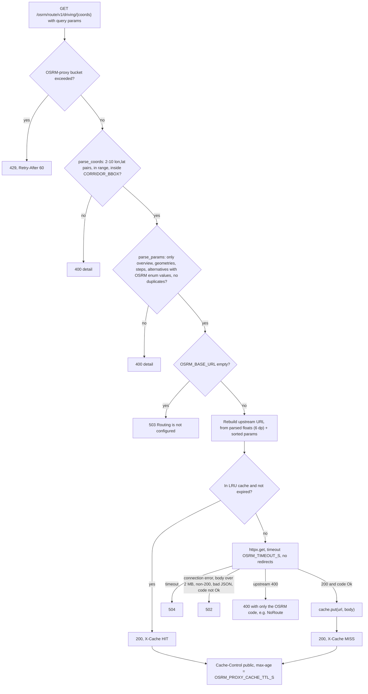

- `CORRIDOR_BBOX = (-82.8, 29.8, -80.6, 32.9)` (min lon, min lat, max
  lon, max lat) — SAV + Statesboro in the north through JAX and St.
  Augustine in the south. Keep it in sync with the `BBOX` build arg in
  [`osrm/Dockerfile`](osrm/Dockerfile).
- The cache key is the rebuilt upstream URL, so equivalent requests
  (param order, coordinate precision) share an entry. TTL and size come
  from `OSRM_PROXY_CACHE_TTL_S` / `OSRM_PROXY_CACHE_MAX`; either `0`
  disables caching. Thread-safe (sync endpoints run in the threadpool).
- Error responses built from `ProxyError` carry `Cache-Control: no-store`
  and `X-Cache: BYPASS`; the passed-through OSRM 400 carries `no-store` +
  `MISS`. Every client treats a non-2xx as "keep the straight-line
  skeleton", so an outage degrades exactly as before.
- GET-only and not admin-gated, so the admin CSRF contract doesn't
  apply. Hidden from OpenAPI.
- Production boot logs a warning (non-fatal) while `OSRM_BASE_URL`
  still points at the public demo — `app.py:_warn_on_public_osrm_in_production`
  via `osrm_proxy.using_public_demo()`. The self-hosted image and its
  Fly.io deploy are in [`osrm/README.md`](osrm/README.md).

### 12.6 Subcontractor cost-plus fare

An overflow trip isn't priced from a rate card. Its fare is the sub's
quoted cost plus our markup, computed with the assigned sub's
`markup_pct`:

```
markup_cents = round(quoted_cost_cents * markup_pct / 100)
fare_cents   = quoted_cost_cents + markup_cents
```

Two functions in [`core.py`](core.py) apply it:

| Function | When | Paths |
|---|---|---|
| `accept_trip_subcontractor(..., quoted_cost_cents=)` | At accept, inside the atomic UPDATE | SMS `ACCEPT N <cost>` (v1.1.18), `POST /trips/{id}/sub-accept` with `{"quoted_cost_cents": …}`, `cli.py trips sub-accept N --sub S --quoted-cost-cents C` |
| `record_subcontractor_cost(session, trip_id, quoted_cost_cents)` | Any time after the accept (E9, v1.1.18) | `POST /admin/trips/{id}/action/sub-cost` (form field `quoted_cost_dollars`), `cli.py trips sub-cost N --cost-cents C` |

`record_subcontractor_cost` exists for the bare SMS `ACCEPT N`, which
leaves the trip `ACCEPTED` with `fare_cents` empty. It raises `ValueError`
(admin `Failed:` flash, CLI exit 1) when the trip doesn't exist, has no
assigned sub, is `CANCELLED`, or the cost is ≤ 0. It doesn't check any
other status, so a completed trip can still be costed. Re-recording is
allowed so a typo can be fixed; each call overwrites both columns. The
sub's payout is `fare_cents - markup_cents`, which is what the
per-sub settlement page and CSV report. Settlement dates a completed trip
by `Trip.completed_at` (v1.1.20), so recording or re-recording a cost on an
already-completed trip leaves it in the settlement period it finished in.
Before v1.1.20, settlement used `updated_at`, and a late cost moved the
trip into the current window.

---

## 13. Middleware stack

Starlette's `add_middleware` (which `@app.middleware("http")` also
calls) **prepends** to the middleware list, so the **last registered is
the outermost**. Registration order in `app.py` is CORS →
`_capture_body_for_audit` → `_AuditLogMiddleware` →
`_admin_auth_middleware` → `_RequestSizeLimitMiddleware` (v1.4.1) →
`_security_headers`. That last one is registered
**explicitly at the end of the middleware section**
(`app.middleware("http")(_security_headers)`) since v1.1.17 (E1). The
resulting request path, outermost first, including where each layer can
short-circuit:

```mermaid
flowchart TD
    CL["Client request"] --> SE["ServerErrorMiddleware (Starlette, outermost)"]
    SE --> SH["_security_headers (registered last since v1.1.17): CSP nonce in, headers out on EVERY response"]
    SH --> RS["_RequestSizeLimitMiddleware (v1.4.1)"]
    RS -->|"body over MAX_REQUEST_BYTES"| R413["413 Request body too large"]
    RS --> AA["_admin_auth_middleware"]
    AA -->|"admin-gated, no valid session"| R401["401 JSON or 307 to /admin/login"]
    AA -->|"X-CSRF-Token present but wrong"| R403A["403 Invalid CSRF token"]
    AA --> AU["_AuditLogMiddleware (writes its row after the response)"]
    AU --> CB["_capture_body_for_audit"]
    CB -->|"flagged write, form token missing or wrong"| R403B["403 Missing or Invalid CSRF token"]
    CB --> CO["CORSMiddleware (registered first)"]
    CO --> EX["ExceptionMiddleware (Starlette)"]
    EX --> RT["Router and route handler"]
    R401 -.->|"passes back out through"| SH
    R403A -.->|"passes back out through"| SH
    R403B -.->|"passes back out through"| SH
    R413 -.->|"passes back out through"| SH
```

Consequences worth knowing:

- **413 before everything that reads a body (v1.4.1).** The size cap sits
  outside auth, the CSRF body check and the routes, so an oversized body is
  refused before any of them reads or parses it, on every surface (public
  forms, admin forms, Twilio webhooks, the driver API). It is inside
  `_security_headers`, so the 413 carries the usual headers.
- **401-before-403.** Auth sits outside the CSRF body check, so a request
  with no session gets 401/307 and never reaches a CSRF check.
- **Every response carries the security headers (E1, v1.1.17).**
  `_security_headers` is outermost, so the 401/307/403 short-circuits from
  `_admin_auth_middleware` and `_capture_body_for_audit` get CSP,
  `X-Frame-Options`, `nosniff`, `Referrer-Policy`, COOP and (in
  production) HSTS too. Before v1.1.17 it was innermost and those responses
  shipped bare. `tests/test_prod_hardening.py` pins both the order and the
  headers on each short-circuit. The CSP nonce still reaches rendered pages:
  it's set in a contextvar before `call_next`, and the inner layers inherit
  it.
- **CORS headers still skip the short-circuits.** CORS is innermost, so a
  401 to an admin-gated path has no `Access-Control-*` headers. That's
  harmless, because the admin surface is same-origin and the public
  cross-origin POSTs (`/reservations`, `/inquiries`, `/quote`, `/osrm`) are
  never short-circuited by auth.
- **Audit coverage.** `_AuditLogMiddleware` sits inside auth, so
  auth-rejected writes are never logged. CSRF 403s produced by
  `_capture_body_for_audit` (inside it) are logged.
- **Rate limiting is not middleware.** The four buckets are checked
  inside the route handlers (`_public_form_rate_limited`,
  `_login_rate_limited`, `_osrm_proxy_rate_limited`), keyed by
  `_client_ip()`, which honours `CLIENT_IP_HEADER` behind a proxy (E5,
  v1.1.17).

### 13.1 `_security_headers`

[`app.py:_security_headers`](app.py). Generates the per-request CSP
nonce BEFORE calling the handler (so templates can read it from the
contextvar in [`csp.py`](csp.py)), then applies security headers on the
response with `setdefault` (a handler can override).

Headers set:

| Header | Value | Why |
|---|---|---|
| `Content-Security-Policy` | `default-src 'self'`; `script-src`/`style-src` `'self' 'nonce-…' https://unpkg.com`; `img-src` adds `data: blob:` + `tile.openstreetmap.org` + unpkg + the `MAP_SERVER_URL` origin when set (v1.3.0); `connect-src 'self'` + Nominatim; `frame-ancestors 'none'`; `base-uri`/`form-action` `'self'`; `object-src 'none'`; `manifest-src`/`worker-src` `'self'` | v1.0.13 hardening; no `'unsafe-inline'`. No OSRM host in `connect-src` since v1.1.15 (maps use the same-origin proxy) |
| `X-Content-Type-Options` | `nosniff` | Prevents MIME confusion |
| `X-Frame-Options` | `DENY` | Older-browser clickjacking defense (frame-ancestors `'none'` for modern) |
| `Referrer-Policy` | `strict-origin-when-cross-origin` | Don't leak path info in referers |
| `Permissions-Policy` | `geolocation=(self)`; microphone, camera, payment, usb, accelerometer, gyroscope, magnetometer off | Driver PWA needs geolocation |
| `Cross-Origin-Opener-Policy` | `same-origin` | Spectre-class isolation |
| `Strict-Transport-Security` | `max-age=31536000; includeSubDomains; preload` (prod only) | HSTS |

CSP exemptions: `/docs`, `/redoc`, `/openapi.json` (Swagger UI loads
JS from jsdelivr.net), **outside production only**. In production those
routes don't exist (E2), the exemption set is empty, and their 404 gets the
full CSP. The other headers apply everywhere. Since v1.1.17 (E1) this
middleware is outermost, so the headers also land on the auth/CSRF
short-circuit responses (see [§13](#13-middleware-stack)).

### 13.2 `_admin_auth_middleware`

[`app.py:_admin_auth_middleware`](app.py). Path-based gate (rule table
in [§7.1](#71-admin-auth-cookie-session)). For admin-gated paths it:
verifies the session cookie (401/307 on failure); stores the CSRF token
in `admin_pages`' contextvar for form rendering; and, when
`_csrf_required(method, path)`, either checks `X-CSRF-Token` on the spot
or sets `request.state._needs_csrf_check` for `_capture_body_for_audit`.

### 13.3 `_AuditLogMiddleware`

[`app.py:_AuditLogMiddleware`](app.py) (a `BaseHTTPMiddleware`
subclass). After the response is produced, every `POST`/`PATCH`/`DELETE`
whose path starts with `/admin/` gets an `AdminAuditLog` row with the
method, path, status code, admin username (or null), and SHA-256 hash
of the body bytes cached by `_capture_body_for_audit` (raw body NOT
stored). It writes through its own `SessionLocal()`. REST mutations
outside `/admin/` are not audited.

### 13.4 CORS

[`app.py` `CORSMiddleware`](app.py). `CORS_ORIGINS` env-driven
(comma-separated); `allow_methods` `GET, POST, PATCH, OPTIONS`;
`allow_headers *`; `allow_credentials=False`. In production
(`DISPATCH_ENV=production`), a wildcard `*` raises `RuntimeError` at
import, before the boot guard runs. Dev/test default to `*`. The static
marketing site is the only cross-origin caller (public forms, `/quote`,
`/osrm`).

### 13.5 `_capture_body_for_audit`

[`app.py:_capture_body_for_audit`](app.py). Reads (and Starlette
caches) the request body for two independent reasons: every `/admin/`
write is audit-hashed (`request.state._audit_body`), and every write
flagged `_needs_csrf_check` by the auth middleware needs its body
searched for a `csrf_token` field. The field is only parsed from
`application/x-www-form-urlencoded` or `multipart/form-data` bodies, so
a JSON write without the header always 403s "Missing CSRF token".

### 13.6 `_RequestSizeLimitMiddleware` (v1.4.1)

[`app.py:_RequestSizeLimitMiddleware`](app.py), pure ASGI (not
`BaseHTTPMiddleware`) so it owns `receive`. SECURITY.md's pre-production
list wanted a reverse proxy that caps request bodies; Fly's proxy documents
no body-size limit, so the app enforces one. `MAX_REQUEST_BYTES` (default
32,768) is re-read per request.

- **`Content-Length` over the cap:** 413 at once, without reading the body.
  uvicorn frames the body by `Content-Length`, so a request at or under the
  cap passes straight through.
- **No `Content-Length` (chunked):** the middleware reads the body itself,
  up to the cap, before the app sees any of it, then replays the buffered
  messages. Crossing the cap is a 413. It reads first, rather than counting
  inside the app's own reads, because FastAPI turns any exception raised
  while it parses a body into a 400.
- **The 413:** `{"detail": "Request body too large (limit N bytes)"}`, with
  `Connection: close` (the unread rest of the body means the connection
  can't be reused). A client still uploading a very large body may see a
  connection reset instead of the 413; either way nothing past the cap is
  read or parsed.

The largest legitimate body is a few KB (a Twilio voicemail-transcription
callback; a bulk-spam form with a few hundred ids). Production refuses to
boot on a `MAX_REQUEST_BYTES` that isn't a whole number of at least 1,024
(the production boot guard in [§14](#14-security-architecture)); elsewhere
an invalid value falls back to the default. Pinned by
`tests/test_request_size.py`.

---

## 14. Security architecture

[`SECURITY.md`](SECURITY.md) is the auditor-facing summary;
this section is the implementer's view.

### 14.1 Defense in depth — layers

| # | Layer | What's in it |
|---|---|---|
| 1 | Edge | Fly.io anycast (DDoS absorption); TLS termination at the edge |
| 2 | Boot guards | CORS wildcard refused in production (import-time `RuntimeError`); `_validate_production_config` refuses to start without `ADMIN_USERNAME`, bcrypt `ADMIN_PASSWORD_HASH`, `ADMIN_SESSION_SECRET` ≥32, `DRIVER_CSRF_SECRET` ≥32, a non-`console` `NOTIFICATION_PROVIDER`, `TWILIO_AUTH_TOKEN` + `TWILIO_ACCOUNT_SID` + `TWILIO_FROM_NUMBER` (when provider is `twilio`; the last two since v1.1.17), an `https://` `PUBLIC_BASE_URL` (Twilio signatures, v1.1.17), `CLIENT_IP_HEADER` (rate-limit key behind a proxy, v1.1.17), and `VAPID_*` (when push is on). Non-fatal warning while `OSRM_BASE_URL` is the public demo |
| 3 | CORS | Explicit origin allowlist (no wildcard in prod); credentials not allowed |
| 4 | Rate limits | Public-form bucket (`/reservations` + `/inquiries` + `/quote`); login bucket (`/admin/login` + `/driver/login`); OSRM-proxy bucket (`GET /osrm/*`, v1.1.15) |
| 5 | HTTP security headers | CSP with per-request nonce (no `'unsafe-inline'`); X-Frame-Options, HSTS, COOP, Referrer-Policy, Permissions-Policy |
| 6 | Authentication | Admin: HMAC-signed session cookie + bcrypt password. Driver: per-driver bearer (rotatable). Twilio webhooks: HMAC-SHA1 signature (`twilio.request_validator`) |
| 7 | Authorization | `_route_requires_admin` path gate (incl. `/reservations/{id}` + `/inquiries/{id}` IDOR fix); `get_authenticated_driver`; `driver_can_see_trip`; assigned-driver check on status walk |
| 8 | CSRF | Admin token bound to session cookie, every admin-gated mutation (v1.1.13); driver token bound to driver id; form field or `X-CSRF-Token`; driver bearer requests exempt |
| 9 | Input validation | Pydantic schemas with length caps on every body; E.164 phone normalization; coordinate range checks; honeypot fields on public POSTs; OSRM proxy coordinate/param allow-list |
| 10 | Application logic | Atomic accept (compare-and-set, can't lose to race) + `ck_trip_one_assignee` CHECK; state machine guard (`VALID_TRANSITIONS`). `force=True` exists on `update_trip_status` but no route passes it |
| 11 | Audit log | `AdminAuditLog` row for every `POST`/`PATCH`/`DELETE` under `/admin/` (REST mutations not covered); body SHA-256 hashed, never stored |
| 12 | Static analysis | CI on push to `main` + PRs: `bandit -r . -ll -x tests` (blocking), `pip-audit` (non-blocking); GitGuardian secret scanning |
| 13 | Adversarial test coverage | 345 probes across 6 pentest suites: auth (114), Twilio (105), driver (48), quote (34), CSP (26), coordinate validation (18) |

### 14.2 Fail-closed boot guard

[`app.py:_validate_production_config`](app.py). When
`DISPATCH_ENV=production`, every required env var is checked. Missing
or malformed → `RuntimeError` at import time, container exits
non-zero, deployment fails loud. (The CORS wildcard check just above it
raises first.)

This is the difference between "ops accidentally shipped with default
secrets and didn't notice for a week" vs. "boot crashed with a clear
error message and ops fixed it in 5 minutes".

Since v1.1.17 the guard also requires:

- **`TWILIO_ACCOUNT_SID` and `TWILIO_FROM_NUMBER`** when the provider is
  `twilio` (E4). `get_provider()` falls back to the console provider when
  any of the three Twilio vars is missing. Production used to boot like
  that and print SMS bodies and passenger phones to the log while paging
  no one.
- **`PUBLIC_BASE_URL`**, an `https://` origin, when the provider is
  `twilio` (E5). `_verify_twilio_signature` rebuilds the signed URL as
  `PUBLIC_BASE_URL + path + ?query`. Behind Fly's TLS-terminating proxy,
  `str(request.url)` is `http://…`, which never matches what Twilio
  signed.
- **`CLIENT_IP_HEADER`** (E5): the header the edge proxy *sets* to the
  real client IP (`Fly-Client-IP` on Fly), or the literal `none` when
  nothing sits in front of uvicorn. `_client_ip()` keys every rate-limit
  bucket on it. Without it, every visitor shares the proxy's address and
  one bucket.

Since v1.4.1 it also refuses a `MAX_REQUEST_BYTES` that isn't a whole
number of at least 1,024 bytes ([§13.6](#136-_requestsizelimitmiddleware-v141)),
so a typo can't silently fall back to the default.

Still not gated: `DISPATCHER_PHONE`. Its absence routes calls straight to
voicemail and silences dispatcher alerts.

### 14.3 Audit trail conventions

Tests pinning closed gaps live in
[`tests/test_security.py`](tests/test_security.py) under the prefix
`test_documented_gap_*`. **Don't rename or delete** — they're the
audit trail showing when each gap was closed and what the contract
is now.

---

## 15. Database & migrations

### 15.1 Dual-path schema management

| Environment | How schema is created | Why |
|---|---|---|
| Tests (in-memory SQLite, conftest.py) | `Base.metadata.create_all(engine)` | Zero-friction, no migration overhead |
| Local dev (file SQLite) | `init_db()` calls `create_all` + defensive `ALTER TABLE drivers ADD COLUMN auth_token` for pre-v0.9.9 DBs | Zero-friction for developers updating their local dispatch.db |
| Production (Fly.io SQLite-on-volume or future Postgres) | `alembic upgrade head`, run by the container entrypoint `boot.py` on every start (v1.1.21; before that, a manual post-deploy command) | Canonical; tracked via `alembic_version` table. See [§15.6](#156-production-boot-migrations-run-in-the-container) |

`init_db()` runs from the FastAPI lifespan on **every** startup,
production included; there `create_all` is a no-op for tables Alembic
already created, so Alembic stays the source of schema changes.

Both paths produce the same schema because `models.py` is the single
source of truth — the Alembic baseline (`dc2823d2aef2`) was
autogenerated against an empty DB to match exactly what `create_all`
would produce.

### 15.2 Alembic configuration

[`alembic.ini`](alembic.ini) and [`alembic/env.py`](alembic/env.py).
Key points:

- `sqlalchemy.url = driver://DATABASE_URL_MISSING...` — intentionally
  invalid placeholder. The real URL comes from the `DATABASE_URL` env
  var (default `sqlite:///./dispatch.db`), read in `env.py`.
- `target_metadata = Base.metadata` — autogenerate diffs against
  the ORM definitions in `models.py`.
- `render_as_batch=True` when the URL is SQLite — needed for ALTER
  TABLE migrations (SQLite emulates them via table-copy).
- Migration filenames are date-prefixed
  (`2026_05_28_HHMM-revid_slug.py`) so `versions/` sorts
  chronologically.

### 15.3 Migration workflow

```
1. Edit models.py
2. DATABASE_URL=sqlite:///./dispatch.db \
     alembic revision --autogenerate -m "describe_change"
3. Review the generated file under alembic/versions/
   (autogenerate misses enum value adds and some constraint renames)
4. alembic upgrade head
5. Run test_alembic.py::test_upgrade_head_produces_orm_schema —
   the schema-drift guard
6. Commit migration file in same PR as the model change
```

### 15.4 Current migrations

| Rev ID | When | Adds |
|---|---|---|
| `dc2823d2aef2` | v1.0.12 | Baseline — 9 tables: admin_audit_log, drivers, inquiries, rate_cards, subcontractors, trips, reservations, trip_broadcasts, call_logs |
| `47830a2466c9` | v1.1.0 | `driver_push_subscriptions` table (FK→drivers ON DELETE CASCADE, unique on (driver_id, endpoint), index on driver_id) |
| `5c1e7a9b3d42` | v1.1.20 | `trips.completed_at` (nullable `DateTime`, added with batch mode so SQLite works); backfills `completed_at = updated_at` for existing `COMPLETED` rows |

### 15.5 Existing pre-v1.0.12 deploys

These had their schema created by `create_all` before Alembic was
introduced. One-time:

```
alembic stamp dc2823d2aef2  # claim the baseline
alembic upgrade head        # apply 47830a2466c9, 5c1e7a9b3d42 + future migrations
```

### 15.6 Production boot: migrations run in the container

Since v1.1.21 the image's entrypoint is [`boot.py`](boot.py)
(`ENTRYPOINT ["python", "boot.py"]`, with uvicorn as the `CMD`). On every
start it:

1. **Runs as root just long enough** to `chown` the SQLite directory, any
   `dispatch.db*` files and the `backups/` folder (v1.4.1) to the
   `dispatch` user. Fly mounts volumes owned by root.
2. **Drops root for good** (`setgroups([])`, `setgid`, `setuid`).
3. **Migrates:** `boot.migrate(DATABASE_URL)` inspects the database, then
   runs `alembic upgrade head`. Two states are deliberate exceptions.
   Tables with no `alembic_version` (a `create_all` database that was never
   stamped) raise `SystemExit`, because guessing a revision could skip a
   migration. A revision the image's scripts don't know means the database
   is ahead of the code, i.e. a rollback, so it warns, skips and returns
   `"ahead"`: older code runs on a newer additive schema. **Before a
   migration moves an existing database** (its revision is known but isn't
   head), `backup.pre_migration_backup` copies it to
   `/data/backups/dispatch-pre-migration-<revision>-<UTC time>.db` (v1.4.1;
   the newest ten are kept). If the copy fails, boot exits with nothing
   migrated; `SKIP_PRE_MIGRATION_BACKUP=1` overrides that on purpose. A
   fresh database and a restart at head make no copy.
4. **`os.execvp`s the CMD,** so uvicorn becomes PID 1 and gets signals
   directly.

**Why not `release_command`:** Fly runs release commands on a temporary
machine without the app's volumes; with SQLite-on-volume it would migrate
an empty throwaway file. **Why at all:** before v1.1.21 every
migration-shipping release needed a manual `alembic upgrade head` after
deploy, and v1.1.20's new `trips.completed_at` column broke every trip page
until someone ran it. The flow is drawn in
[DEPLOY.md § 6](DEPLOY.md#6-database-schema-alembic--v1012). Pinned by
`tests/test_deploy_config.py` (no Docker) and
an image boot test (`image-smoke.sh`, not included in this
repository).

### 15.7 Backups (v1.4.1)

Three layers, all for SQLite on the volume (Postgres would bring its own
point-in-time recovery):

| Layer | What | Where it lives | Kept |
|---|---|---|---|
| Fly volume snapshots | Daily, automatic (`fly.toml [mounts]`: `scheduled_snapshots = true`, `snapshot_retention = 30`) | Off the volume (Fly's snapshot storage) | 30 days |
| Pre-migration copy | `boot.py` → `backup.pre_migration_backup`, before `alembic upgrade` moves an existing database | `/data/backups/` | Newest 10 |
| On-demand copy | `python backup.py` (`flyctl ssh console -C "python backup.py --db /data/dispatch.db"`) | `/data/backups/dispatch-YYYY-MM-DD.db` | 30 daily + the first of each of 12 months |

[`backup.py`](backup.py) is stdlib-only and imports nothing from the app,
so it runs before the app can and on a machine whose app won't boot. Every
copy goes through `sqlite3.Connection.backup` (a transactionally
consistent snapshot that includes commits still in the WAL, which a file
copy would miss), is written under a `.partial` name, and is renamed into
place only after `PRAGMA integrity_check` returns `ok`. Run as root, it
hands the copy to the database file's owner. Restore steps are in
[DEPLOY.md, Backups](DEPLOY.md#backups-sqlite). Pinned by
`tests/test_backup.py`.

---

## 16. Notification providers

[`notifications.py`](notifications.py). Three providers, two
interfaces.

### 16.1 SMS — `NotificationProvider` protocol

```python
class NotificationProvider(Protocol):
    def send_sms(self, to: str, body: str) -> dict: ...
```

| Provider | When | Behavior |
|---|---|---|
| `ConsoleProvider` | Default in dev/tests | Prints `[SMS → +XXX] body` to stdout (replaces unencodable characters rather than raising on a cp1252 console) |
| `TwilioProvider` | `NOTIFICATION_PROVIDER=twilio` with `TWILIO_ACCOUNT_SID`, `TWILIO_AUTH_TOKEN` and `TWILIO_FROM_NUMBER` all set | Real SMS via Twilio REST |

Resolved via `get_provider()` on every send. If the provider is
`twilio` but any of the three `TWILIO_*` values is missing, it prints a
warning and returns `ConsoleProvider`. Production boot guard refuses
`NOTIFICATION_PROVIDER=console` (but see [§14.2](#142-fail-closed-boot-guard)
for the SID/FROM gap).

### 16.2 Push — `WebPushProvider`

v1.1.0. Separate from the SMS protocol because Push has different
shape — per-subscription, not per-phone.

```python
class WebPushProvider:
    def send_push(self, *, endpoint, p256dh, auth, payload, ttl=60) -> WebPushResult: ...

class WebPushResult:
    delivered: bool
    expired: bool   # True when push service returned 410/404
    error: str | None
```

**Critical contract:** `send_push` never raises. The broadcast loop
must not crash mid-fanout when one driver's push service is unhappy.
All exceptions (network, pywebpush internals) are caught and
translated to `WebPushResult(delivered=False, error=...)`.

Resolved via `get_push_provider()`. Gate `push_notifications_enabled()`
returns the feature-flag state.

---

## 17. PWA & Service Worker

The driver surface (`/driver/*`) is a Progressive Web App. Chauffeurs
can add it to their home screen and launch it like a native app
without an App Store dependency (web-only is a standing decision — no
native apps).

### 17.1 PWA shell

| Route | What | Cacheable? |
|---|---|---|
| `/driver/manifest.json` | W3C Web App Manifest (name, SVG icon `purpose: any maskable`, theme color, `start_url=/driver`, `scope=/driver`, `display=standalone`, portrait) | Cached by SW |
| `/driver/icon.svg` | App icon (brass-on-dark SVG, resolution-independent) | Cached by SW; `Cache-Control: public, max-age=86400` |
| `/driver/sw.js` | Service Worker (\~80 lines of JS) | NEVER cached — `Cache-Control: no-cache, no-store, must-revalidate` |
| `/driver/login` | Login form | Cached by SW (app-shell) |

### 17.2 Service Worker behavior

[`app.py:_DRIVER_SW_JS`](app.py). Cache name `driver-v1`
(`_PWA_CACHE_VERSION`).

- **install** — caches the app shell (`/driver/login`, manifest, icon)
  and calls `skipWaiting()`
- **activate** — drops old caches when `CACHE` version bumps;
  `clients.claim()`
- **fetch** — ONLY intercepts GETs to the app-shell URLs (cache first,
  network fallback). Does NOT intercept API calls, accept/decline
  POSTs, or anything else. **This is deliberate** — caching an accept
  POST would let a chauffeur accept a trip that's already been claimed
  by someone else.
- **push** (v1.1.0) — parses payload, shows notification with trip
  route + distance, `requireInteraction` so it persists
- **notificationclick** (v1.1.0) — focuses an existing `/driver` tab
  and navigates it to `/driver/trips/{id}`; opens a new window
  otherwise

### 17.3 Inline JS (gets the CSP nonce)

The `_doc()` template in [`driver_pages.py`](driver_pages.py) renders
`<meta name="csrf-token">` and injects three inline scripts (with CSP
nonce):

1. **Service Worker registration** —
   `navigator.serviceWorker.register('/driver/sw.js', { scope: '/driver/' })`
2. **GPS heartbeat** (v0.9.13) — `setInterval(tick, 30s)` (override via
   `data-ping-interval-ms`) calling `POST /driver/location` with
   `X-CSRF-Token`. Gated by `body[data-on-trip="1"]` so it doesn't burn
   battery off-shift
3. **Push enable / turn-off button wiring** (v1.1.0; turn-off v1.1.18) —
   fetches `/driver/push/vapid-key`, reveals the `#push-block`, checks for
   an existing subscription, and handles both button flows
   ([§11.1](#111-architecture))

---

## 18. Testing pyramid

Counts at v1.4.0, unchanged since v1.3.0 (`pytest --collect-only`; Playwright counted from the
spec files, including loop-generated tests):

| Layer | Count | Where | What |
|---|---|---|---|
| Pentests (adversarial probes) | 346 probes, 6 suites | `tests/pentests/` | In-process `TestClient`; auth, Twilio, driver, quote, CSP, coordinate validation |
| Unit + integration | 738 tests, 29 files | `tests/test_*.py` | pytest, in-memory SQLite (`StaticPool`), `TestClient`; conftest auto-authenticates as admin. Includes `test_prod_hardening.py` (39, v1.1.17), `test_gaps_e6_e10.py` (32, v1.1.18) `test_deploy_config.py` (23, v1.1.21), `test_map_server.py` (17, v1.3.0), `test_request_size.py` (14, v1.4.1) and `test_backup.py` (20, v1.4.1) |

**Total: 1,084 pytest tests (in-process, run in CI on every push to
`main` and every PR) + 69 Playwright tests + the image boot test.**

### 18.1 Conftest conventions

[`tests/conftest.py`](tests/conftest.py).

- **Per-test in-memory SQLite engine** via `StaticPool`. Without
  StaticPool, each connection from a `sqlite://` pool gets a fresh
  empty DB. The `client` fixture monkeypatches `database.engine` /
  `SessionLocal` and overrides `get_session`.
- **Admin auto-fixture**: every test starts with an admin session
  cookie + `X-CSRF-Token` header set. Tests that exercise unauth
  behavior call `client.cookies.clear()` +
  `client.headers.pop("X-CSRF-Token", None)`.
- **Env vars set at module import time** (before `app` is imported,
  via `setdefault`):
  - `BROADCAST_RADIUS_MI=200` (so corridor distances fit)
  - `NOTIFICATION_PROVIDER=console`
  - `FARE_DISTANCE_PROVIDER=haversine` (no OSRM HTTP in tests)
  - `PUBLIC_FORM_RATE_LIMIT_ENABLED=false` (rate-limit tests re-enable)
  - `LOGIN_RATE_LIMIT_ENABLED=false`
  - `OSRM_PROXY_RATE_LIMIT_ENABLED=false`
  - `ADMIN_USERNAME` / `ADMIN_PASSWORD_HASH` (test credentials)

### 18.2 Pentest conventions

[`tests/pentests/README.md`](tests/pentests/README.md).

- Every test starts unauthenticated (helpers strip cookies + headers)
- `test_documented_gap_*` prefix is the audit trail — DON'T delete
- Module-level mutable state (rate-limit buckets) is cleared at the
  start of any test that exercises it

### 18.3 Schema-drift guard

[`tests/test_alembic.py::test_upgrade_head_produces_orm_schema`](tests/test_alembic.py).
Compares the schema produced by `alembic upgrade head` against what
`Base.metadata.create_all` produces. If they diverge, the test fails —
which is the signal that someone added a model without generating a
migration.

### 18.4 What's NOT tested in pytest

- **Push notification delivery to a real device.** Mocked at the
  `WebPushProvider.send_push` boundary. The push payload + Service
  Worker handler need a manual smoke test on a real phone (covered
  in `DEPLOY.md` § Step-by-step push rollout).
- **Twilio voice TwiML execution.** We test the TwiML strings we
  return; Twilio's interpretation of them is not unit-testable.
- **Real OSRM routing.** Fare tests use haversine; the `/osrm` proxy
  tests (`test_osrm_proxy.py`) monkeypatch `httpx.get` and
  `fare._OSRM_BASE`, so no test touches a live OSRM.

---

## 19. Configuration reference

Every env var. Defaults from [`.env.example`](.env.example) unless the
code default differs (noted).

### 19.1 Runtime mode

| Var | Default | Purpose |
|---|---|---|
| `DISPATCH_ENV` | unset (= dev) | Set to `production` to enable HSTS, secure cookies, fail-closed config check, CORS strict check, console notifier refusal, the public-OSRM warning, and (v1.1.17) to drop `/docs` `/redoc` `/openapi.json` |

### 19.2 Database

| Var | Default | Purpose |
|---|---|---|
| `DATABASE_URL` | `sqlite:///./dispatch.db` | SQLAlchemy URL. `postgresql://...` for future Postgres. Read by `database.py`, `alembic/env.py` and `backup.py` |
| `SKIP_PRE_MIGRATION_BACKUP` | unset | `1`/`true`/`yes` lets `boot.py` migrate an existing SQLite database without copying it first (v1.4.1). Leave unset; it exists for a full volume you can't free in time |

### 19.3 Notifications (SMS)

| Var | Default | Purpose |
|---|---|---|
| `NOTIFICATION_PROVIDER` | `console` | `console` (dev) or `twilio` (prod). Refused in prod if `console` |
| `TWILIO_ACCOUNT_SID` | — | Twilio dashboard → Account → SID. **PROD-REQUIRED** with provider `twilio` (v1.1.17) |
| `TWILIO_AUTH_TOKEN` | — | **PROD-REQUIRED** when provider is `twilio`. Also turns on webhook signature verification |
| `TWILIO_FROM_NUMBER` | — | E.164 Twilio number that sends + receives. **PROD-REQUIRED** with provider `twilio` (v1.1.17) |
| `PUBLIC_BASE_URL` | — | Public `https://` origin Twilio calls (e.g. `https://dispatch.example.com`). Webhook signatures are verified against `PUBLIC_BASE_URL + path + ?query` instead of the proxy-internal URL. **PROD-REQUIRED** with provider `twilio` (v1.1.17) |
| `TWILIO_VALIDATE_SIGNATURE` | `true` | Only the value `false` has an effect: it bypasses the webhook signature check (local diagnostics only) |

### 19.4 Voice routing

| Var | Default | Purpose |
|---|---|---|
| `DISPATCHER_PHONE` | unset | E.164 of the dispatcher's cell — Twilio dials this for inbound calls; also receives new-reservation / inquiry / voicemail SMS alerts. Unset → calls go straight to voicemail, alerts are skipped |
| `QUIET_HOURS_ENABLED` | `true` | Any value other than `false` keeps quiet hours on: inside the window the dispatcher dial is skipped (after-hours message + SMS + voicemail) |
| `QUIET_HOURS_START` | `02:00` | Start of quiet window |
| `QUIET_HOURS_END` | `08:00` | End of quiet window (start == end means no window) |
| `QUIET_HOURS_TIMEZONE` | `America/New_York` | |

### 19.5 CORS

| Var | Default | Purpose |
|---|---|---|
| `CORS_ORIGINS` | `*` (dev) | **PROD-REQUIRED** to pin to real origins. Comma-separated. Wildcard refused in prod |

### 19.6 Admin auth

| Var | Default | Purpose |
|---|---|---|
| `ADMIN_USERNAME` | `admin` (.env.example); unset in code | **PROD-REQUIRED**. Login form username |
| `ADMIN_PASSWORD_HASH` | unset | **PROD-REQUIRED**. bcrypt hash (`$2a$`/`$2b$`/`$2y$`) |
| `ADMIN_SESSION_SECRET` | unset (random per process in dev) | **PROD-REQUIRED**. ≥32 chars. HMAC key for the session cookie **and** the admin CSRF token |

### 19.7 Driver surface

| Var | Default | Purpose |
|---|---|---|
| `DRIVER_CSRF_SECRET` | unset (random per process in dev) | **PROD-REQUIRED**. ≥32 chars. HMAC key for driver CSRF tokens only (admin CSRF uses `ADMIN_SESSION_SECRET`) |

### 19.8 Rate limits

| Var | Default | Purpose |
|---|---|---|
| `PUBLIC_FORM_RATE_LIMIT_ENABLED` | `true` (prod) / `false` (tests) | Toggle for `/reservations`, `/inquiries`, `/quote` bucket |
| `PUBLIC_FORM_RATE_WINDOW_S` | `60` | Sliding window |
| `PUBLIC_FORM_RATE_MAX` | `5` | Max requests per window per IP |
| `LOGIN_RATE_LIMIT_ENABLED` | `true` (prod) / `false` (tests) | Toggle for `/admin/login` + `/driver/login` bucket |
| `LOGIN_RATE_WINDOW_S` | `60` | |
| `LOGIN_RATE_MAX` | `10` | |
| `CLIENT_IP_HEADER` | unset | Header the edge proxy **sets** (not appends to) with the real client IP; `_client_ip()` keys every bucket on it (a comma list → last entry). `none` or unset = socket peer. **PROD-REQUIRED** (v1.1.17): `Fly-Client-IP` on Fly.io, `none` with no proxy |

The OSRM-proxy bucket is in [§19.10](#1910-fare-distance). All rate
vars are re-read on every request.

| Var | Default | Purpose |
|---|---|---|
| `MAX_REQUEST_BYTES` | `32768` | Largest request body accepted, in bytes (v1.4.1, [§13.6](#136-_requestsizelimitmiddleware-v141)). Re-read per request. Production refuses to boot on anything but a whole number ≥ 1024 |

### 19.9 Dispatch tuning

| Var | Default | Purpose |
|---|---|---|
| `BROADCAST_FANOUT` | `3` | Max drivers per own-fleet broadcast |
| `BROADCAST_RADIUS_MI` | `50` | Max distance from pickup to driver for candidacy; also the fallback radius for subs without `service_radius_mi` |
| `OVERFLOW_FANOUT` | `5` | Max subs per overflow broadcast |

`ACCEPT_WINDOW_SECONDS` was listed in `.env.example` until v1.1.18 but no
code ever read it, so it was removed. Offers don't auto-expire: the
dispatcher times them and re-broadcasts or hands off to overflow
([§8](#8-broadcast-lifecycle)).

### 19.10 Fare distance

| Var | Default | Purpose |
|---|---|---|
| `FARE_DISTANCE_PROVIDER` | `osrm` (prod) / `haversine` (tests) | Which calculator to use |
| `OSRM_BASE_URL` | `https://router.project-osrm.org` | OSRM endpoint for **both** fare distance and the `/osrm` map proxy (read once at import). Production: the self-hosted image ([`osrm/README.md`](osrm/README.md), e.g. `http://livery-osrm.flycast`); boot logs a warning in production while it's still the public demo. `""` disables routing (proxy 503, fares need `FARE_DISTANCE_PROVIDER=haversine`) |
| `OSRM_TIMEOUT_S` | `5` | HTTP timeout (fare + proxy); fare falls back to haversine, proxy returns 504 |
| `OSRM_PROXY_CACHE_TTL_S` | `86400` | Proxy cache lifetime (also the `max-age` on 200s); `0` disables caching |
| `OSRM_PROXY_CACHE_MAX` | `512` | Proxy LRU entry cap |
| `OSRM_PROXY_RATE_LIMIT_ENABLED` | `true` (prod) / `false` (tests) | Toggle for the `/osrm` bucket |
| `OSRM_PROXY_RATE_WINDOW_S` | `60` | Sliding window |
| `OSRM_PROXY_RATE_MAX` | `60` | Max route requests per window per IP |

### 19.11 Web push (v1.1.0)

| Var | Default | Purpose |
|---|---|---|
| `PUSH_NOTIFICATIONS_ENABLED` | `false` | **Feature flag.** Flip to `true` only after the live phone smoke test |
| `VAPID_PRIVATE_KEY` | — | **PROD-REQUIRED when flag is true.** PEM-encoded EC private key |
| `VAPID_PUBLIC_KEY` | — | **PROD-REQUIRED when flag is true.** Public key handed to the browser by `/driver/push/vapid-key` |
| `VAPID_CONTACT_EMAIL` | `mailto:desk@example.com` (.env.example); unset in code | **PROD-REQUIRED when flag is true.** Sent as VAPID `sub` claim per RFC 8292; `mailto:` added if missing |

### 19.12 Map tiles (v1.3.0)

| Var | Default | Purpose |
|---|---|---|
| `MAP_SERVER_URL` | unset | The https origin of our map server (QGIS Server; its image is not in this repository), e.g. `https://livery-maps.fly.dev`. `/map` then draws its WMS basemap (`/ogc/coastal_basemap`, layer `basemap`), and the origin is added to the CSP `img-src`. Read per request by `map_view.map_server_url()`: only a clean `https://host[:port]` is accepted (plain `http://` for localhost only); any path, query, credentials or junk makes it count as unset. Unset: OpenStreetMap's standard tiles, darkened in the browser, and production logs a boot warning |

---

## 20. Glossary

| Term | Meaning |
|---|---|
| **Trip** | A confirmed ride: pickup + dropoff coords, vehicle class, status moving through the state machine. The thing the chauffeur actually drives |
| **Reservation** | A public-form (or voicemail-derived) booking request awaiting dispatcher confirmation. Text addresses only. Promoted to a `Trip` by `POST /admin/reservations/{id}/promote` |
| **Inquiry** | A non-reservation lead (wedding planner, vendor pitch, early-access signup). Never converted to a Trip |
| **Broadcast** | The act of offering a Trip to one or more drivers (own-fleet) or subcontractors (overflow). Creates one `TripBroadcast` row per recipient |
| **Fanout** | How many recipients the broadcast goes to. Configurable via `BROADCAST_FANOUT` (own-fleet) and `OVERFLOW_FANOUT` (subcontractor) |
| **Anchor** | A canonical corridor location with hardcoded coordinates in `anchors.py` (e.g. `JAX`, `SI` for Sea Island / The Cloister). Used by `/quote` to convert text labels to coords |
| **Quote** | A non-binding fare estimate computed from a `RateCard` + distance. The marketing-site reserve form previews this; the dispatcher's confirmation call is the binding step |
| **Settlement** | The per-subcontractor view / CSV of trips they handled in a date range, with our payable to them. Rendered by `admin_pages.sub_settlement_page` / `sub_settlement_csv` |
| **Recap** | The daily trips / reservations / inquiries summary printed by `cli.py recap` (`recap.build_recap`) |
| **PWA** | Progressive Web App. The driver surface (`/driver/*`) installs to a phone's home screen via the Web App Manifest. No App Store dependency |
| **VAPID** | Voluntary Application Server Identification (RFC 8292). The cryptographic identity the server uses to send Web Push. One private/public keypair per environment |
| **Subscription** | A `DriverPushSubscription` row. Represents one device that a chauffeur opted into push notifications on |
| **Service Worker** | A browser-managed background script that runs even when the PWA tab is closed. Handles push events + offline shell |
| **CSP nonce** | A per-request random value injected into both the `Content-Security-Policy` header and every inline `<script>`/`<style>` tag. Defeats inline-script XSS even if HTML escaping fails |
| **Honeypot** | A hidden form field (`bot_field`) that real users don't fill out but bots do. Non-empty value → reservation/inquiry quarantined as `SPAM` silently (no error returned to the bot) |
| **Fail-closed** | The boot guard's posture: refuse to start the app at all if required production config is missing. Better than starting with insecure defaults |
| **Documented gap** | A test prefixed `test_documented_gap_*` that pins either an open security limitation OR proves when one was closed. Don't delete — audit trail |
| **Corridor bbox** | `osrm_proxy.CORRIDOR_BBOX` — the lon/lat box the `/osrm` proxy accepts and the self-hosted OSRM image is clipped to |

---

## 21. Decision log

The decisions that aren't obvious from the code, and shouldn't be
undone without thinking:

| Decision | Where | Why |
|---|---|---|
| Atomic compare-and-set accept | [`core.py:accept_trip`](core.py) | Two drivers tapping Accept within ms is the canonical race |
| `Reservation` ≠ `Trip` ≠ `Inquiry` | Models + [§4](#4-data-model) | Each has different lifecycle + different conversion semantics |
| Symmetric auth (v1.0.0) | [§7](#7-authentication--authorization) | Single posture across admin + driver makes the codebase easier to reason about |
| Admin CSRF on every admin-gated mutation (v1.1.13) | [`app.py:_csrf_required`](app.py) | Admin auth is cookie-only, so the REST surface needed the same token contract as `/admin/*` forms instead of leaning on SameSite + preflight |
| CORS permissive in dev, refused in prod | [`app.py`](app.py) | Catches the most common deploy-time foot-gun |
| No auto-broadcast on `POST /trips` | [`app.py:create_trip`](app.py) | Broadcasting is an explicit dispatcher decision, not a side effect |
| Twilio Voice live-person-answers | [§10](#10-twilio-integration) | Premium concierge expects a human voice. Quiet hours skip the dial 02:00–08:00 |
| Sub cost-plus markup at accept time | [`core.py:accept_trip_subcontractor`](core.py), [`record_subcontractor_cost`](core.py) | `trip.fare_cents = quoted_cost + markup_cents`. The cost arrives in the SMS `ACCEPT N <cost>`, the REST/CLI `sub-accept`, or later via `record_subcontractor_cost` (v1.1.18, [§12.6](#126-subcontractor-cost-plus-fare)) |
| Driver released on COMPLETED or CANCELLED, only if idle (v1.1.18) | [`core.py:_release_driver_if_idle`](core.py) | A cancel used to leave the driver `ON_TRIP` forever; an `OFF_DUTY`/`OFFLINE` driver or one holding another active trip stays put ([§5.3](#53-driver-status)) |
| No `NO_DRIVERS` while any offer is pending (v1.1.18) | [`core.py:has_pending_offers`](core.py) | `NO_DRIVERS` blocks accept, so an empty overflow or re-broadcast would strand open offers ([§8](#8-broadcast-lifecycle)) |
| OSRM road-network distance with haversine fallback | [`fare.py`](fare.py) | Road reality matters; fallback survives OSRM outage |
| Browser maps route through a same-origin `/osrm` proxy, not a hardcoded host (v1.1.15) | [`osrm_proxy.py`](osrm_proxy.py) | One `OSRM_BASE_URL` for maps + fares; CSP `connect-src` no longer needs the public demo; corridor-bounded so it isn't an open relay. The public demo (non-commercial, \~1 req/s) was why routes drew as straight lines |
| Public `POST /quote` is non-binding | [§9.3](#93-post-quote) | Dispatcher confirmation call is the binding step. Soft-fail UX |
| Rate limiting + Twilio sig + E.164 normalization (v0.9.18) | Public surfaces | Phase 4.6c hardening before public marketing site went live |
| Trip status state machine (v0.9.17) | [`core.py:VALID_TRANSITIONS`](core.py) | Audit found unrestricted status writes |
| `datetime.now(timezone.utc)` everywhere (v0.9.17) | All files | Python 3.12+ deprecates `datetime.utcnow()` |
| Alembic adoption (v1.0.12) | [§15](#15-database--migrations) | Production schema evolution; SQLite dev keeps `create_all` |
| Migrations run at container boot, not in `release_command` (v1.1.21) | [`boot.py`](boot.py), [§15.6](#156-production-boot-migrations-run-in-the-container) | Fly release machines don't mount volumes; boot-time also means no deploy can skip a migration |
| Request-size cap in the app, not only at a proxy (v1.4.1) | [§13.6](#136-_requestsizelimitmiddleware-v141) | Fly's proxy documents no body limit; refusing before parsing means a 1 MB JSON probe costs nothing |
| A copy before every boot-time migration (v1.4.1) | [`boot.py`](boot.py), [`backup.py`](backup.py), [§15.7](#157-backups-v141) | Migrations run unattended at boot; restoring the copy undoes one that goes wrong. Fails closed |
| One machine, one uvicorn worker (v1.1.21) | [`fly.toml`](fly.toml), [`Dockerfile`](Dockerfile) | SQLite on a volume is per-machine, and the rate-limit buckets and `/osrm` cache are in-process |
| CSP nonce hardening (v1.0.13) | [§13.1](#131-_security_headers) | Drop `'unsafe-inline'`; close inline-script-XSS amplification |
| Web push flag-gated (v1.1.0) | [§11](#11-web-push-notifications) | Code complete, off by default until live phone smoke test |
| Basemap from our own QGIS Server, not CARTO (v1.3.0) | [`map_view.py:map_server_url`](map_view.py), [§19.12](#1912-map-tiles-v130) | CARTO's free tiles demand an API key now; our server publishes only public layers. OSM tiles, darkened, are the fallback |

---

## 22. Maintenance contract

This doc is the reference for what the dispatch backend actually
does. If it drifts from the code, future engineers will believe the
doc and ship bugs.

**The rule:** when you change the shape of the system, update this
doc **in the same commit**. Specifically:

| When you... | Update |
|---|---|
| Add a new ORM model or field | [§4 Data model](#4-data-model) — the table + every column, and the `erDiagram` if it adds an entity or FK. Generate the Alembic migration too |
| Add a new enum value | [§4.1 Enums](#41-enums) — append the value to the enum's row |
| Add a new route | [§6 API reference](#6-api-reference) — find the right surface table; bump the route count (`APIRoute`s, currently 100) |
| Change `VALID_TRANSITIONS` | [§5.1](#51-trip-status) — regenerate the `stateDiagram-v2` edge-for-edge + the transition table |
| Change reservation / inquiry / driver status rules | [§5.3–§5.5](#5-state-machines) diagrams |
| Add a new env var | [§19 Configuration reference](#19-configuration-reference) — add to the right subsection + `.env.example` |
| Add or move a middleware | [§13 Middleware stack](#13-middleware-stack) — recompute the order (last registered = outermost) and update the flowchart |
| Change auth or CSRF posture | [§7](#7-authentication--authorization) — sequence diagrams, flowchart and the gate table |
| Change the broadcast / accept loop | [§8 Broadcast lifecycle](#8-broadcast-lifecycle) + [§11.2](#112-broadcast-integration) — keep the diagrams honest |
| Change the voice / SMS webhooks | [§10](#10-twilio-integration) flowcharts + sequence |
| Change OSRM proxy or fare math | [§12](#12-fare-calculation) flowcharts |
| Add an external service | [§1](#1-system-overview) system-context diagram + [§13.1](#131-_security_headers) CSP row |
| Add a new pentest suite | [§18 Testing pyramid](#18-testing-pyramid) + [§14.1](#141-defense-in-depth--layers) layer 13 + `SECURITY.md` pentest table |
| Make a load-bearing decision | [§21 Decision log](#21-decision-log) |
| Bump test count | [§2](#2-technology-stack) testing row + [§18](#18-testing-pyramid) table (pytest total: 1,084 at v1.4.1) |
| Change the Dockerfile, `fly.toml`, `boot.py`, `backup.py` or runtime deps | [§3](#3-project-layout), [§15.6](#156-production-boot-migrations-run-in-the-container), [§15.7](#157-backups-v141), `DEPLOY.md` § 2–6 and Backups; keep `tests/test_deploy_config.py` passing |

**At every release:** bump the "Last verified against" version at the
top of this file.

**When you finish a release:** scan this doc for any section that
references the old state of the system and update it. The doc should
always describe what the code does TODAY.

If you're not sure whether a change warrants a doc update, the
default answer is yes. Cheap to update, expensive to let drift.

---

*End of ARCHITECTURE.md.*
