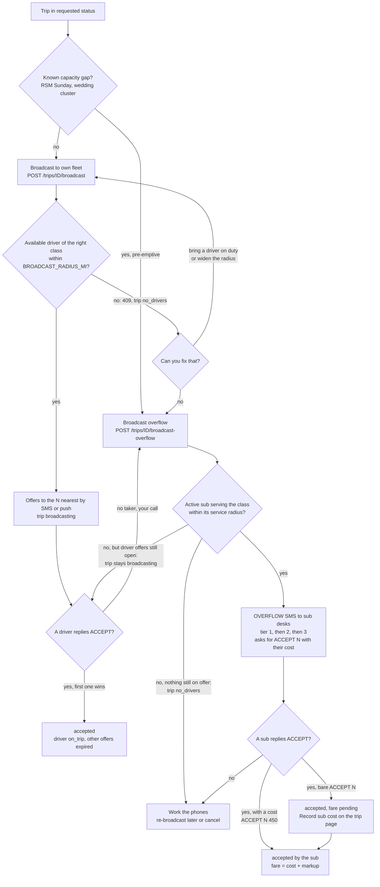
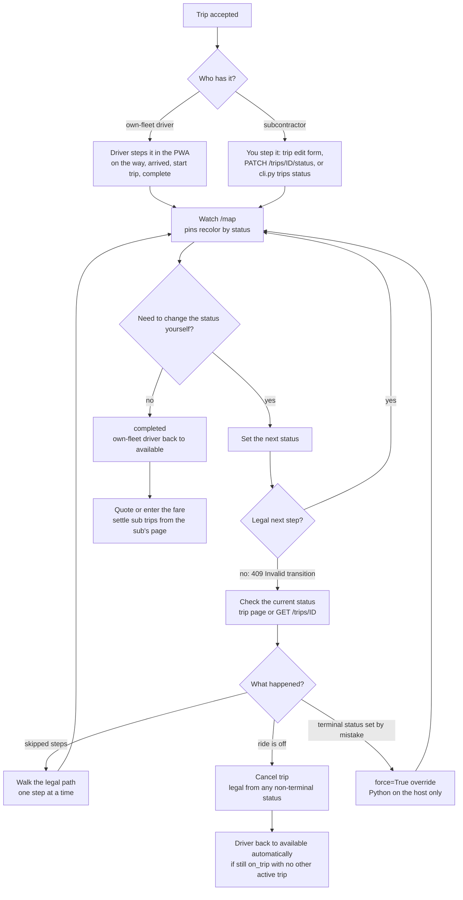
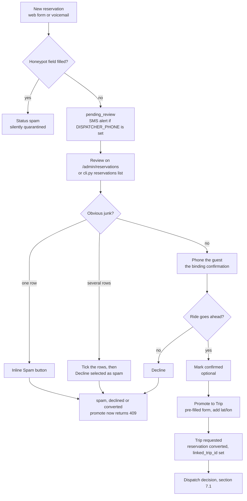
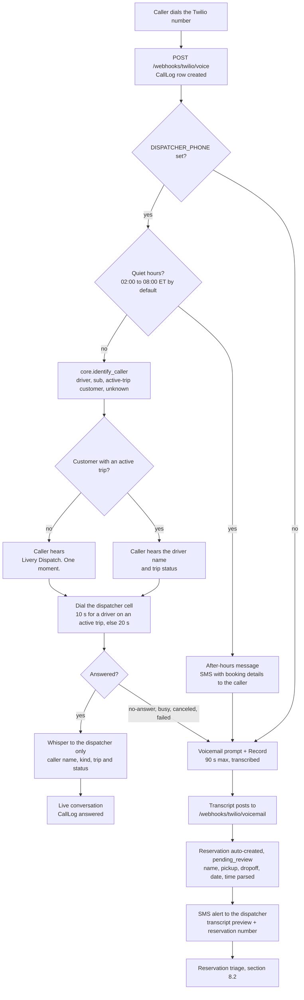

# Livery Dispatch — Operator Guide

**Audience:** anyone who needs to run, operate, or extend the Livery Dispatch system. This is the *user-facing* guide that lives next to the code. If you've never touched this folder before, read this top-to-bottom once and you'll be functional inside an hour.

**Companion docs:**

- [README.md](README.md) — the **design reference**. System diagram, end-to-end walkthrough, trip state machine, module map, design decisions.
- [DEPLOY.md](DEPLOY.md) — the **production runbook** (Fly.io, secrets, migrations, push rollout).
- [ARCHITECTURE.md](ARCHITECTURE.md) — the **low-level reference**: every endpoint and ORM field.

This guide overlaps with all of them on purpose — it's the single-file landing page. Drill into the others when you need depth.

---

## Table of contents

0. [The fleet model — own fleet AND overflow subs](#0-the-fleet-model--own-fleet-and-overflow-subs-this-is-intentional) ← **read this first**
1. [What the dispatch system is](#1-what-the-dispatch-system-is)
2. [Install and run (5 minutes)](#2-install-and-run-5-minutes)
3. [The dispatcher's web surfaces](#3-the-dispatchers-web-surfaces)
4. [Click-to-dispatch on the live map](#4-click-to-dispatch-on-the-live-map)
5. [CLI — every operation has a command](#5-cli--every-operation-has-a-command)
6. [Data model in one screen](#6-data-model-in-one-screen)
7. [Dispatching a trip](#7-dispatching-a-trip) — the [dispatch decision](#71-the-dispatch-decision--own-fleet-first-overflow-second), the [trip lifecycle](#72-the-trip-lifecycle-from-the-dispatchers-seat), [fare quoting](#73-fare-quoting--rate-cards)
8. [Reservations, inquiries, and the marketing-site bridge](#8-reservations-inquiries-and-the-marketing-site-bridge) — including [reservation triage](#82-triage-step-by-step)
9. [Twilio — call intake and SMS replies](#9-twilio--call-intake-and-sms-replies)
10. [Environment variables and configuration](#10-environment-variables-and-configuration)
11. [Tests](#11-tests)
12. [Deploying to a real environment](#12-deploying-to-a-real-environment)
13. [Troubleshooting](#13-troubleshooting)
14. [Where to look next](#14-where-to-look-next)

---

## 0. The fleet model — own fleet AND overflow subs (this is intentional)

Before anything else: **The system models a dual-track operation, not a subcontractor-only marketplace.** Skim this section before reading the rest of the guide so the data model doesn't read like a confusing mix of "drivers" and "subcontractors."

| | Own fleet (Drivers) | Overflow subs (Subcontractors) |
|---|---|---|
| What | The operator's own vehicles and its own chauffeurs (W-2 / 1099) | Partner operators with their own vehicles + drivers |
| When dispatched | **First** — every trip broadcasts to own-fleet drivers first | **Only when own fleet exhausted** — dispatcher's explicit `broadcast-overflow` action |
| Quality model | Trained to the operator's own service standard | Cost-plus 15% markup; vehicle-class match enforced contractually |
| In the data model | `Driver` rows (`models.py`) | `Subcontractor` rows (`models.py`) |
| In the dispatch UI | Brass disc pins on the live map; status (available / on_trip / off_duty / offline) | Pentagonal shield pins with service-radius rings; tier (1/2/3) + markup_pct |
| Customer perception | "I booked the operator" — our driver, our vehicle, our protocol | Customer typically never knows. Trip is fulfilled, under the operator's brand. Sub keeps their identity off the customer-facing surface |

The visual prominence of subs on `/map` is a side-effect of each sub having a 60–100 mile **service-radius ring** drawn around their base (so you can see at a glance who's eligible for overflow on a given pickup). Driver pins are compact 24px discs. Visual weight ≠ operational priority — **own-fleet broadcast is always the first move**, the overflow rings show *who's also available if your own fleet runs out*.

### Why this dual-track model (not a larger own fleet)

Outside peak weeks, much of a larger owned fleet would sit idle, and the capital cost plus chauffeur payroll on idle hours hurts unit economics. Established premium black-car operators run the same hybrid for the same reason.

### Seed data caveat

`seed.py` loads 3 placeholder drivers (Marcus Aurelius / Eleanor Vance / Henry Cole) — **those are not real hires**. They exist so the dashboard and live map have visible activity out of the box for dev work.

---

## 1. What the dispatch system is

A FastAPI app that runs the operator's dispatch loop end to end:

| What | Surface |
|---|---|
| Dispatcher web dashboard with at-a-glance counts and queues | `GET /dashboard` |
| Live map of every driver, sub base, and active trip — with click-to-dispatch trip creation | `GET /map` |
| Working queues and detail pages (trips, reservations, inquiries, drivers, subs, rates, calls, audit) | `/admin/*` |
| REST API for drivers, subcontractors, trips, broadcasts, reservations, inquiries | `GET /docs` (Swagger UI) |
| Driver web app (PWA) for chauffeurs: offers, accept, status steps, GPS heartbeat | `/driver` |
| CLI for every operation (good for keyboard-first dispatchers, scripts, peak weeks) | `python cli.py …` |
| Inbound Twilio webhooks: chauffeur and sub `ACCEPT 17` / `DECLINE 17` replies (subs can add their cost: `ACCEPT 17 450`), and the voice line | `POST /webhooks/twilio/*` |
| Public endpoints the marketing site calls | `POST /reservations`, `/inquiries`, `/quote`; `GET /osrm/route/v1/driving/…` |

It has not yet run in production. It powers the marketing-site reserve form bridge, the dispatcher's everyday workspace (dashboard + map + admin pages), the inquiry triage queue, the chauffeur PWA, and a complete CLI for any operation.

**Stack:** Python 3.11+, FastAPI, SQLAlchemy 2.x, Pydantic v2, Alembic, SQLite (Year 1) → Postgres (Year 2+), Typer for the CLI, Twilio for SMS + voice, pywebpush for flag-gated web push. The maps use Leaflet 1.9.4 + CARTO Dark Matter tiles + Nominatim geocoding, with road routes from OSRM through the app's own `/osrm` proxy — no API keys.

---

## 2. Install and run (5 minutes)

From the repository root:

```powershell
# First-time setup (per machine)
pip install -r requirements.txt

# Admin login for local dev. The dashboard, map, admin pages and REST API all
# sit behind /admin/login (v1.0.0), so you need credentials before step 3 is useful.
Copy-Item .env.example .env
python -c "from admin_auth import hash_password; print(hash_password('pick-a-dev-password'))"
# Paste the printed hash into .env as:  ADMIN_PASSWORD_HASH='$2b$12$...'
# (ADMIN_USERNAME=admin is already in the template.)

# Seed a development database (3 drivers, 4 subcontractors, 2 rate cards, 2 trips)
python seed.py

# Boot the server (auto-reloads on file change in dev)
uvicorn app:app --reload
```

Then open:

- **http://localhost:8000/admin/login** — sign in with `admin` + the password you hashed
- **http://localhost:8000/map** — the live dispatcher map (start here)
- **http://localhost:8000/dashboard** — the at-a-glance dashboard
- **http://localhost:8000/docs** — Swagger UI

Without `ADMIN_SESSION_SECRET` in `.env`, sessions don't survive a server restart (each process mints a random secret) — just sign in again.

Server logs print to the terminal. If you want to tail them from another window:

```powershell
# Run uvicorn redirected to a log file:
uvicorn app:app --reload > dispatch-server.log 2>&1
# In another window:
Get-Content dispatch-server.log -Wait -Tail 50
```

To stop: `Ctrl+C` in the uvicorn terminal.

The seed is idempotent — running `python seed.py` twice doesn't duplicate. To wipe and reseed, delete `dispatch.db` and re-run.

**Windows console:** since v1.1.18 the CLI swaps any character the console can't show (the `→` in trip and route lines on a cp1252 code page) for a `?` instead of crashing, so no `PYTHONIOENCODING` setting is needed.

---

## 3. The dispatcher's web surfaces

All of them sit behind the admin login (v1.0.0) — sign in at `/admin/login` with the credentials configured in env (`ADMIN_USERNAME` / `ADMIN_PASSWORD_HASH`). Session lasts 24 hours. Sign out via the header button or `POST /admin/logout`. The pages are internal-only (`<meta name="robots" content="noindex">`) and cross-link in their headers.

### 3.1 Dashboard — `/dashboard`

Auto-refreshes every **30 seconds** (uses `<meta http-equiv="refresh">` — no JavaScript required, survives an internet hiccup). It is read-only; actions live on the admin pages it links to. What it surfaces:

- **Top summary bar:** active trips, pending reservations, pending inquiries, drivers available, drivers on trip, today's ride count (completed / total).
- **Active trips:** every trip in `broadcasting` / `accepted` / `en_route_pickup` / `on_scene` / `in_transit` with ID, status, pickup time, passenger, route, vehicle class, assigned driver or subcontractor, and fare.
- **Pending reservations:** marketing-site reserve-form submissions (and voicemail-created reservations) still awaiting dispatcher review.
- **Pending inquiries:** wedding-planner inquiries, vendor onboarding requests, Year-2-portal early-access signups.
- **Drivers roster** with current status.
- **Subcontractors** (Tier-1 first).

Keep this on a second monitor during a shift. It's the at-a-glance overview.

### 3.2 Live map — `/map`

Full-page Leaflet map on our own dark basemap (QGIS Server, `MAP_SERVER_URL`), or darkened OpenStreetMap tiles until that's deployed. Polls `/map/data` every **12 seconds** to refresh positions. Default view spans the SE US (GA / FL / SC / AL) so the operating context is visible cleanly. Once any live driver, sub, or trip is plotted, the view auto-fits to its actual bounds.

**Pin vocabulary:**

| Pin / shape | Meaning |
|---|---|
| Brass disc with **SV** / **SP** glyph | Driver. Color-coded by status: green = available, brass = `on_trip` (pulses with a halo so you can see it peripherally), taupe = `off_duty`, gray = `offline`. |
| Brass / brown / gray shield with **T1** / **T2** / **T3** | Subcontractor base. Translucent dashed circle = their service radius. |
| Brass diamond **P** | Trip pickup. |
| Ivory diamond **D** | Trip dropoff. |
| **Status colors on trip pins (v0.9.21):** | Both pickup and dropoff pins recolor by lifecycle status. Muted gray = `requested`, amber + pulse = `broadcasting` (awaiting accept), green = `accepted`, orange = `en_route_pickup`, bright brass + pulse = `on_scene` (driver at curb — time-sensitive), blue = `in_transit`. Pulses draw the dispatcher's eye to the two states that need attention. |
| Brass dashed line | Road-following route between pickup and dropoff, fetched from this server's `/osrm` proxy (v1.1.15). A dimmer straight-line skeleton is drawn first and stays if routing is slow or down. |

**Side panel (top-right, tabbed):**

- **Trips** — every active trip; click a row to fly the map to its pickup.
- **Drivers** — full driver roster; click a row to fly the map to that driver.
- **Subs** — active subcontractors; click for their base.
- **Legend** — pin vocabulary reference.

**Footer:** UTC-stamped last refresh + manual "Refresh now" button.

### 3.3 Admin pages — `/admin/*`

| Page | What you do there |
|---|---|
| `/admin/trips` | Filter by status and vehicle class. A trip's page has the edit form (status, fare, notes, labels, coordinates, time, class), **Quote fare using rate card** (with a peak-week box), **Broadcast to own fleet**, **Broadcast to subs** / **Hand off to subs**, **Record sub cost** (on trips a sub has accepted, v1.1.18), **Mark complete**, **Cancel trip**, and the broadcast log. |
| `/admin/reservations` | The review queue: inline Confirm / Decline / Spam on pending rows, bulk "Decline selected as spam", and a detail page with the edit form and **Promote to Trip**. |
| `/admin/inquiries` | Wedding / vendor / early-access inquiries; Responded and Closed actions plus notes. |
| `/admin/drivers` | Roster. A driver's page shows the full bearer token to hand the chauffeur, **Rotate token**, and an edit form. |
| `/admin/subcontractors` | Sub details and edit form, plus a **settlement** page and CSV per sub (fare, markup, payout per completed trip). |
| `/admin/rates` | Rate cards per vehicle class. **+ New rate card** creates one (v1.1.18); see § 7.3. |
| `/admin/calls` | Inbound call log: recording player, transcript, notes, linked reservation. |
| `/admin/audit` | Append-only log of every admin write (who, path, status, payload hash). |

---

## 4. Click-to-dispatch on the live map

This is the headline UX added in v0.9.0. You can dispatch a trip without leaving the map.

### 4.1 Typed-address flow (default)

1. Click **+ New Trip** in the top-right.
2. The trip drawer slides in from the right with the **pickup address search** field focused.
3. Start typing — *"jax airport"*, *"1 cinnamon beach way"*, *"cloister sea island"*. After 3+ characters and \~300ms of typing pause, suggestions appear from Nominatim (OpenStreetMap's free geocoder). Up to 6 results.
4. Click a suggestion (or use **↑ / ↓ / Enter** to keyboard-pick). A brass diamond pin drops on the map at that location; the map flies to it; the pickup label, lat, and lon fields fill in automatically.
5. Move to the **dropoff address search** and repeat.
6. As soon as both pickup and dropoff are set, a **road-following route preview** is drawn between them on the map.
7. Fill the rest of the form: passenger name, passenger phone (E.164 format — e.g., `+19045551234`), pickup time (defaults to **now + 90 minutes** local), vehicle class, optional notes.
8. Click **"Create &amp; broadcast"** — the trip is created via `POST /trips`, then broadcast to nearest-available own-fleet drivers via `POST /trips/{id}/broadcast` in one move. Toast confirms on success. Both requests carry the page's CSRF token as `X-CSRF-Token` (required on the REST surface since v1.1.13).
9. Or click **"Create only"** to log the trip without broadcasting (useful for prepping a future trip you'll broadcast later).
10. Press **Esc** at any point to cancel.

### 4.2 Click-on-map flow (fallback)

When you want to drop a pin somewhere without typing an address:

1. Open the drawer (**+ New Trip**, or via re-pick on an existing draft).
2. In the pickup section, click **"Pick on map"**.
3. A banner appears across the top: *"Click the map to set the pickup location."* Cursor becomes a crosshair.
4. Click anywhere on the map. Pin drops; lat/lng fill in; reverse-geocoding via Nominatim fills the label (you can overwrite if the result is too verbose — e.g., the dispatcher knows *"JAX Airport, baggage claim"* is the canonical wording).
5. Click "Pick on map" under dropoff and repeat.

### 4.3 Mixed flows

You can mix the two: typed pickup + click-on-map dropoff, or vice versa. The pin and form state stay in sync regardless of which path filled them.

### 4.4 Reverse geocoding policy

Nominatim is free and run by the OSM Foundation. Their [usage policy](https://operations.osmfoundation.org/policies/nominatim/) asks for **< 1 request per second** and a unique identifier per app. Dispatcher clicks are far below 1 rps in practice. The browser sends a `Referer` header automatically; that's enough identification under the policy.

If Nominatim is unreachable or rate-limits us, the click-on-map flow falls back to bare `(lat, lng)` text in the label field and you type the venue name yourself.

For production-grade traffic, swap to a paid geocoder (Mapbox, Google) — the swap point is the `reverseGeocode` and `bindAddressSearch` functions in `map_view.py`.

---

## 5. CLI — every operation has a command

Every dispatcher action surfaces in `python cli.py …` so you never need to fall back to raw curl. The CLI talks to the database directly (no login, no CSRF), so run it on the machine that holds `dispatch.db` — locally, or inside `flyctl ssh console` in production. Run `python cli.py --help` for the full list. The greatest hits:

```powershell
# Daily warmup — what's pending, who's available
python cli.py drivers list
python cli.py subs list
python cli.py reservations list --status pending_review

# Drivers
python cli.py drivers add "Jane Doe" "+19045551212" --classes suv,sprinter
python cli.py drivers status 1 available --lat 31.1499 --lon -81.4915

# Subcontractors
python cli.py subs add "New Operator" "+19125559999" --tier 1 --markup-pct 15

# Trips
python cli.py trips broadcast 1                  # broadcast trip 1 to own fleet
python cli.py trips broadcast-overflow 1         # hand off to subs
python cli.py trips sub-cost 1 --cost-cents 45000  # sub texted a bare ACCEPT: record its $450 cost
python cli.py trips status 1 completed

# Rate cards (v1.1.18)
python cli.py rates list                         # every card, active or not
python cli.py rates seed-defaults                # load the planning-grade SUV + Sprinter cards; no-op if any card exists

# Reservation review queue
python cli.py reservations show 1
python cli.py reservations set-status 1 confirmed
python cli.py reservations link-trip 1 --trip 7  # mark reservation 1 converted, linked to trip 7

# Inquiry queue
python cli.py inquiries list --status pending_review
python cli.py inquiries set-status 1 responded

# End-of-shift recap (revenue, completed trips, intake totals)
python cli.py recap                              # today (UTC)
python cli.py recap --date 2026-11-15            # specific day
```

---

## 6. Data model in one screen

Six core entities, each backed by a SQLAlchemy model in `models.py`:

| Entity | What it is |
|---|---|
| **Driver** | A chauffeur. Has phone (E.164), status (`offline` / `available` / `on_trip` / `off_duty`), vehicle classes (comma-separated `suv,sprinter`), last-known lat/lon, and the bearer token for the PWA. |
| **Subcontractor** | An outside operator. One dispatch contact phone, vehicle classes served, tier (1/2/3), markup % applied at cost-plus, base location, service radius. |
| **Trip** | A passenger ride request. Pickup + dropoff with coords + labels, pickup time, vehicle class, status (see § 7.2), one optional assigned driver OR subcontractor (never both — DB-enforced). Carries fare and markup once accepted. |
| **TripBroadcast** | Per-recipient offer log. Polymorphic over driver / subcontractor — exactly one of `driver_id` / `subcontractor_id` is set (XOR enforced). Tracks `pending` → `accepted` / `declined` / `expired`. |
| **Reservation** | A customer-side booking inquiry from the marketing site reserve form (or a transcribed voicemail). Text-only addresses (no geocoding needed at intake), raw form fields, lifecycle `pending_review` → `confirmed` / `declined` / `converted` / `spam`. Promoted to Trip by dispatcher action. |
| **Inquiry** | B2B / lead-capture inquiry (wedding planner, vendor onboarding, Year-2 early-access). One table with a `kind` discriminator; kind-specific fields stashed as JSON in `details_json`. Lifecycle `pending_review` → `responded` / `closed` / `spam`. |

Supporting tables: **RateCard** (pricing per vehicle class), **CallLog** (one row per inbound call), **DriverPushSubscription** (one row per chauffeur device opted into push), **AdminAuditLog** (every admin write).

Reservations and Inquiries are kept **separate from Trips on purpose** — the dispatcher's review queue stays clean, and the form's text addresses don't carry coordinates anyway. Dispatcher promotes a reservation to a trip after phoning the guest.

---

## 7. Dispatching a trip

Once a trip exists — promoted from a reservation (§ 8), created on the map (§ 4), or from the CLI — three things happen on it: you decide who gets the offer, you watch it through its statuses, and you put a fare on it.

### 7.1 The dispatch decision — own fleet first, overflow second

Own-fleet broadcast is always the first move; `broadcast-overflow` to the Tier-1 subs is the explicit fallback, or a pre-emptive call for a known capacity gap:



How the pieces behave:

- **Own-fleet broadcast** picks up to `BROADCAST_FANOUT` (default 3) `available` drivers who serve the trip's vehicle class and have a known location within `BROADCAST_RADIUS_MI` (default 50 mi), nearest first. Drivers with a push subscription get a push when push is enabled; everyone else gets SMS.
- **Nothing times out by itself.** Offers stay open until someone accepts or you act — "no taker" is a judgment call, not a timer.
- **Overflow** offers to up to `OVERFLOW_FANOUT` (default 5) active subs that serve the class, sorted by tier then distance from their base. A sub's own service radius wins over the broadcast radius; subs with no base location are included at the end of their tier. The SMS quotes the sub's markup ("Cost-plus 15%") and asks for their cost: `Reply ACCEPT 12 <your cost $> (e.g. ACCEPT 12 450) or DECLINE 12.`
- **An empty broadcast no longer closes open offers (v1.1.18).** If an overflow finds no eligible sub, or a re-broadcast finds no eligible driver, while earlier offers are still pending, the trip stays `broadcasting` and a driver's `ACCEPT` still works. The flash says "earlier offers are still open" (on both the own-fleet and the overflow button since v1.1.19), and the REST 409 adds "(earlier offers are still open)". Only when nothing is pending does the trip go to `no_drivers`.
- **Sub fares (v1.1.18).** A sub that replies with its cost (`ACCEPT 12 450`, also `ACCEPT 12 $450.50` or `ACCEPT 12 at 450`) has the fare set at accept: cost + markup. A bare `ACCEPT 12` still accepts, with the fare pending. Then type the sub's cost in dollars into **Record sub cost** on the trip page, or run `python cli.py trips sub-cost 12 --cost-cents 45000`. Both set `fare = cost + markup`, and you can re-run either to fix a typo. Don't ask the sub to text the price again: a second `ACCEPT` from them is refused. To record a phoned-in quote at accept time instead, use `POST /trips/{id}/sub-accept` / `cli.py trips sub-accept N --sub S --quoted-cost-cents C`.
- **First accept wins** across drivers and subs alike: the atomic compare-and-set in `core.accept_trip` / `core.accept_trip_subcontractor` lets exactly one acceptance claim the trip. See [README.md § Design notes](README.md#design-notes).

### 7.2 The trip lifecycle from the dispatcher's seat

Statuses run `requested → broadcasting → accepted → en_route_pickup → on_scene → in_transit → completed`, with `no_drivers` and `cancelled` off to the side; the full state machine is drawn in [README.md § Trip state machine](README.md#trip-state-machine). Here is what you do once a trip is accepted, including when a status change is refused:



- **The guard.** Every status write that goes through `core.update_trip_status` is checked against `core.VALID_TRANSITIONS` (v0.9.17): only the next step forward, or `cancelled`, is allowed; `completed` and `cancelled` are terminal; `no_drivers` can only go back to `broadcasting` or to `cancelled`.
- **How a refusal shows up:** `PATCH /trips/{id}/status` returns **409** `Invalid transition: a → b`; `cli.py trips status` prints the same message and exits 1; the admin edit form and buttons redirect with a "Failed:" / "Update failed:" flash; the driver PWA answers 400 naming the only allowed next step.
- **Mark complete** on the trip page only succeeds from `in_transit`. For an earlier status, walk the steps (or let the driver finish in the PWA).
- **Cancelling frees the driver (v1.1.18).** Like `completed`, `cancelled` returns the assigned own-fleet driver to `available`, but only if they are still `on_trip` and hold no other active trip (`accepted` / `en_route_pickup` / `on_scene` / `in_transit`). A driver you set to `off_duty` or `offline` stays that way, so nobody who signed off gets paged. Before v1.1.18 a cancel left the driver `on_trip` until you reset them by hand.
- **The `force` override** exists in code (`update_trip_status(..., force=True)`) but no HTTP route or CLI flag exposes it — it's for recovering a trip put in a terminal status by mistake, e.g. marked `completed` while the passenger is still in the car. Run it on the machine that holds the database (locally, or in `flyctl ssh console`), from the repository root:

  ```powershell
  python -c "import core; from database import SessionLocal; from models import TripStatus; s = SessionLocal(); print(core.update_trip_status(s, 12, TripStatus.IN_TRANSIT, force=True).status)"
  ```

  It changes only the status; the assignment and broadcasts stay as they were. After forcing a completed trip back to `in_transit`, put its driver back on the trip too (`python cli.py drivers status ID on_trip`), since completion had released them. Forcing a cancelled, previously assigned trip back to `requested` leaves the old assignee on the row, so a fresh broadcast can't be accepted — create a new trip instead.

### 7.3 Fare quoting + rate cards

`RateCard` is a per-vehicle-class pricing reference. Edit the cards at **/admin/rates** — base fare, per-mile, per-hour, airport-meet surcharge, after-hours surcharge, peak-week multiplier, minimum fare. Replace the planning-grade values with real numbers before going live.

**Getting cards into a database (v1.1.18).** With no active card for a class, the trip-page quote and the public `POST /quote` have nothing to price with; the site's estimate soft-fails to "dispatcher will confirm". Three ways in:

- **`python cli.py rates seed-defaults`** loads the two planning-grade cards (SUV + Sprinter) from [rate_defaults.py](rate_defaults.py). It does nothing if *any* card already exists, so it's safe on production and never overwrites your edits. In production, run it inside `flyctl ssh console` ([DEPLOY.md](DEPLOY.md) § 7).
- **+ New rate card** on `/admin/rates` (`/admin/rates/new`) creates one by hand. It clamps the same way as the edit form (amounts ≥ 0, multiplier ≥ 1.0); a blank name or no vehicle class bounces back with a "Failed:" flash.
- **`python seed.py`** (dev only) loads the same two cards as `seed-defaults`.

`python cli.py rates list` shows what's there. When several active cards share a class, the lowest id wins.

On every trip detail page (`/admin/trips/{id}`), the **"Quote fare using rate card"** button computes a suggested fare from the active rate card matching the trip's vehicle class, fills `trip.fare_cents`, and shows a line-itemized breakdown in the flash banner:

```
Quoted: $150.00 Base fare + $289.50 Distance (52.7 mi) +
        $125.00 Time (1.4 hr) + $25.00 Airport meet-and-greet = $589.50
```

**Pricing logic** lives in `fare.py`. Pure module, no DB. Two entry points:

- `quote_trip(...)` — explicit kwargs; useful for unit tests and one-off quotes. The public `POST /quote` uses it too.
- `quote_for_trip_and_card(trip, rate_card, is_peak_week=False)` — wrapper that pulls fields off ORM rows. Auto-detects airport meet-and-greet from `trip.pickup_label` + `trip.notes` (looks for "airport", "terminal", "JAX", "SAV", "meet-and-greet", etc.).

**Distance is OSRM road distance** (`fare._compute_distance_miles`), falling back to haversine (great-circle) on any OSRM failure or when `FARE_DISTANCE_PROVIDER=haversine`. Haversine runs 15–25% short of road mileage on most corridor legs, so if a quote looks low, check whether routing was down and override upward. Since v1.1.15 the same `OSRM_BASE_URL` serves fares and the map routes; production should point it at the [self-hosted corridor OSRM](osrm/README.md).

**Peak week** (e.g., RSM Sunday, Masters traffic) is a calendar decision — not stored on the trip row. The dispatcher checks the "is_peak_week" box on the Quote action if the trip falls in a peak window.

---

## 8. Reservations, inquiries, and the marketing-site bridge

### 8.1 Where reservations come from

A marketing site wired to this backend (not included in this repository) has four kinds of form:

| Page | Form | What it produces |
|---|---|---|
| `index.html` and the 5 resort landing pages | Reservation | `POST /reservations` (after `POST /quote` estimates as fields fill) |
| `concierge.html` | Wedding inquiry | `POST /inquiries` with `kind=wedding` |
| `concierge.html` | Vendor onboarding | `POST /inquiries` with `kind=vendor` |
| `account.html` | Early access | `POST /inquiries` with `kind=early_access` |

The site's `js/reserve.js` and `js/inquiry.js` POST to the dispatch backend when `data-dispatch-url` is set on the form. Honeypot-positive submissions are silently quarantined as `spam` — no review-queue noise. Unanswered calls add a second source: a transcribed voicemail becomes a `pending_review` reservation (see § 9.1).

**To wire the site up to a deployed dispatch backend:**

1. Deploy the backend (runbook: [DEPLOY.md](DEPLOY.md)). Pin `CORS_ORIGINS` to your live site origin(s).
2. In the marketing site, set `data-dispatch-url="https://your-dispatch.example.com"` on every form (the reserve form on the six booking pages, both concierge forms, and the account form).
3. Optionally set `data-osrm-url="https://your-dispatch.example.com/osrm"` on the `#map` div of the corridor and resort pages so the site maps route through the dispatch proxy too.

Site can run perfectly fine without the dispatch backend — forms fall back to Netlify Forms submission. The dispatch backend is an enhancement, not a dependency.

### 8.2 Triage, step by step

Every reservation goes through the same human review; the dispatcher's phone call is the binding step:



What the buttons actually do:

- **Inline Confirm / Decline / Spam** (v0.9.20) appear only on `pending_review` rows, on both the queue and the detail page, so the common case needs no click-through.
- **Bulk spam:** tick rows on the queue and press **Decline selected as spam**. It posts to `/admin/reservations/bulk-spam` and only flips rows that are still `pending_review`; the flash reports how many changed.
- **Promote to Trip** (v0.9.22) shows on `pending_review` and `confirmed` reservations, so confirming first is optional. The pre-filled form carries name, phone, pickup/dropoff labels, vehicle class, pickup time and notes; you add the coordinates (text reservations don't have them). Submit creates the Trip (status `requested`), flips the reservation to `converted` with `linked_trip_id`, and lands you on the trip page.
- **Re-promotion is blocked.** A `converted` / `declined` / `spam` reservation returns 409 on promote — one reservation, at most one trip. The edit form also refuses a manual flip to `converted` without a linked trip.
- **CLI path:** `python cli.py trips create …` then `python cli.py reservations link-trip 1 --trip 7`.

**Reservations never auto-promote to Trips.** Year-1 reality is human-in-the-loop, and form text addresses don't carry coordinates.

Inquiries follow a shorter loop: review on `/admin/inquiries`, reply by email or phone, then **Responded** and later **Closed** (or `python cli.py inquiries set-status`). They never become trips.

---

## 9. Twilio — call intake and SMS replies

### 9.1 Call intake (Twilio Voice)

Year-1 posture: **live-person-answers**. The Twilio number's voice webhook rings the dispatcher's cell (`DISPATCHER_PHONE`) with caller context, and anything unanswered becomes a voicemail that lands in the reservation queue:



The details behind the boxes:

1. **Quiet hours** default to 02:00–08:00 `America/New_York` (`QUIET_HOURS_START` / `QUIET_HOURS_END` / `QUIET_HOURS_TIMEZONE`; `QUIET_HOURS_ENABLED=false` turns the gate off). **Don't widen them** without reconfirming: 18:00–02:00 is peak business (resort dinners, evening events, late-night returns).
2. **Caller ID** checks `Driver.phone`, then `Subcontractor.dispatch_phone`, then the passenger phone on trips in `accepted` / `en_route_pickup` / `on_scene` / `in_transit`.
3. **The whisper** plays only on the dispatcher's leg when they pick up (`POST /webhooks/twilio/whisper`), e.g. *"Call from John Henderson — customer — Trip 7, driver en route to pickup."*
4. **Unanswered calls**: the `<Dial action>` posts to `/webhooks/twilio/dial-status`, which marks the CallLog and returns the voicemail TwiML. When Twilio's transcription arrives at `/webhooks/twilio/voicemail`, the CallLog gets the recording URL and text, and — if the transcript isn't empty — a `pending_review` Reservation is created with the raw transcript in `notes` and whatever `core.parse_voicemail_transcript` could extract in the fields. Then the dispatcher gets the SMS alert.

**Required env vars to enable:**

```powershell
$env:TWILIO_ACCOUNT_SID = "AC..."
$env:TWILIO_AUTH_TOKEN  = "..."             # auto-enables signature validation on webhooks
$env:TWILIO_FROM_NUMBER = "+15551234567"
$env:DISPATCHER_PHONE   = "+19045551212"    # the dispatcher's cell — gets forwarded calls + SMS alerts
$env:NOTIFICATION_PROVIDER = "twilio"
```

**Twilio console config** (per Twilio number):

- Voice → "A Call Comes In" → Webhook → `POST https://your-dispatch.example.com/webhooks/twilio/voice`
- That's it — the rest of the flow (Dial, whisper, fallback to Record, transcription callback) is driven by the TwiML the webhook returns.

**Inbound calls show up at /admin/calls.** Each call row links to a detail page with the recording audio player (`<audio>` element pointing at Twilio's recording URL), the transcription text, dispatcher notes field, and a link to the auto-created Reservation if any. You can also manually link a call to an existing reservation if the call was a callback on a prior submission.

**Where this is going (deferred):** LLM-driven call intake. The trigger conditions are >30 inbound/day sustained AND voicemail-to-conversion loss is meaningful AND no second dispatcher hired. Until then, **don't replace the live-answer path** with an AI front-line — premium concierge customers expect a human voice. Guardrails if it is ever built: a concierge-channel allowlist, "press 0 for a person", and suggest-and-confirm by default.

### 9.2 SMS ACCEPT/DECLINE from chauffeurs and subs

Drivers and subcontractors receive broadcast SMSes from the dispatch system. They reply `ACCEPT 17` or `DECLINE 17` (case-insensitive, punctuation-tolerant). Since v1.1.18 a **subcontractor** can add its quoted cost in dollars after the trip number:

| Reply | From a sub | From a driver |
|---|---|---|
| `ACCEPT 17` | Accepts; fare pending until you record the cost (§ 7.1) | Accepts |
| `ACCEPT 17 450`, `accept 17 $450.50`, `ACCEPT 17 at 450` | Accepts; fare = $450 + the sub's markup, set at accept | Accepts; the price is ignored |
| `DECLINE 17` (a price, if any, is ignored) | Declines | Declines |

The price is up to five digits with optional cents. Commas aren't accepted, so `ACCEPT 17 $1,200` is an unrecognized reply; ask for `ACCEPT 17 1200`. A price of zero counts as no price.

The reply hits `POST /webhooks/twilio/sms`, where:

1. The body is parsed (`_REPLY_RE` in `app.py`: the keyword, the trip number, then the optional price).
2. The sender's phone is matched to a `Driver` (own fleet) first, then a `Subcontractor` (overflow).
3. The atomic `core.accept_trip` (or `accept_trip_subcontractor`, with the cost when given) runs.
4. First-write-wins serializes concurrent accepts at the DB layer.

Problems (unknown sender, unrecognized body, trip already taken) come back as `200` with `matched=false` and a `detail` string, so Twilio doesn't retry. A sub accept's `detail` also says `cost $X + markup → fare $Y` or "fare pending". Nothing is texted back to the sender.

**To enable real Twilio:**

```powershell
$env:NOTIFICATION_PROVIDER = "twilio"
$env:TWILIO_ACCOUNT_SID = "AC..."
$env:TWILIO_AUTH_TOKEN = "..."          # also enables webhook signature validation
$env:TWILIO_FROM_NUMBER = "+15551234567"
$env:DISPATCHER_PHONE = "+19125559999"   # your phone for new-reservation alerts
```

In Twilio's console, point the number's (or messaging service's) incoming-message webhook to `https://your-dispatch.example.com/webhooks/twilio/sms`.

When `TWILIO_AUTH_TOKEN` is set, **signature validation is automatically enforced** — any request without a valid `X-Twilio-Signature` header gets 403'd. Override only for diagnostics: `TWILIO_VALIDATE_SIGNATURE=false`.

Without these vars, the system runs with a `ConsoleProvider` that prints SMS payloads to the terminal — perfect for dev / tests.

---

## 10. Environment variables and configuration

All read at runtime; `database.py` also loads `.env` if present. Defaults work for dev apart from the admin login pair. The annotated template is [.env.example](.env.example); production requirements are in [DEPLOY.md](DEPLOY.md).

| Variable | Default | Purpose |
|---|---|---|
| `DISPATCH_ENV` | `""` | `production` turns on the fail-closed boot guard, HSTS, secure cookies, the CORS wildcard refusal, and the public-OSRM boot warning. |
| `DATABASE_URL` | `sqlite:///./dispatch.db` | SQLAlchemy URL (relative to the working directory for SQLite). |
| `CORS_ORIGINS` | `*` | Comma-separated list of allowed origins for cross-origin calls. **Pin to your site origin(s) in prod.** |
| `ADMIN_USERNAME` | none | Admin login username. **Required** to sign in. |
| `ADMIN_PASSWORD_HASH` | none | Bcrypt hash of the admin password. Generate: `python -c "from admin_auth import hash_password; print(hash_password('yourpass'))"`. **Required.** |
| `ADMIN_SESSION_SECRET` | per-process random | HMAC secret for session cookies (and the admin CSRF token). ≥32 chars, **required in production** so sessions survive restarts. |
| `DRIVER_CSRF_SECRET` | per-process random | Secret for driver-surface CSRF tokens. ≥32 chars, **required in production**. |
| `BROADCAST_RADIUS_MI` | `50` | Max distance for own-fleet candidates; also the radius for subs that don't advertise their own. |
| `BROADCAST_FANOUT` | `3` | How many drivers to offer a trip to in one broadcast. |
| `OVERFLOW_FANOUT` | `5` | Same, for subcontractors. |
| `NOTIFICATION_PROVIDER` | `console` | `console` or `twilio`. Console is refused in production. |
| `TWILIO_ACCOUNT_SID`, `TWILIO_AUTH_TOKEN`, `TWILIO_FROM_NUMBER` | none | Twilio API creds + sender number. |
| `TWILIO_VALIDATE_SIGNATURE` | auto | Auto-enabled when `TWILIO_AUTH_TOKEN` is set. Set `false` to diagnostically disable. |
| `DISPATCHER_PHONE` | none | Voice calls ring this number; new-reservation, new-inquiry and voicemail alerts SMS to it. Unset means every call goes to voicemail. |
| `QUIET_HOURS_ENABLED` | `true` | `false` disables the after-hours gate. |
| `QUIET_HOURS_START` / `QUIET_HOURS_END` | `02:00` / `08:00` | Quiet window (don't widen it — see § 9.1). |
| `QUIET_HOURS_TIMEZONE` | `America/New_York` | Timezone for the window. |
| `FARE_DISTANCE_PROVIDER` | `osrm` | `osrm` (road distance, haversine fallback) or `haversine`. |
| `OSRM_BASE_URL` | `https://router.project-osrm.org` | One routing engine for fares and the `/osrm` map proxy. Empty string disables routing. Production: the [self-hosted image](osrm/README.md). |
| `OSRM_TIMEOUT_S` | `5.0` | Upstream timeout for fares and the proxy. |
| `OSRM_PROXY_CACHE_TTL_S` / `OSRM_PROXY_CACHE_MAX` | `86400` / `512` | Proxy cache lifetime and size. |
| `OSRM_PROXY_RATE_LIMIT_ENABLED` / `_WINDOW_S` / `_MAX` | `true` / `60` / `60` | Per-IP limit on `/osrm` (its own bucket). |
| `PUBLIC_FORM_RATE_LIMIT_ENABLED` / `_WINDOW_S` / `_MAX` | `true` / `60` / `5` | One per-IP bucket shared by `POST /reservations`, `/inquiries` and `/quote`. |
| `LOGIN_RATE_LIMIT_ENABLED` / `_WINDOW_S` / `_MAX` | `true` / `60` / `10` | Per-IP limit on `/admin/login` and `/driver/login`. |
| `MAX_REQUEST_BYTES` | `32768` | Largest request body accepted (v1.4.1); bigger ones get a 413 before anything reads them. Production refuses a value that isn't a whole number ≥ 1024. |
| `SKIP_PRE_MIGRATION_BACKUP` | unset | `1` lets `boot.py` migrate an existing database without copying it to `backups/` first (v1.4.1). Leave unset. |
| `PUSH_NOTIFICATIONS_ENABLED` | `false` | Web push for subscribed drivers (SMS fallback). |
| `VAPID_PRIVATE_KEY`, `VAPID_PUBLIC_KEY`, `VAPID_CONTACT_EMAIL` | none | Required when push is enabled. |

Tests set sane defaults in `tests/conftest.py` so the suite doesn't depend on env state.

---

## 11. Tests

```powershell
# Whole dispatch suite (1,084 tests as of v1.4.1)
pytest

# One file
pytest tests/test_map.py -v

# One test
pytest tests/test_e2e.py::test_peak_week_full_dispatch_cycle -v

# Static security analysis
bandit -r . -ll -x tests

# Dependency CVE scan
pip-audit --requirement requirements.txt
```

**Test files** (`tests/`, plus `tests/pentests/`):

- `test_core.py`, `test_api.py`, `test_e2e.py` — dispatch matching, broadcasting, atomic acceptance; REST contract; full peak-week cycle.
- `test_subcontractors.py` — overflow + cost-plus markup.
- `test_reservations.py`, `test_inquiries.py`, `test_quote.py`, `test_fare.py` — form intake, the public estimate, the fare calculator.
- `test_webhook.py`, `test_twilio_voice.py` — inbound SMS replies; the voice pipeline.
- `test_driver_surface.py`, `test_push_notifications.py` — driver PWA and web push.
- `test_admin_auth.py`, `test_admin_pages.py`, `test_csrf_rest_surface.py`, `test_idor.py` — admin login, admin actions, CSRF on the REST surface, IDOR on reservation/inquiry detail.
- `test_dashboard.py`, `test_map.py`, `test_recap.py`, `test_osrm_proxy.py` — dashboard, live map + feed, end-of-shift recap, the `/osrm` proxy.
- `test_prod_hardening.py` — the v1.1.17 pre-production fixes (header order, docs off in production, broadcast guard, boot guard, proxy posture).
- `test_gaps_e6_e10.py` — the v1.1.18 fixes: rate-card creation + `rates seed-defaults`, cancel frees the driver, empty broadcasts keep open offers, sub SMS prices + `sub-cost`, the push off-switch, the cp1252-safe CLI.
- `test_security.py` — rate limiting, signature validation, CORS production guard, active probes. The `test_documented_gap_*` tests originally pinned the gap; they now pin the hardened default. **Don't delete them** even though they no longer expose gaps — they pin the floor.
- `test_alembic.py` — migration scaffold.
- `pentests/` — auth, CSP, driver, quote, Twilio, and coordinate-validation pentests.

The browser-level Playwright suites (site forms and full-stack end-to-end) are not included in this repository.

---

## 12. Deploying to a real environment

The full runbook is [DEPLOY.md](DEPLOY.md) — Fly.io in `atl`, SQLite on a persistent volume, secrets, Twilio webhooks, the push rollout, and the private OSRM app. The points that most often trip people up:

1. `DISPATCH_ENV=production` makes the app **refuse to boot** until admin credentials, both ≥32-char secrets, a pinned `CORS_ORIGINS`, `NOTIFICATION_PROVIDER=twilio` with `TWILIO_AUTH_TOKEN` + `TWILIO_ACCOUNT_SID` + `TWILIO_FROM_NUMBER`, an `https://` `PUBLIC_BASE_URL`, `CLIENT_IP_HEADER` (`Fly-Client-IP` on Fly), a valid `MAX_REQUEST_BYTES` if it's set, and (if push is on) the VAPID keys are all set. The error lists what's missing. In production `/docs` doesn't exist.
2. Migrations run by themselves: the image's entrypoint (`boot.py`) runs `alembic upgrade head` on every start (v1.1.21), and since v1.4.1 it copies the database to `/data/backups/` first whenever a migration is pending. A fresh volume is built straight to head.
3. Load rate cards on the fresh database (`python cli.py rates seed-defaults` in `flyctl ssh console`, or **+ New rate card** at `/admin/rates`). Until then the site's `/quote` estimate soft-fails. See § 7.3.
4. Point `OSRM_BASE_URL` at the self-hosted corridor OSRM before paying customers; the public demo is non-commercial and rate-limited (the boot log warns until you do).
5. Wire every site form's `data-dispatch-url` (and the maps' `data-osrm-url`) to the dispatch host, and keep that origin in `CORS_ORIGINS`.
6. Backups until the Postgres move: Fly snapshots the volume daily and keeps 30 days; take an extra copy with `python backup.py` before anything risky and download one weekly. Never `cp` the live `dispatch.db`. Steps in [DEPLOY.md, Backups](DEPLOY.md#backups-sqlite).
7. If dispatcher geocoding traffic ever approaches \~1 req/sec, host Nominatim or swap to a paid geocoder.

---

## 13. Troubleshooting

**Server won't start: `Address already in use`**

Another process holds port 8000. Find and stop it: `Get-NetTCPConnection -LocalPort 8000 -State Listen | ForEach-Object { Stop-Process -Id $_.OwningProcess }` — or just close the other terminal window. Or pick a different port: `uvicorn app:app --port 8001`.

**Can't sign in at `/admin/login` locally ("Invalid credentials")**

`ADMIN_USERNAME` / `ADMIN_PASSWORD_HASH` aren't in `.env`, the hash was generated from a different password, or uvicorn was started before you edited `.env` (restart it). See § 2.

**Map shows no pins**

Open `http://localhost:8000/map/data` in the browser tab where you're signed in (a bare `curl` gets 401 now). If `drivers` / `subcontractors` / `active_trips` are empty arrays, re-run `python seed.py` from the repository root. If they have data but pins don't render, the issue is in the browser — open the JS console and look for errors.

**Map draws straight lines instead of road routes**

Routing is unreachable or rate-limited; the straight line is the designed fallback. Check the `/osrm/route/v1/driving/…` request in the browser's network tab: 429 means the proxy's own per-IP limit, 502/504 means `OSRM_BASE_URL` failed or timed out, 503 means routing is disabled (`OSRM_BASE_URL=""`). The public demo rate-limits often — self-host it ([osrm/README.md](osrm/README.md)).

**Address search returns nothing for valid US addresses**

Likely Nominatim rate-limit or temporary outage. Try a different address; if all searches fail, fall back to click-on-map. If it's persistent, swap geocoders in `map_view.py` (search for `nominatim.openstreetmap.org`).

**Click-to-dispatch creates trip but broadcast fails**

`POST /trips/{id}/broadcast` returns 409 when no eligible drivers exist within `BROADCAST_RADIUS_MI` of the pickup (the trip is now `no_drivers`). Either: bring a driver into the radius (`python cli.py drivers status ID available --lat … --lon …`), widen the radius (`$env:BROADCAST_RADIUS_MI = "200"` and restart), or hand off with **Broadcast to subs** on the trip page. See § 7.1.

**A REST call or Swagger "Try it out" returns 403 `Missing CSRF token`**

Since v1.1.13 every admin-gated mutation (`/trips`, `/drivers`, `/subcontractors`, `PATCH /reservations/{id}`, `PATCH /inquiries/{id}`) needs the admin CSRF token as an `X-CSRF-Token` header (or a `csrf_token` form field) on top of the session cookie. Swagger UI doesn't send it. Use the admin pages, the `/map` drawer, or the CLI — or copy the token from the `<meta name="csrf-token">` tag on any admin page into the header.

**Status change refused with 409 `Invalid transition`**

The trip state machine only allows the next step forward or a cancel. See § 7.2 for the way through, including the `force` override.

**A driver's `ACCEPT` reply comes back "cannot accept"**

The trip is no longer `requested` / `broadcasting`, or this driver's offer is no longer pending: someone else accepted first, the trip was cancelled, or the driver had already declined. (Before v1.1.18 an overflow that found no sub could also flip the trip to `no_drivers` while driver offers were open; it no longer does.) Check the trip page's broadcast log; re-broadcast if the trip should be live.

**A sub accepted by SMS but the trip has no fare**

They replied with a bare `ACCEPT N`. Record their cost with **Record sub cost** on the trip page or `python cli.py trips sub-cost N --cost-cents C` (§ 7.1). Recording it on an already-completed trip is fine: since v1.1.20 settlement dates trips by when they were completed (`completed_at`), so the trip stays in the period it finished in.

**Twilio webhook returns 403**

Signature validation is rejecting the request. Confirm `TWILIO_AUTH_TOKEN` matches what's in the Twilio console and that the webhook URL in Twilio matches the public URL exactly (scheme, host, path). Since v1.1.17 the signature is checked against `PUBLIC_BASE_URL` + path, because that's the URL Twilio signed. Behind Fly's TLS proxy, set `PUBLIC_BASE_URL` to the exact origin configured in the Twilio console; don't trust forwarded headers instead (see [DEPLOY.md](DEPLOY.md) § 2). To temporarily disable for diagnostics: `$env:TWILIO_VALIDATE_SIGNATURE = "false"`.

**Reservation lands silently — no SMS alert**

`DISPATCHER_PHONE` isn't set, or `NOTIFICATION_PROVIDER` is `console` (which just prints). Set both for real SMS.

**`pytest` fails on first run with `ModuleNotFoundError`**

Run from the repository root. The test conftest sets up `sys.path` for the local source files.

**Cancel button on the pickup banner doesn't work**

That was a Leaflet click-propagation issue in v0.9.0 pre-fix. If you see it on a current build: confirm `L.DomEvent.disableClickPropagation(...)` is wired for the banner in `map_view.py` (it should be).

---

## 14. Where to look next

| You want to … | Read |
|---|---|
| Look up every CLI command | `python cli.py --help` |
| Read the design, diagrams and load-bearing decisions | [README.md](README.md) |
| Deploy to production | [DEPLOY.md](DEPLOY.md) |
| Self-host routing | [osrm/README.md](osrm/README.md) |
| See the data model in code | [models.py](models.py) |
| Trace the dispatch loop end-to-end | [core.py](core.py) |
| Customize the dashboard look | [dashboard.py](dashboard.py) |
| Customize the live map look or pin vocabulary | [map_view.py](map_view.py) |

If any of those overlap with this guide and disagree, **the linked document is authoritative.** Update this guide to match rather than the other way around — this is the landing page; depth lives in the targets.

---

*Last updated 2026-11-15 for v1.1.18 (rate-card creation, cancel frees the driver, empty broadcasts keep open offers, sub costs by SMS or `sub-cost`, push off-switch, cp1252-safe CLI).*
