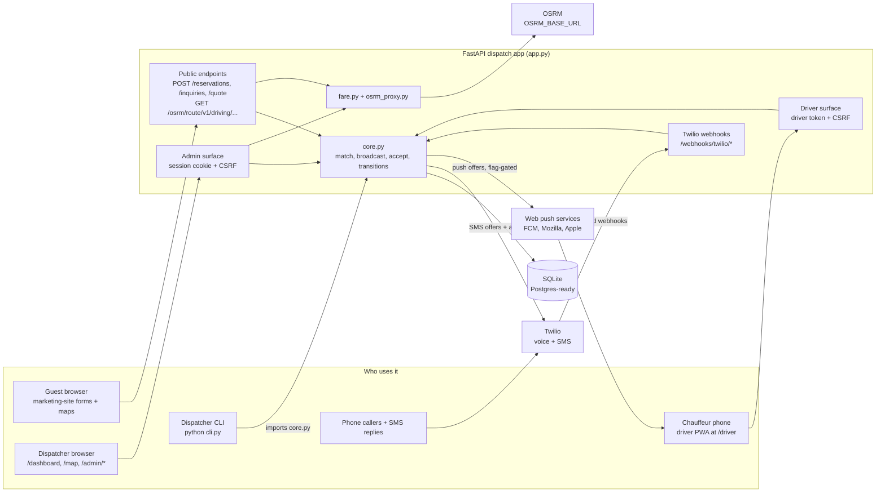
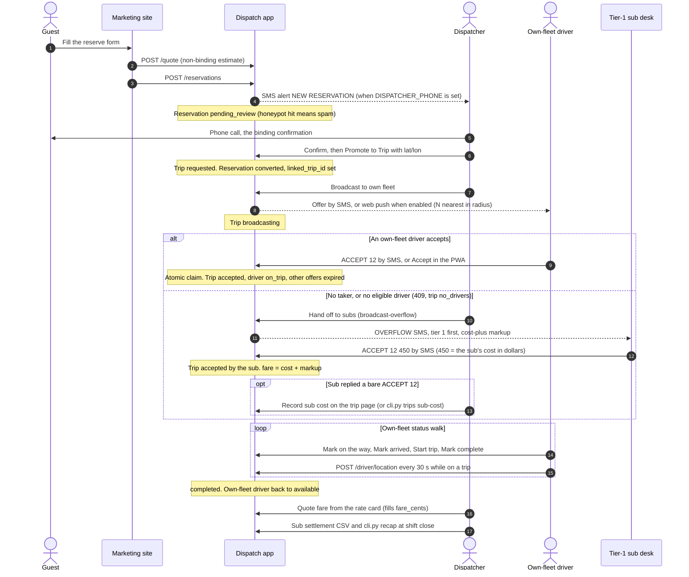
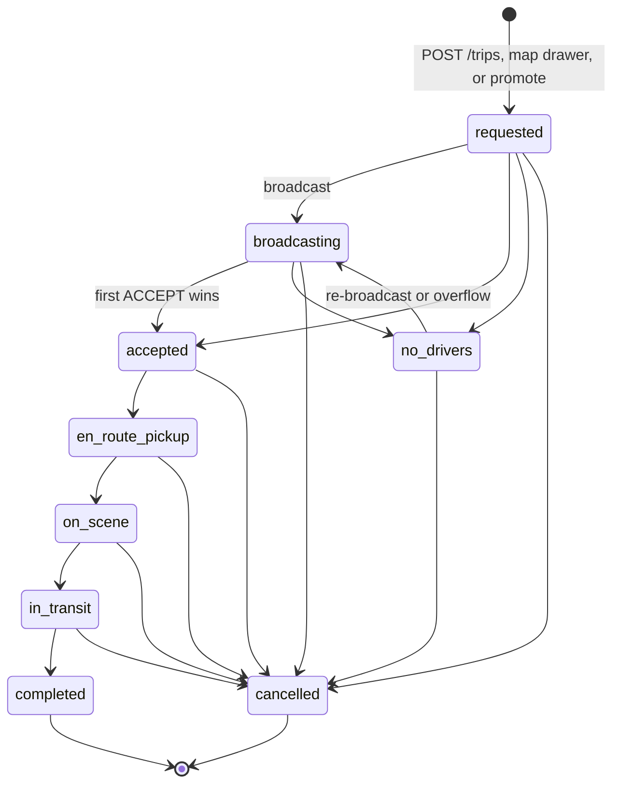

# Livery Dispatch — MVP scaffold

A small, runnable dispatch system for a premium car service. Inspired by the early-Jack-Dorsey courier-dispatch model: trips come in (from a phone call to dispatch or a web booking), the system finds the nearest available driver of the right vehicle class, and broadcasts the trip to a small fanout of candidates. First driver to accept gets the trip; the rest are released.

**Sibling docs** — when looking for something specific:

- [`GUIDE.md`](GUIDE.md) — day-to-day operator handbook, with the dispatcher workflows drawn as flowcharts
- [`DEPLOY.md`](DEPLOY.md) — production deployment runbook (Fly.io, secrets, migrations, push rollout)
- [`osrm/README.md`](osrm/README.md) — self-hosted corridor routing (OSRM image + Fly app)
- [`ARCHITECTURE.md`](ARCHITECTURE.md) — comprehensive low-level reference: every endpoint, every ORM field, state machines, internals
- [`SECURITY.md`](SECURITY.md) — security posture + threat model

**Status: tested, not yet run in production.** The production image and its boot path are covered by tests, but no live deployment has carried real rides yet. It does not take payments or issue invoices, and it has no customer self-service portal; the full list is under [What's intentionally NOT in the MVP](#whats-intentionally-not-in-the-mvp).

## System at a glance

Every surface talks to one FastAPI app ([`app.py`](app.py), 100 routes), which keeps state in SQLite and reaches the outside world through Twilio, web push and OSRM; the CLI imports the same dispatch logic directly:



## How the dispatch system works — callers, dispatchers, drivers

Three parties interact through the dispatch system. Here is the full lifecycle of a ride, from first contact to completion and payment.

### The caller (customer / concierge / resort front desk)

A caller reaches Livery Dispatch by one of three channels:

1. **Phone call to the dispatch line.** The `POST /webhooks/twilio/voice` endpoint orchestrates a caller-aware voice pipeline — premium concierge expects a human voice, not an IVR tree. The unified call flow (drawn step by step in [GUIDE.md § 9.1](GUIDE.md#91-call-intake-twilio-voice)):

   - **No dispatcher phone:** if `DISPATCHER_PHONE` is unset, every call goes straight to voicemail.
   - **Quiet-hours gate** (default 02:00–08:00 ET; configurable via `QUIET_HOURS_START` / `QUIET_HOURS_END` / `QUIET_HOURS_TIMEZONE`, switchable via `QUIET_HOURS_ENABLED`): during off-hours the system skips dialing the dispatcher, plays a recorded after-hours message, sends the caller an SMS with booking details, and offers voicemail. **18:00–02:00 is peak business**, not quiet hours.
   - **Caller identification** (`core.identify_caller`): matches the inbound `From` phone against `Driver.phone` → `Subcontractor.dispatch_phone` → `Trip.passenger_phone` on active trips (ACCEPTED / EN_ROUTE_PICKUP / ON_SCENE / IN_TRANSIT). Unknown numbers proceed with the standard flow.
   - **Active-trip status for repeat callers**: if the caller is a customer with a trip in progress, they hear the driver's name and real-time status before connecting — *"James is on the way to pick you up. Connecting you to dispatch now."*
   - **Dial timeout by caller kind**: drivers with active trips get 10 seconds (urgent — they're on the road); everyone else gets 20 seconds.
   - **Caller ID whisper** (`POST /webhooks/twilio/whisper`): when the dispatcher picks up, a short whisper plays on their end only — *"Call from John Henderson — customer — Trip 7, driver en route to pickup."* Implemented via `<Number url="...">` TwiML attribute; the whisper endpoint receives caller identity as query params (stateless, no DB hit).
   - **Voicemail with transcript parsing**: if unanswered (no-answer, busy, canceled or failed), `POST /webhooks/twilio/dial-status` falls through to `<Record>` with Twilio transcription (90 s max). `core.parse_voicemail_transcript()` extracts structured fields (name, pickup/dropoff locations, date/time keywords) via regex heuristics and populates Reservation columns. Raw transcript always preserved in `notes`. Dispatcher gets an SMS alert with a preview.
2. **Reserve form on example.com.** The guest fills name / phone / pickup / dropoff / date / time / vehicle preference. JavaScript calls `POST /quote` for a non-binding estimate as fields fill, then POSTs JSON to `POST /reservations`; the system creates a `Reservation` (status: `pending_review`) and fires an SMS alert to the dispatcher. Honeypot-positive submissions are silently quarantined as `spam`.
3. **Concierge relay.** A Sea Island / Jekyll Island Club / Ritz Amelia concierge calls or emails on behalf of a guest. The dispatcher either logs it as a reservation or creates the trip directly (the `/map` click-to-dispatch drawer, or `python cli.py trips create`).

In all three cases, a **phone call from the dispatcher to the guest** is the binding confirmation step — no ride is locked in until the dispatcher speaks with the customer (or the concierge confirms on behalf).

### The dispatcher (the head dispatcher)

The dispatcher is the orchestration layer and works from three web surfaces (all behind the admin login):

- **`/dashboard`** — a read-only, auto-refreshing (30 s) overview: active trips, pending reservations, pending inquiries, drivers, subcontractors. Its header links to every admin page.
- **`/admin/*` pages** — the working queues: trips, reservations, inquiries, drivers, subcontractors (with settlement), rate cards, calls, audit log. Filter chips narrow by status; action buttons (confirm, decline, spam, promote, broadcast, hand off to subs, quote, complete, cancel, rotate token) are one-click POSTs with post-redirect-get flash messages.
- **`/map`** — a live Leaflet map showing driver pins (color-coded by status), subcontractor base pins (with service-radius rings), and active trip pickup/dropoff markers connected by road routes from the same-origin `/osrm` proxy. **Trip pins also color by trip status** (v0.9.21): muted gray = `requested`, amber+pulse = `broadcasting`, green = `accepted`, orange = `en_route_pickup`, brass+pulse = `on_scene`, blue = `in_transit`. Refreshes every 12 seconds. The "+ New Trip" drawer creates and broadcasts a trip in one move.

### End-to-end walkthrough

A web booking travels from the guest's form to a settled trip like this (the own-fleet path is the default; overflow is the explicit fallback):



Notes on the steps the diagram compresses:

- **Promote** (step 7) is `GET`/`POST /admin/reservations/{id}/promote` (v0.9.22). The pre-filled form carries name, phone, pickup/dropoff labels, vehicle class, pickup time and notes; the dispatcher adds the coordinates text reservations don't have. Re-promotion of a `converted` / `declined` / `spam` reservation is blocked with 409 — one reservation, at most one trip.
- **Broadcast** finds the `BROADCAST_FANOUT` (default 3) nearest `available` own-fleet drivers serving the vehicle class within `BROADCAST_RADIUS_MI` (default 50 mi). Each gets *"Trip #12 — SUV — JAX → Cloister at 2026-11-12 15:00. Reply ACCEPT 12 or DECLINE 12. (23.4 mi from you)"*. With zero eligible drivers the REST call returns 409 and the trip goes to `no_drivers`, unless earlier offers on it are still pending (then it stays `broadcasting`, v1.1.18).
- **Overflow** filters active subs by vehicle class and service radius, sorts by tier (1 = preferred, 2 = backup, 3 = last-resort) then distance, and offers to `OVERFLOW_FANOUT` (default 5). The SMS asks each sub to reply `ACCEPT 12 <cost>` (e.g. `ACCEPT 12 450`); a bare `ACCEPT 12` still accepts, with the fare pending until the dispatcher records the cost.
- **Sub trips** have no PWA: the dispatcher steps their status from the trip edit form, `PATCH /trips/{id}/status`, or `python cli.py trips status`.
- **Fare quoting:** "Quote fare using rate card" on the trip page pulls the active rate card for the vehicle class, computes distance (OSRM road network, haversine fallback) and duration, and applies surcharges (airport meet-and-greet, after-hours, peak-week multiplier). The line-itemized result lands in the flash banner and in `trip.fare_cents`; the dispatcher can override it on the edit form. The public `POST /quote` runs the same calculator as a non-binding estimate.

### The driver (chauffeur)

Drivers interact through two channels:

1. **SMS replies** — the primary Year-1 interface. When a broadcast SMS arrives, the driver texts `ACCEPT 12` or `DECLINE 12`. The Twilio inbound webhook (`POST /webhooks/twilio/sms`) parses the reply, matches the `From` phone to a driver (or subcontractor), and routes to the accept/decline handler. Case-insensitive, tolerates hyphens and whitespace (`"  accept-12  "` works). A trailing price (`ACCEPT 12 450`) is a subcontractor's cost (v1.1.18); on a driver's reply it's ignored.

2. **Driver web app (PWA)** at `/driver` — a mobile-first web surface the chauffeur adds to their phone's home screen. After logging in with their auth token at `/driver/login`:
   - Dashboard shows open broadcasts with one-tap Accept buttons
   - Trip detail page shows pickup/dropoff with native map deep-links (Apple Maps, Google Maps, `geo:` URI)
   - Status-transition buttons walk the trip through the lifecycle: "Mark on the way" → "Mark arrived" → "Start trip" → "Mark complete"
   - GPS heartbeat pings `/driver/location` every 30 seconds while on an active trip, keeping the dispatcher's `/map` current
   - Opt-in web push for broadcast offers once `PUSH_NOTIFICATIONS_ENABLED=true` (see [DEPLOY.md](DEPLOY.md) for the rollout), with a **Turn off notifications** button on a subscribed device (v1.1.18)
   - Installable shell via a service worker that caches the app shell only (never accept/decline POSTs or trip data)

**Auth:** Each driver has an opaque bearer token (43-char URL-safe string from `secrets.token_urlsafe(32)`). The dispatcher sees the full token on the admin driver detail page and hands it to the chauffeur. Cookie-based auth is set on login; CSRF protection on all cookie-auth POSTs. Token rotation is a one-click admin action that immediately invalidates the old value and deletes the driver's push subscriptions.

> **Product principle: routing through phone calls and the website only — no native apps.** A standing product decision. Every customer-facing and driver-facing surface this backend serves is delivered through the browser (or, for the most time-critical operating moments, through SMS-via-Twilio as a backup channel). There is no native iOS / Android app and there will not be one. The driver-facing surface is a Progressive Web App (PWA — installable from a URL, can be added to a chauffeur's phone home screen, runs full-screen, no App Store / Play Store dependency); any future customer-facing surface would be a responsive web portal.

### How we know each driver's location (production)

The chauffeur's **phone is the GPS source** — there is no hardware to install in the vehicle. The mechanism, end to end:

1. The driver opens the PWA at `/driver` on their phone and logs in with the token the dispatcher issued them.
2. An inline script ([`driver_pages.py`](driver_pages.py), the v0.9.13 GPS heartbeat) calls the browser's `navigator.geolocation` and **POSTs the coordinates to `POST /driver/location` every 30 seconds**. The first ping fires immediately on login, so the dispatcher's map sees the driver within seconds.
3. The backend writes `Driver.lat` / `Driver.lon` (the row's `updated_at` moves with it).
4. The dispatcher's `/map` polls every 12 seconds and redraws the driver's pin. That is the live movement on the map.

**Requirements in production:** the site must be served over **HTTPS** (geolocation only works on secure origins — the Fly.io deploy provides this automatically), and the driver grants the location permission once. `Permissions-Policy: geolocation=(self)` is already set so the browser allows it.

**Two design choices shape what "exact" means today:**

- **Pings only fire while the driver is on an active trip** — the loop is gated by `body[data-on-trip="1"]` to save battery. Between trips you see the driver's *last known* position plus their availability status, not a live trail. Removing the gate (always-on tracking) is a one-line change with a battery / privacy trade-off.
- **Accuracy is currently coarse** — `enableHighAccuracy: false` (cell / Wi-Fi positioning, good to roughly a block). Flip it to `true` for true-GPS precision at the cost of battery.

**The inherent limitation of the web-only / no-native-app decision:** a mobile web page's GPS loop is **suspended by iOS and Android when the screen locks or the browser is backgrounded.** While the chauffeur has the PWA open with the screen on (e.g. phone on a dash mount), tracking is reliable; lock the phone and pings pause until it wakes. A native app could run background location; a PWA structurally cannot. Mitigations that stay within the web-only constraint: the **Screen Wake Lock API** (keep the screen awake on an active trip), the **high-accuracy toggle** above, an **in-vehicle phone mount + charger** as standard operating practice, and the existing **Twilio SMS fallback** for a "where are you?" check when GPS is stale.

## What's in the box

- **FastAPI** app with three audiences: a public surface (reserve / inquiry / quote forms, the `/osrm` route proxy, Twilio webhooks), an admin surface (REST API for drivers, subcontractors, trips, reservations, inquiries + the server-rendered `/dashboard`, `/map` and `/admin/*` pages), and the driver PWA under `/driver`.
- **SQLAlchemy** + **SQLite** (zero-config) data layer, Postgres-ready via `DATABASE_URL`. **Alembic** migrations under [`alembic/`](alembic/) since v1.0.12.
- **Dispatch logic** — haversine-distance candidate ranking, vehicle-class matching, broadcast fanout, first-accept-wins, **two-tier dispatch** (own fleet first, then subcontractor overflow handoff), and a strict trip status state machine.
- **Subcontractor overflow** — Outside operators with cost-plus markup, tier ordering (1=preferred / 2=backup / 3=last-resort), per-sub service radius, atomic accept across own-fleet and overflow, and a per-sub settlement page + CSV.
- **Notifications** — `console` (default, prints SMS bodies to stdout; refused in production) or `twilio` for SMS, plus flag-gated **web push** (VAPID) to subscribed drivers with SMS fallback.
- **Inbound SMS** — `POST /webhooks/twilio/sms` accepts driver and subcontractor `ACCEPT N` / `DECLINE N` replies and routes them to the right accept/decline function. A sub can add its cost (`ACCEPT N 450`), which sets the cost-plus fare at accept (v1.1.18). **Twilio signature validation is automatic when `TWILIO_AUTH_TOKEN` is set** (Phase 4.6c hardening); dev/test (no token) accepts unsigned requests.
- **Inbound voice automation** — `POST /webhooks/twilio/voice` orchestrates a caller-aware pipeline: quiet-hours gating with SMS fallback, caller identification (driver / subcontractor / customer / unknown), active-trip status announcements for repeat callers, caller-ID whisper for the dispatcher, driver-priority dial timeout, and voicemail transcript parsing into structured Reservation fields. Calls are logged at `/admin/calls`.
- **Fare quoting** — rate cards per vehicle class (`/admin/rates`, created at `/admin/rates/new` or loaded with `python cli.py rates seed-defaults` since v1.1.18), a pure calculator in [`fare.py`](fare.py), and the public non-binding `POST /quote` that resolves corridor labels through [`anchors.py`](anchors.py).
- **Routing** — one `OSRM_BASE_URL` drives fare distance and the same-origin `/osrm` proxy the maps use (v1.1.15); the self-hosted corridor image lives in [`osrm/`](osrm/).
- **Typer-based CLI** for dispatcher operations (`python cli.py ...`), including subcontractor CRUD, overflow broadcast, recording a sub's cost (`trips sub-cost`), rate cards (`rates list`, `rates seed-defaults`) and the end-of-shift `recap`.
- **Pytest suite** — 1,084 tests across unit, API, end-to-end, security-probe and pentest layers (see [Testing](#testing)).

## Running

From the repository root:

```bash
# 1. Set up a virtualenv and install
python -m venv .venv
source .venv/bin/activate    # on Windows: .venv\Scripts\activate
pip install -r requirements.txt

# 2. Copy the env template (console SMS by default; no Twilio needed)
cp .env.example .env

# 3. Give yourself an admin login: /dashboard, /map, /admin/* and the REST API
#    all require it (v1.0.0). Paste the printed hash into .env as
#    ADMIN_PASSWORD_HASH='...' (ADMIN_USERNAME is already "admin" in the template)
python -c "from admin_auth import hash_password; print(hash_password('pick-a-dev-password'))"

# 4. Seed example drivers, subs, rate cards + trips (idempotent)
python seed.py

# 5. Either run the API or use the CLI

# Option A: Run the REST API
uvicorn app:app --reload
#   open http://localhost:8000/admin/login, then /map or /dashboard
#   http://localhost:8000/docs is the auto-generated Swagger UI

# Option B: Use the CLI directly against the SQLite DB
python cli.py drivers list
python cli.py subs list                                  # subcontractors
python cli.py trips list
python cli.py trips broadcast 1                          # to own-fleet drivers
python cli.py trips accept 1 --driver 1
python cli.py trips status 1 en_route_pickup
python cli.py trips broadcast-overflow 1                 # hand off to subs
python cli.py trips sub-accept 1 --sub 2 --quoted-cost-cents 25000
python cli.py trips sub-cost 1 --cost-cents 25000        # record a sub's cost after a bare SMS ACCEPT
python cli.py rates list                                 # rate cards
python cli.py rates seed-defaults                        # planning-grade cards; no-op if any card exists
python cli.py reservations list --status pending_review  # ride-booking inquiries
python cli.py reservations link-trip 1 --trip 7         # mark converted + link trip 7
python cli.py inquiries list --kind wedding              # wedding / vendor / early-access
python cli.py inquiries show 1
python cli.py inquiries set-status 1 closed --notes "Sent COI 2026-05-12"
python cli.py recap                                      # end-of-shift numbers
```

On a Windows cp1252 console the CLI prints `?` for characters it can't show (like the `→` in trip lines) instead of crashing (v1.1.18), so `PYTHONIOENCODING` isn't needed.

## Customer-side booking flow (reservations)

The marketing site's reserve form (on `site/index.html` and the five resort pages) POSTs to `/reservations` once its `data-dispatch-url` attribute names the dispatch host. A reservation carries text addresses and the raw form fields — no geocoding required at submission time. The full path is the [end-to-end walkthrough](#end-to-end-walkthrough) above; the rules that matter:

- `bot_field` empty → `pending_review`; non-empty → `spam` (silently quarantined; the response is still 201).
- When `DISPATCHER_PHONE` is set, an SMS alert fires: *"NEW RESERVATION #5 — Mr Whitfield … JAX Terminal -> The Cloister at 2026-11-12 15:00 …"*.
- Review happens on `/admin/reservations` (inline Confirm / Decline / Spam per pending row since v0.9.20, plus a bulk "Decline selected as spam" bar) or `python cli.py reservations list --status pending_review`.
- **Reservations never auto-promote.** A human promotes after phoning the guest.

If the front-end fetch fails (network error, dispatch backend offline, CORS denial) the bridge falls back to native Netlify Forms submission so the inquiry never gets dropped — the dispatcher still sees it in the Netlify forms dashboard and re-enters it manually.

Set `CORS_ORIGINS=https://example.com` (plus `www.` if served) in production so a stray third party can't POST junk reservations from any origin. **Production deploys are deploy-time-gated**: if `DISPATCH_ENV=production` and `CORS_ORIGINS` is `*` (or unset), the app refuses to start (Phase 4.6c). Dev / tests default to `*`.

`POST /reservations`, `POST /inquiries` and `POST /quote` share a **per-IP rate limit** — default 5 per 60 seconds across all three (one bucket — six form hits from the same IP in a minute looks like a script regardless of which form they hit). Tunable via `PUBLIC_FORM_RATE_WINDOW_S` and `PUBLIC_FORM_RATE_MAX`; disable entirely with `PUBLIC_FORM_RATE_LIMIT_ENABLED=false` (in-memory limiter, so this is the brake, not the bank vault — pair with an upstream gateway for DDoS). The `/osrm` proxy and the two login forms have their own buckets.

## Trip state machine

`core.update_trip_status` enforces `core.VALID_TRANSITIONS` (v0.9.17) on every status write that goes through it — the REST `PATCH /trips/{id}/status`, the admin trip edit form and its Complete / Cancel buttons, `cli.py trips status`, and the driver PWA's step buttons. The broadcast and accept functions set `broadcasting`, `no_drivers` and `accepted` themselves, and the atomic accept only claims a trip that is `requested` or `broadcasting`:



Anything off this map returns **409** on the REST API (exit code 1 on the CLI; a "Failed: Invalid transition" flash on the admin pages). `completed` and `cancelled` are terminal. `update_trip_status(..., force=True)` bypasses the guard for admin recovery, but no HTTP route or CLI flag exposes it — see [GUIDE.md § 7.2](GUIDE.md#72-the-trip-lifecycle-from-the-dispatchers-seat). On `completed` **and** `cancelled` (v1.1.18) the assigned own-fleet driver flips back to `available`, but only if they're still `on_trip` and hold no other active trip; a driver set to `off_duty` or `offline` stays put.

The same steps across the three interfaces:

| Step | REST (admin session + CSRF) | Admin page / other channel | CLI |
|---|---|---|---|
| Create | `POST /trips` | `/map` "+ New Trip"; reservation promote | `trips create …` |
| Broadcast to own fleet | `POST /trips/{id}/broadcast` | "Broadcast to own fleet" | `trips broadcast N` |
| Hand off to subs | `POST /trips/{id}/broadcast-overflow` | "Broadcast to subs" / "Hand off to subs" | `trips broadcast-overflow N` |
| Driver accept / decline | `POST /trips/{id}/accept?driver_id=` (and `/decline`) | SMS `ACCEPT N`; PWA Accept button | `trips accept N --driver D` |
| Sub accept / decline | `POST /trips/{id}/sub-accept?subcontractor_id=` with optional `{"quoted_cost_cents": …}` (and `/sub-decline`) | SMS `ACCEPT N <cost>` or a bare `ACCEPT N` from the sub's dispatch phone | `trips sub-accept N --sub S --quoted-cost-cents C` |
| Record a sub's cost later | — (admin form `POST /admin/trips/{id}/action/sub-cost`) | "Record sub cost" on the trip page | `trips sub-cost N --cost-cents C` |
| Status | `PATCH /trips/{id}/status` | Trip edit form; PWA step buttons | `trips status N <state>` |

The atomic compare-and-set in `accept_trip` and `accept_trip_subcontractor`
prevents both an own-fleet driver and a sub from accepting the same trip — the
WHERE clause requires both `assigned_driver_id IS NULL` and
`assigned_subcontractor_id IS NULL`. This is the load-bearing correctness
property under simultaneous own-fleet + overflow broadcast.

## Architecture

| File | Responsibility |
|---|---|
| `app.py` | FastAPI application: 100 routes (REST, admin HTML, driver PWA, public forms, `/osrm` proxy, Twilio webhooks) plus the middleware stack — CORS, security headers with per-request CSP nonce, admin auth + CSRF, admin audit log, per-IP rate limits — and the production boot guard |
| `core.py` | Dispatch matching, broadcast (own fleet + overflow), atomic accept/decline, `record_subcontractor_cost`, `VALID_TRANSITIONS` + driver release, caller identification, quiet hours, voicemail transcript parsing |
| `models.py` | SQLAlchemy ORM: Driver, Subcontractor, Trip, TripBroadcast, Reservation, Inquiry, RateCard, CallLog, AdminAuditLog, DriverPushSubscription + enums |
| `schemas.py` | Pydantic request/response schemas, E.164 phone normalization, coordinate ranges |
| `database.py` | SQLAlchemy engine + session lifecycle; `init_db()` (`create_all` on boot) |
| `admin_auth.py` | Single-user admin login: bcrypt hash from env, HMAC-signed 24 h session cookie, admin CSRF tokens |
| `admin_pages.py` | Server-rendered `/admin/*` pages: queues, detail/edit forms, promote form, settlement, rate cards, calls, audit |
| `dashboard.py` | Read-only `/dashboard` overview (meta-refresh every 30 s) |
| `map_view.py` | `/map` page + `/map/data` JSON feed; click-to-dispatch drawer, Nominatim geocoding |
| `driver_pages.py` | Driver PWA pages, GPS heartbeat script, allowed driver status steps |
| `notifications.py` | SMS provider abstraction (console + Twilio) and the flag-gated web push provider |
| `fare.py` | Pure fare calculator; OSRM road distance with haversine fallback |
| `anchors.py` | Text label → corridor coordinates for the public `POST /quote` |
| `osrm_proxy.py` | Same-origin, corridor-bounded, cached OSRM route proxy (v1.1.15) |
| `recap.py` | End-of-shift aggregation behind `cli.py recap` |
| `csp.py`, `_styles.py` | Per-request CSP nonce; shared CSS tokens and formatting helpers |
| `cli.py` | Typer-based dispatcher CLI (drivers / trips / subs / reservations / inquiries / rates / recap) |
| `rate_defaults.py` | The planning-grade SUV + Sprinter rate cards, shared by `seed.py` and `cli.py rates seed-defaults` (v1.1.18) |
| `seed.py` | Seed 3 drivers + 4 subs + 2 rate cards + 2 trips for local development (idempotent) |
| `alembic/` | Schema migrations (baseline v1.0.12, push subscriptions v1.1.0, `trips.completed_at` v1.1.20) |
| `Dockerfile`, `fly.toml`, `.dockerignore` | The production image and its Fly.io app config (v1.1.21): one always-on machine, SQLite on the `/data` volume, runtime deps only |
| `boot.py` | Container entrypoint: hands `/data` to the `dispatch` user, drops root, runs `alembic upgrade head`, then execs uvicorn |
| `requirements-runtime.txt` | What the app needs to run; the only file the image installs. `requirements.txt` includes it and adds pytest, bandit, pip-audit |
| `osrm/` | Self-hosted corridor OSRM image, private Fly app config, runbook |
| `tests/` | Pytest: unit, API, e2e scenarios, security probes, `pentests/` |

## Design notes

- **Distance is OSRM road network, with haversine as the safety net.** Fare quotes ask OSRM for road distance (`fare._compute_distance_miles`) and fall back to great-circle on any failure or when `FARE_DISTANCE_PROVIDER=haversine` (what the tests use). Broadcast candidate ranking stays haversine (`core.haversine_miles`): it only orders a handful of nearby drivers. Since v1.1.15 one `OSRM_BASE_URL` serves both fares and the map proxy; production should point it at the [self-hosted corridor image](osrm/README.md) — the app logs a boot warning while it is still the public demo.
- **Notifications are pluggable.** `NotificationProvider` is a Protocol; add `TwilioWhatsAppProvider` or `EmailProvider` without touching dispatch logic. Web push is a separate provider: when `PUSH_NOTIFICATIONS_ENABLED=true`, each broadcast tries push for drivers with a subscription, skips their SMS on success, falls back to SMS otherwise, and deletes subscriptions the push service reports gone (404/410).
- **Vehicle classes folded into Driver / Subcontractor.** Each recipient has a `vehicle_classes` field listing the classes they're licensed and equipped to serve (e.g. `"suv,sprinter"`). Vehicle-class match enforcement at the candidate filter is the structural protection against a known overflow failure mode: "the subcontractor showing up in a 2018 Tahoe when the rate quoted a Forbes-grade SUV." For Year-2+ when fleet management gets richer, split out a `Vehicle` model and link via assignments.
- **TripBroadcast is polymorphic over driver/subcontractor.** A single broadcast row has either `driver_id` or `subcontractor_id` set (XOR enforced by table check constraint `ck_broadcast_recipient_xor`). This keeps broadcast/accept/decline logic uniform across own-fleet and overflow.
- **First-accept-wins is enforced atomically across both branches.** `core.accept_trip` and `core.accept_trip_subcontractor` both use a single compare-and-set UPDATE with `WHERE assigned_driver_id IS NULL AND assigned_subcontractor_id IS NULL`. Whichever transaction commits first wins; the loser sees rowcount=0 and raises 409. Prevents both lost-update TOCTOU and own-fleet/overflow double-assignment.
- **Offers don't time out on their own.** Nothing expires a pending broadcast on a timer. (`ACCEPT_WINDOW_SECONDS` was removed from `.env.example` in v1.1.18; no code ever read it.) Deciding that "nobody is taking it" and handing off to subs is the dispatcher's call. `no_drivers` is set only when a broadcast finds zero eligible recipients **and** no earlier offer on the trip is still pending (`core.has_pending_offers`, v1.1.18). Before that, an overflow that found no sub flipped the trip to `no_drivers` and stranded the open own-fleet offers.
- **Subcontractor cost-plus markup is computed when the cost is recorded.** `markup_cents = round(cost * markup_pct / 100)` and `fare_cents = cost + markup_cents`. Accounting derives the sub's payout from the difference. Default Tier-1 markup is 15%. The cost arrives at accept time in the sub's SMS (`ACCEPT N 450`) or the REST/CLI `sub-accept`. After a bare SMS `ACCEPT N`, `core.record_subcontractor_cost` sets it later (admin "Record sub cost", `cli.py trips sub-cost`); it can be re-run, and refuses cancelled trips, trips with no sub, and costs ≤ 0.
- **Cancelling frees the driver, carefully (v1.1.18).** `update_trip_status` releases the assigned driver on `completed` and `cancelled` through `_release_driver_if_idle`: only a driver still `on_trip` with no other active trip goes back to `available`.
- **Auth is asymmetric by audience.** The admin surface (REST + HTML) uses one env-configured account and a 24 h signed session cookie; since v1.1.13 every admin-gated mutation needs a CSRF token bound to that cookie, as an `X-CSRF-Token` header or a `csrf_token` form field (`_csrf_required` in `app.py`). `/map` reads it from a `<meta name="csrf-token">` tag. The public POSTs (`/reservations`, `/inquiries`, `/quote`) stay token-free for the marketing site. The driver surface uses a per-driver token (bearer header or cookie) with CSRF on cookie-auth POSTs.
- **Inbound SMS webhook signature validation is automatic when configured.** `POST /webhooks/twilio/sms` parses `ACCEPT N` / `DECLINE N` from any sender and routes by phone match. **Setting `TWILIO_AUTH_TOKEN` in env automatically enables `X-Twilio-Signature` verification** — no second flag required (Phase 4.6c hardening). Dev / tests run without the token and accept unsigned requests. The verified behavior lives in `tests/test_security.py::test_documented_gap_twilio_webhook_signature_now_required_when_token_set`.
- **Schema: `create_all` on boot, Alembic for production.** `init_db()` runs on app startup and is idempotent, which keeps local dev zero-friction. Production schema changes go through Alembic (v1.0.12+). Because the first boot on an empty database already builds the head schema, a fresh production volume is `alembic stamp head`-ed rather than upgraded — see [DEPLOY.md](DEPLOY.md).

## What's intentionally NOT in the MVP

- **No native iOS or Android app — and there will not be one.** Per the product principle locked 2026-05-03, every customer-facing and driver-facing surface this backend serves is delivered through the browser. The driver surface is the `/driver` PWA; any future customer-facing surface will be a responsive web portal. SMS-via-Twilio remains the backup notification channel for the most time-critical operating moments (RSM Sunday-evening departure window).
- **No customer self-service portal.** Guests reach the system only through the public forms (which create reservations for human review) and the phone line.
- **No payment processing.** Fare is logged in cents; integrate Stripe or similar separately.
- **No background GPS.** The PWA heartbeat runs only while the page is open on an active trip (see the location section above).
- **No surge pricing, auto-routing, or automatic re-broadcast.** Out of scope for MVP.
- **One admin account.** Credentials come from env; there is no user table or role model yet.

Hardening already in place:

- **Authentication on every surface (v1.0.0).** Admin surface (dashboard, map, admin pages, REST API) requires the session-cookie login at `/admin/login`; driver surface requires the per-driver token. Contract pinned by `tests/test_security.py::test_documented_gap_authentication_required_on_all_surfaces`.
- **Fail-closed production boot (v1.0.3).** `DISPATCH_ENV=production` refuses to start without admin credentials, ≥32-char secrets, a non-console notification provider, the Twilio auth token, and VAPID keys when push is on. Detail in [DEPLOY.md](DEPLOY.md).
- **Per-request CSP nonce (v1.0.13)** — no `'unsafe-inline'` on script or style.
- **Coordinate range validation (v1.1.7).** Latitude is bounded to [-90, 90] and longitude to [-180, 180] on every inbound path — `TripCreate` / `DriverLocationUpdate` / `DriverStatusUpdate` / `Subcontractor` base coords via Pydantic `Field(ge=/le=)` → 422; the reservation-promote Form handler via `core.coords_in_range` → 422 (no Trip created, reservation left unconverted); and the `/admin/trips/{id}/edit` Form handler via an inline range check → 422 (a bad value never mutates the trip). Pinned by `tests/pentests/test_pentest_coordinate_validation.py` + `tests/test_security.py::test_extreme_coordinates_handled_predictably`.
- **CSRF across the whole admin REST surface (v1.1.13)**, not just the `/admin/*` forms. Pinned by `tests/test_csrf_rest_surface.py`.
- **Phase 4.6c (2026-05-11):** per-IP rate limiting on the public form endpoints; E.164 phone validation with separator stripping on `DriverCreate.phone`, `SubcontractorCreate.dispatch_phone`, `SubcontractorUpdate.dispatch_phone`, and `ReservationCreate.phone` (`"+1 (904) 555-1234"` normalizes to `"+19045551234"`; obvious garbage gets 422); Twilio signature validation default-on when `TWILIO_AUTH_TOKEN` is set; and the CORS production guard.

## Testing

```bash
# Run everything (1,084 tests as of v1.4.1)
pytest -v

# Run a specific layer
pytest tests/test_core.py        # unit
pytest tests/test_api.py         # integration (CRUD + dispatch round-trip)
pytest tests/test_e2e.py         # scenario / e2e (multi-driver multi-trip + concurrency)
pytest tests/test_security.py    # active probes + documented gaps
pytest tests/pentests            # pentest suites (auth, CSP, driver, quote, Twilio, coordinates)

# Static security analysis (Python source)
bandit -r . -ll -x tests

# Dependency CVE scan
pip-audit --requirement requirements.txt
```

Test modules in `tests/`:

| Module | Covers |
|---|---|
| `test_core.py` | Haversine math; candidate filtering by status, vehicle class, radius; broadcast fanout; first-accept-wins; lifecycle status transitions |
| `test_api.py` | Driver and trip CRUD via TestClient; full dispatch round-trip; status filter; duplicate-phone 409 |
| `test_e2e.py` | Peak-week multi-driver scenario; first-accept-wins (sequential: SQLite + StaticPool rules out threaded concurrency tests); rebroadcast after no-drivers; decline-then-alternate-accept |
| `test_subcontractors.py` | Sub candidate filtering (active, class, radius, tier order); overflow broadcast; sub accept/decline; markup math; cross-table mutual exclusion; sub REST API |
| `test_reservations.py`, `test_inquiries.py` | Public form intake, honeypot quarantine, validation, status updates, promote via `linked_trip_id`, CORS preflight |
| `test_quote.py`, `test_fare.py` | Public `POST /quote` anchors + soft-fail; the pure fare calculator |
| `test_osrm_proxy.py` | `/osrm` proxy validation, corridor bound, cache, failure mapping, rate limit |
| `test_webhook.py` | Inbound Twilio SMS `ACCEPT N` / `DECLINE N` parsing and routing; soft failures |
| `test_twilio_voice.py` | Voice pipeline: quiet hours, caller ID, whisper, dial status, voicemail parsing |
| `test_driver_surface.py`, `test_push_notifications.py` | Driver PWA auth, CSRF, status steps, GPS heartbeat; web push subscribe, fan-out, fallback, cleanup |
| `test_admin_auth.py`, `test_admin_pages.py`, `test_csrf_rest_surface.py` | Admin login/session, admin page actions, CSRF on the REST surface |
| `test_dashboard.py`, `test_map.py`, `test_recap.py` | Dashboard renderer, live map + JSON feed, end-of-shift recap |
| `test_security.py`, `test_idor.py` | Active probes plus **documented-gap forcing-function tests**, IDOR on reservation/inquiry detail |
| `test_alembic.py` | Migration env imports, single head, `upgrade head` matches `create_all` |
| `test_prod_hardening.py` | v1.1.17 pre-production fixes E1–E5: header order on short-circuits, docs off in production, broadcast status guard, Twilio boot guard, proxy posture |
| `test_map_server.py` | v1.3.0: `/map`'s basemap comes from `MAP_SERVER_URL` (our QGIS Server) or darkened OSM, never CARTO; only a clean https origin reaches the page and the CSP; production warns when it's unset |
| `test_deploy_config.py` | v1.1.21: the Dockerfile and `fly.toml` agree (port, volume path, one worker, no secrets in `[env]`, `.dockerignore` keeps the code); `boot.migrate` on fresh, older, unstamped and rolled-back databases |
| `test_gaps_e6_e10.py` | v1.1.18 fixes E6–E10: rate-card create form + `rates seed-defaults`, cancel frees an idle driver, empty broadcasts keep open offers, sub SMS prices + `record_subcontractor_cost`, push off-switch, cp1252-safe CLI, no unread `ACCEPT_WINDOW_SECONDS` |

The `documented_gap_` names stay even after a gap closes — the assertions flip to pin the hardened default, and the audit trail stays greppable.

The security checks are `bandit -r . -ll -x tests` (static analysis of the Python source) and `pip-audit --requirement requirements.txt` (dependency CVE scan). CI workflows are not set up in this repository yet.

## Running it next to a commercial platform

The backend can run alongside a commercial livery platform instead of replacing it:

- **Custom driver web app (PWA)** that reads from this backend, while the commercial platform handles customer booking and corporate billing.
- **Shadow system** that captures detailed dispatch metrics the commercial platform doesn't expose.
- **Affiliate/overflow management.** This backend can manage the **broadcast layer** to your own subcontractor roster (tier ordering, vehicle-class enforcement, cost-plus markup tracking) while the commercial platform handles your owned fleet. The `/trips/{id}/broadcast-overflow` endpoint and `cli.py trips broadcast-overflow` are the seams for that integration.
