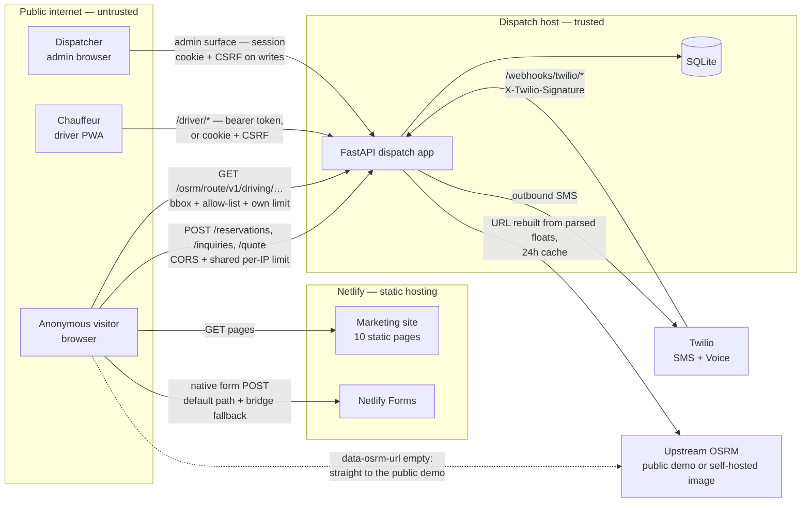
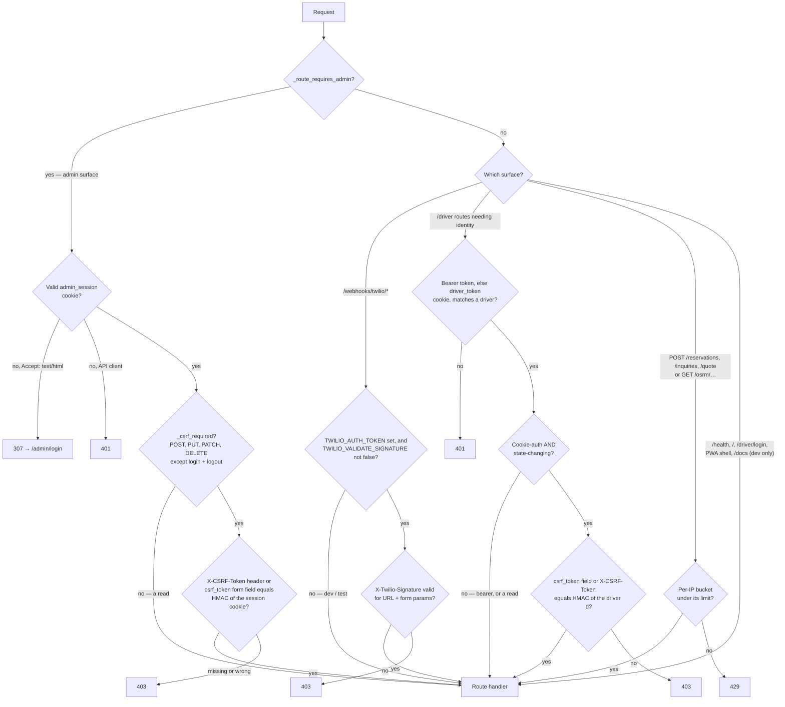

# Livery Dispatch — Security Audit & Pre-Production Checklist

Last updated: November 15, 2026 (v1.1.16 documentation refresh — folds in the
v1.1.13 CSRF widening and the v1.1.15 OSRM route proxy; probe counts
re-collected and `bandit` re-run the same day). Last full audit: May 27, 2026
(v1.0.8). Previously audited: May 27, 2026 (v1.0.1).

This audit covers the dispatch backend as it stands, the
current security posture, and what still needs to land before the system
can be deployed to the public internet under `DISPATCH_ENV=production`.

A marketing site that posts to this backend is separate and not in this
repository. Only when one of its pages sets `data-dispatch-url` /
`data-osrm-url` does a visitor's browser call the backend's public
endpoints, cross-origin; nothing proxies to the backend.

---

## Trust boundaries

Every party that talks to the dispatch app, and the check that guards each crossing (derived from `app.py`, `osrm_proxy.py` and the site's `js/*.js`):

The app is the only component that writes SQLite, and the only one that
calls the routing upstream on a visitor's behalf — it rebuilds that upstream
URL from validated values rather than forwarding anything (see
**Routing-relay abuse** below). The dashed edge is the pre-launch default:
with `data-osrm-url` empty, site visitors' browsers call the public OSRM
demo directly and the backend is not involved.

---

## Threat model

The system is in pre-production. The threat surface that matters before
the first real ride:

| Actor | Capability | Defended? |
|---|---|---|
| **Anonymous web user** | POST to public endpoints (`/reservations`, `/inquiries`, `/quote`), submit forms via the marketing site | Pydantic validation, per-IP rate limit (one 5-per-60s bucket shared by all three), honeypot field (`bot_field` → `spam` lane), CORS pinned in production, no DB writes on `/quote` |
| **Oversized-body flood** | POST megabyte bodies at any endpoint (public forms, webhooks, login) to burn CPU on parsing | Request-size cap (v1.4.1): `MAX_REQUEST_BYTES`, default 32 KiB, enforced in the app ahead of auth, CSRF and every route; a declared `Content-Length` over the cap is refused unread, a chunked body is refused as it crosses (413, `tests/test_request_size.py`) |
| **Drive-by scanner** | Probe for auth endpoints, attempt path traversal, fuzz inputs | Admin auth middleware on every `/admin/*` / `/dashboard` / `/map` / `/trips` / `/drivers` / `/subcontractors` route, the `GET /reservations` + `GET /inquiries` lists, and every `/reservations/{id}` + `/inquiries/{id}` sub-path; 401 JSON (or 307 to `/admin/login` for HTML) with no info leak |
| **Stolen driver token** | Replay a `Driver.auth_token` to act as a chauffeur | Token rotation via `/admin/drivers/{id}/action/rotate-token` invalidates immediately; rate limit on `/driver/login` slows replay |
| **Credential-stuffing bot** | Bulk POST against `/admin/login` or `/driver/login` | Per-IP rate limit (one 10-per-60s bucket shared across both endpoints); bcrypt password verification (cost factor 12) |
| **CSRF attack from another origin** | Cross-site write to `/admin/*`, the dispatcher REST surface (`/trips`, `/drivers`, `/subcontractors`, `PATCH /reservations/{id}` + `/inquiries/{id}`), or cookie-auth `/driver/*` | HMAC-bound CSRF token tied to session cookie on every admin-gated mutation (widened from `/admin/*`-only in v1.1.13; pinned by `tests/test_csrf_rest_surface.py`), with SameSite=Lax as a second layer; bearer-auth driver POSTs are exempt because a cross-site page never holds the chauffeur's bearer token to attach |
| **Routing-relay abuse** | Use the public `GET /osrm/*` proxy as a free OSRM relay, or smuggle paths/params/hosts to the upstream router | Waypoints must parse as `lon,lat` floats inside the corridor bbox (2–10); query params allow-listed to OSRM enums; upstream URL rebuilt from parsed values, never forwarded; own per-IP rate limit (60-per-60s default); 24h cache absorbs repeats; upstream errors return generic 502/504 (503 when routing is off) with no internals (`osrm_proxy.py`, `tests/test_osrm_proxy.py`) |
| **Twilio webhook forgery** | POST to `/webhooks/twilio/*` impersonating Twilio | HMAC-SHA1 signature verification using `TWILIO_AUTH_TOKEN` (auto-on when the env var is set) |
| **Voicemail transcript injection** | Speak adversarial content during a voicemail; Twilio transcribes it; parser feeds it into a `Reservation` row | Input length cap (5000 chars); per-field output caps (name 80, labels 200, date 20, time 10); control characters stripped; whitespace-only captures rejected |
| **PII leakage via console mode** | Operator accidentally deploys with `NOTIFICATION_PROVIDER=console`; SMS bodies + phone numbers land in journald/docker logs | Production boot guard refuses `NOTIFICATION_PROVIDER=console` |
| **Misconfigured deploy** | Forgotten env var ships the app with default secrets, permissive CORS, or weak HSTS | Fail-closed boot guard (`_validate_production_config`) refuses to start without `ADMIN_USERNAME`, `ADMIN_PASSWORD_HASH` (bcrypt), `ADMIN_SESSION_SECRET` (≥32 chars), `DRIVER_CSRF_SECRET` (≥32 chars), `CORS_ORIGINS` (no wildcards), `TWILIO_AUTH_TOKEN` + `TWILIO_ACCOUNT_SID` + `TWILIO_FROM_NUMBER` and an `https://` `PUBLIC_BASE_URL` when notification provider is Twilio, `CLIENT_IP_HEADER` (v1.1.17), a valid `MAX_REQUEST_BYTES` when set (v1.4.1), and VAPID credentials when `PUSH_NOTIFICATIONS_ENABLED=true`; logs a (non-fatal) warning if `OSRM_BASE_URL` still points at the public demo |
| **Forged push subscription (v1.1.0)** | Anonymous POST to `/driver/push/subscribe` impersonating a chauffeur to receive their trip notifications | Endpoint is driver-auth-gated + CSRF-protected; subscriptions are scoped to the authenticated `driver_id` so a chauffeur can never subscribe on someone else's behalf; `(driver_id, endpoint)` unique constraint upserts cleanly without race |
| **Stale VAPID key** | A leaked or rotated VAPID private key signs pushes that the push services will accept | Rotation playbook in `DEPLOY.md` § Web push; rotating the key invalidates every subscription so chauffeurs must re-enable, which is documented as the expected ops cost |

Out of scope for the MVP (planning-grade, deferred):

- DDoS at the network layer — handled by the deployment edge (Cloudflare /
  Fly's anycast network), not the app
- Insider threat from a compromised dispatcher account — single-user admin
  by design; the audit log captures every `/admin/*` write (REST writes to
  `/trips` etc. are not audit-logged — see **Audit trail**)
- Long-term key rotation policy — sessions are 24h; the admin CSRF token is
  an HMAC of the session cookie (new token with every login), the driver
  CSRF token an HMAC of the driver id (changes only when
  `DRIVER_CSRF_SECRET` does); secrets rotate via env-var redeploy

---

## Current posture (v1.1.17)

### Auth boundaries

- **Admin surface** (`/admin/*`, `/dashboard`, `/map` + `/map/data`,
  `/trips`, `/drivers`, `/subcontractors`, the `GET /reservations` and
  `GET /inquiries` lists, and every method on `/reservations/{id}` /
  `/inquiries/{id}`): session cookie + CSRF on every POST/PUT/PATCH/DELETE
  (`/admin/login` and `/admin/logout` excepted). Single-user; credentials
  in env vars; bcrypt password hash; session secret HMAC-SHA256. Auth
  middleware fail-closed.
- **Driver surface** (`/driver` and `/driver/*`): per-driver opaque token
  (32-byte URL-safe random, stored in `drivers.auth_token`). Bearer header
  OR `driver_token` cookie. Cookie-auth POSTs require HMAC-bound CSRF.
  Rotation invalidates immediately. `/driver/login`, `/driver/logout` and
  the PWA shell (`/driver/manifest.json`, `/driver/sw.js`,
  `/driver/icon.svg`) need no token.
- **Public surface** — *create-only, plus routing*: `POST /reservations`,
  `POST /inquiries`, `POST /quote`, `GET /osrm/route/v1/driving/{coords}`
  (v1.1.15), plus `/health`, `/` (redirect to `/dashboard`) and
  `/webhooks/twilio/*`. No auth by design; the three form POSTs share one
  per-IP bucket, the OSRM proxy has its own; Twilio webhooks
  signature-verified. **The per-id detail `GET`/`PATCH`
  (`/reservations/{id}`, `/inquiries/{id}`) and the list `GET`s are
  admin-gated, NOT public** — they expose customer PII (name / email /
  phone / flight / itinerary / dispatcher notes). The path gate
  prefix-matches these sub-paths; an earlier exact-match-only rule let them
  fall through unauthenticated (fixed; pinned by
  `test_documented_gap_authentication_required_on_all_surfaces`).

### How a request is classified

How `_route_requires_admin`, `_csrf_required` and the route-level driver and Twilio checks in `app.py` decide a request's fate:

Two mechanics the diagram compresses:

- **Where the admin CSRF check runs.** `_admin_auth_middleware` (the
  outermost middleware — last registered) compares an `X-CSRF-Token`
  header itself. With no header it flags the request, and the inner
  `_capture_body_for_audit` middleware reads the body and looks for a
  `csrf_token` field in a urlencoded / multipart form. A JSON write with no
  header therefore fails there with `403 Missing CSRF token`.
- **Login endpoints.** `/admin/login` and `/driver/login` sit on the
  public side of the gate but enforce their own shared per-IP login bucket
  (10 per 60s default, `LOGIN_RATE_*`).

### Pentest coverage

Adversarial probes live under `tests/pentests/` (collected counts,
including parametrized cases, as of 2026-11-18):

| Suite | File | Probes |
|---|---|---|
| Admin auth (session, CSRF, route sweep, login hardening, rate limit) | `test_pentest_auth.py` | 114 |
| Driver auth (token integrity, CSRF, login rate limit, cookie management, cross-surface isolation) | `test_pentest_driver.py` | 48 |
| Public `/quote` endpoint (validation, injection, anchor fuzz, method confusion, rate limit, info leakage, body-size cap) | `test_pentest_quote.py` | 35 |
| Twilio webhooks (signature forgery / URL+body binding / payload injection across all 6 endpoints) | `test_pentest_twilio.py` | 105 |
| CSP nonce hardening (header structure, nonce freshness, inline-tag coverage, placeholder leakage) | `test_pentest_csp.py` | 26 |
| Coordinate range validation (lat/lon bounds on `POST /trips`, driver location, reservation promote; no Trip created on bad coords — v1.1.7) | `test_pentest_coordinate_validation.py` | 18 |

**346 adversarial probes total.** Run with `python -m pytest tests/pentests`
from the repository root. Two security contracts live outside `pentests/`:
`tests/test_csrf_rest_surface.py` (73 cases — the v1.1.13 CSRF contract
across the REST surface) and `tests/test_osrm_proxy.py` (48 cases — bbox,
param allow-list, cache, failure mapping, rate limit), plus
`tests/test_request_size.py` (14, the v1.4.1 body-size cap). The full
dispatch suite is 1,084 tests (v1.4.1).

### Defense-in-depth headers (v1.0.2, hardened v1.0.13)

Every response carries the following headers, including the auth / CSRF short-circuits since v1.1.17:
`Content-Security-Policy` (frame-ancestors none, object-src none, base-uri
self, form-action self, locked img/connect/font sources, **per-request
`'nonce-...'` on script-src/style-src — no `'unsafe-inline'` since
v1.0.13**), `X-Frame-Options: DENY`, `X-Content-Type-Options: nosniff`,
`Referrer-Policy: strict-origin-when-cross-origin`, `Permissions-Policy`
(geolocation=(self), everything else off), `Cross-Origin-Opener-Policy:
same-origin`, and `Strict-Transport-Security` in production.

The CSP nonce is a fresh 128-bit URL-safe random per request, generated in
the `_security_headers` middleware and injected into every inline
`` into a rendered page can't execute
because they can't guess the nonce. `connect-src` is `'self'` plus
Nominatim — the dispatcher `/map` fetches routes from the same-origin
`/osrm` proxy since v1.1.15, so no OSRM host is allow-listed. `img-src`
allows OpenStreetMap's tile server and, when `MAP_SERVER_URL` is set, our
own map server (v1.3.0); CARTO is gone. `MAP_SERVER_URL` only counts when
it's a clean `https://` origin, so a bad value can't widen the policy or
inject markup (`tests/test_map_server.py`).

**Closed in v1.1.17 (E1).** Before, `_security_headers` was registered
first, which made it the innermost middleware, so the 401 JSON, the 307 to
`/admin/login` and the middleware-level CSRF 403s left without any of these
headers. It is now registered last, which makes it outermost, and every
response passes through it. `tests/test_prod_hardening.py` pins the order
and checks the headers on each short-circuit, on a 429, and on production
HSTS.

### Static analysis

- `bandit -r . -ll -x tests` — **0 medium/high** findings (re-run
  2026-11-15)
- `pip-audit --requirement requirements.txt` — run it before every release (CI is not set up in this
  repository yet)
- `tests/test_security.py::test_no_credential_logging_in_production_source`
  — static scan blocks credential-shaped `print()` / `_log.*()` calls

### Audit trail

`AdminAuditLog` rows record every write to `/admin/*` (method, path,
SHA-256 of body, status code, user). Append-only. Raw body not stored to
avoid PII bloat. Writes made through the REST surface (`/trips`,
`/drivers`, `/subcontractors`, `PATCH /reservations/{id}`,
`PATCH /inquiries/{id}`) — including the `/map` click-to-dispatch flow —
are CSRF-protected but are **not** audit-logged; the middleware only
matches the `/admin/` prefix.

---

## Known accepted risks

These are flagged so a future reviewer knows they were considered and
left in place:

1. **The CSP allow-lists one third-party origin.** `script-src` and
   `style-src` include `https://unpkg.com` so the dispatcher `/map` can
   load Leaflet 1.9.4; both tags pin the exact version and carry SRI
   `integrity` hashes. (The earlier `'unsafe-inline'` allowance is gone —
   per-request nonces replaced it in v1.0.13.)
2. **`auth_token` is rendered in cleartext on `/admin/drivers/{id}`.** The
   dispatcher needs the full token to hand to the chauffeur for login.
   The admin surface is gated behind session auth; this is an intentional
   trust boundary, not a leak.
3. **SQLite for MVP.** No row-level encryption, no point-in-time recovery,
   no streaming replication. Since v1.4.1 the backups are three layers
   (daily Fly volume snapshots kept 30 days, a copy before every boot-time
   migration, and `python backup.py` on demand; `DEPLOY.md`,
   Backups), so the worst case is a day of data, not all of it. Migration
   to Postgres is a pre-launch blocker — see the checklist below.
4. **`/docs`, `/redoc`, `/openapi.json` are CSP-exempt and auth-exempt
   outside production only.** Swagger UI loads JS from jsdelivr, and a
   strict policy would break the dev docs. **Since v1.1.17 (E2) they don't
   exist in production**: `docs_url` / `redoc_url` / `openapi_url` are
   `None` when `DISPATCH_ENV=production`, the CSP exemption set is empty,
   and the paths return 404 with the full header set.
5. **No row-level retention policy on `AdminAuditLog`, `CallLog`, or
   `Reservation`.** Log volume is low for a single-dispatcher MVP. Add
   retention when call volume justifies it.

---

## Pre-production checklist

Before flipping `DISPATCH_ENV=production`, every item below must be done.
The fail-closed boot guard (v1.0.3) enforces the env-var items at startup
— the app refuses to start without them. For the deeper ops runbook
(every command, every Twilio config step, the SQLite→Postgres migration
plan), see [`DEPLOY.md`](DEPLOY.md).

### Environment configuration (enforced at boot)

- [ ] `DISPATCH_ENV=production`
- [ ] `ADMIN_USERNAME` set to a non-default value
- [ ] `ADMIN_PASSWORD_HASH` set, bcrypt format (`$2a$` / `$2b$` / `$2y$`)
- [ ] `ADMIN_SESSION_SECRET` set, ≥32 random characters
- [ ] `DRIVER_CSRF_SECRET` set, ≥32 random characters
- [ ] `CORS_ORIGINS` pinned to live site origin(s), no `*`
- [ ] `NOTIFICATION_PROVIDER=twilio` (console refused in production)
- [ ] `TWILIO_AUTH_TOKEN` set (required for webhook signature verification)
- [ ] `TWILIO_ACCOUNT_SID` set (boot-enforced since v1.1.17, E4; before, a
      missing SID silently fell back to console SMS)
- [ ] `TWILIO_FROM_NUMBER` set (boot-enforced since v1.1.17, E4)
- [ ] `PUBLIC_BASE_URL` = the public `https://` origin Twilio calls
      (boot-enforced since v1.1.17, E5; webhook signatures verify against it
      behind the TLS proxy)
- [ ] `CLIENT_IP_HEADER` = the header the edge proxy *sets* to the client IP
      (`Fly-Client-IP` on Fly.io; `none` without a proxy). Boot-enforced
      since v1.1.17 (E5); every rate-limit bucket keys on it
- [ ] `DISPATCHER_PHONE` set (live-person voice routing — not boot-enforced;
      without it every call goes straight to voicemail)
- [ ] If `PUSH_NOTIFICATIONS_ENABLED=true`: `VAPID_PRIVATE_KEY`,
      `VAPID_PUBLIC_KEY`, `VAPID_CONTACT_EMAIL` set

### Deploy environment

- [x] Container runs the app as a non-root user (automatic since v1.1.21:
      `boot.py` hands the `/data` volume to `dispatch` (uid 10001), drops
      root, then execs uvicorn; app code is root-owned and read-only; no
      test or dev tooling in the image).
- [x] Schema migrations can't be skipped on deploy (automatic since
      v1.1.21: `alembic upgrade head` runs at container boot)
- [ ] Map server deployed and `MAP_SERVER_URL` set on the dispatch app plus `data-qgis-url` on the six site maps; until then the maps use OpenStreetMap's public tiles. The server publishes only public layers; pin its `NGINX_CORS_ALLOW_ORIGIN` to the site origin
- [ ] Exactly one Fly machine (`flyctl deploy --ha=false`): SQLite on a
      volume is per-machine, so a second machine would split the database
- [ ] TLS termination configured at the edge (Fly.io / Render / Cloudflare)
      — the dispatch app sets `secure=True` on cookies when
      `DISPATCH_ENV=production` and assumes HTTPS upstream
- [ ] HSTS preload submission (after the `Strict-Transport-Security`
      header has been served for ≥30 days)
- [ ] CORS pinned to the final marketing-site origin (Netlify production
      URL, not the deploy-preview URLs)
- [ ] `OSRM_BASE_URL` pointed at the self-hosted corridor image
      ([`osrm/`](osrm/README.md)) — boot only *warns* if
      it still names the public demo (non-commercial use, no SLA); routing
      degrades to straight lines / haversine rather than failing
- [ ] Site pages wired deliberately: `data-dispatch-url` on the reserve /
      inquiry forms and `data-osrm-url` on the six `#map` divs point at the
      production backend, whose origin list includes the site
- [x] `/docs`, `/redoc`, `/openapi.json` disabled in production (automatic
      since v1.1.17, E2; nothing to configure)
- [x] Request-size limits (defence against 50KB+ JSON bodies that pentest
      probes showed were rejected cleanly but only after parsing). Enforced
      in the app since v1.4.1, because Fly's proxy documents no body limit:
      `MAX_REQUEST_BYTES` (default 32 KiB) refuses bigger bodies with a 413
      before anything reads them. Nothing to configure

### Data / persistence

- [ ] **SQLite → Postgres migration** — see
      [`DEPLOY.md`](DEPLOY.md) for the runbook. SQLite
      is fine for soft-launch dev; Postgres is mandatory before paying
      customers depend on the DB.
- [x] Backup posture defined for whichever DB ships first (daily snapshot
      + 30-day retention minimum). For SQLite since v1.4.1: Fly volume
      snapshots daily, kept 30 days (`fly.toml`), a copy before every
      migration, and `python backup.py` on demand
      ([`DEPLOY.md`](DEPLOY.md#backups-sqlite)). Postgres
      would need its own
- [ ] After the first deploy: confirm a volume snapshot exists
      (`flyctl volumes snapshots list <volume-id>`), take one copy with
      `backup.py`, download it, and restore it into a scratch database once,
      so the restore steps are known to work
- [ ] Migration runbook tested in a staging environment

### Twilio

- [ ] Voice webhook URL configured in Twilio console to point at the
      production deploy (`POST {prod-host}/webhooks/twilio/voice`)
- [ ] SMS webhook URL configured the same way (`POST
      {prod-host}/webhooks/twilio/sms`)
- [ ] Voicemail callback URL configured
      (`POST {prod-host}/webhooks/twilio/voicemail`)
- [ ] Twilio number provisioned and pointed at the Voice + SMS webhooks
- [ ] `TWILIO_VALIDATE_SIGNATURE` left unset (or `true`) — setting it to
      `false` turns signature checks off; it is a diagnostics-only override

### Monitoring

- [ ] Application logs shipped to a retention system (Fly's log stream,
      Cloudwatch, or equivalent) — minimum 30 days
- [ ] Uptime monitor against `GET /health` (returns `200` with body
      `{"status":"ok","service":"livery-dispatch","version":"…"}`)
- [ ] Alert on the 5xx rate; alert on `/admin/login` 429 surges
      (potential brute force in progress)

### Rollback plan

- [ ] Previous-release container tag retained
- [x] DB migration is reversible (or backed up immediately before):
      automatic since v1.4.1. `boot.py` copies the database to
      `/data/backups/` before migrating it and refuses to migrate if it
      can't
- [ ] Documented "kill switch" — single-command revert path

---

## Reporting a vulnerability

If you discover a security issue in this repository, please report it
privately rather than opening a public issue:

- **Email** the repository owner via the address on the GitHub profile
  associated with the username `wbp318`.
- Use a subject line beginning with `[security]`.
- Include a minimum reproducible case and the commit hash you observed
  the issue on.
- Do **not** open a public issue or PR until the maintainer has
  acknowledged the report.

This is a small family-business repo with no formal disclosure SLA; the
maintainer aims to respond within 7 days. There is no bounty program.

See `LICENSE` for the legal posture on access and reuse.
