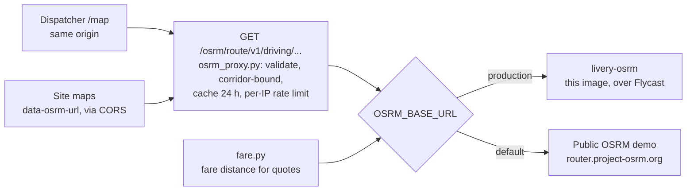
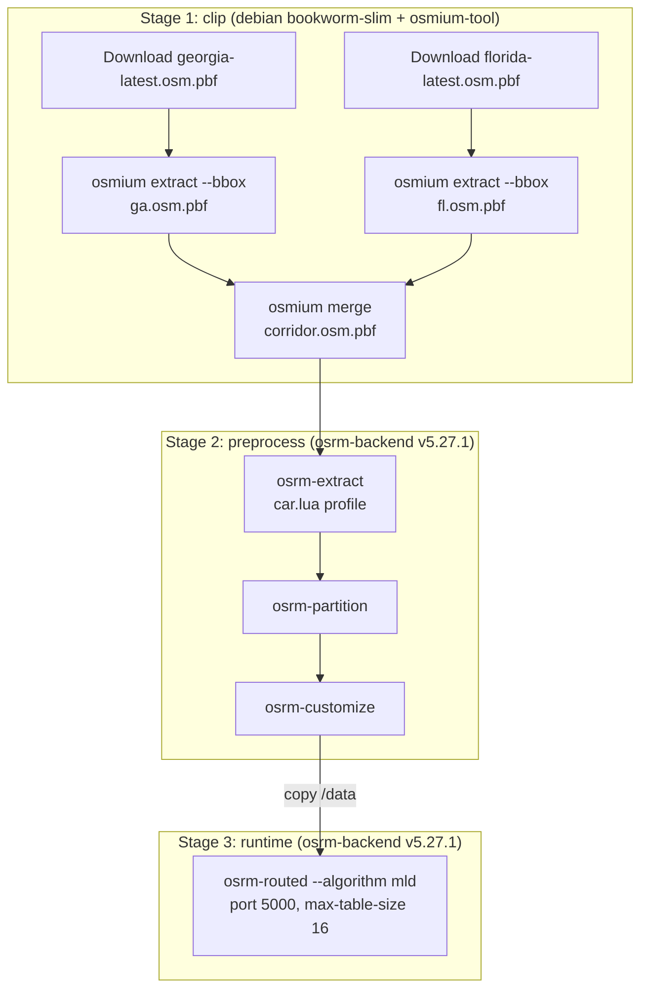

# Self-hosted OSRM (corridor routing)

Retires the public OSRM demo (`router.project-osrm.org`, which is non-commercial only, about 1 request/second, and has no SLA). The demo rate-limiting is what made the maps fall back to straight lines.

## How the pieces fit (v1.1.15)

Every routing consumer reads one env var, **`OSRM_BASE_URL`**, so pointing it at this container retires the public demo for the maps and the fare quotes in one move:



The default is still the public demo, so nothing changes until `OSRM_BASE_URL` is pointed here. If routing is down, everything degrades the same way as before: maps show straight lines, and fares fall back to haversine distance.

**What the proxy does** ([osrm_proxy.py](../osrm_proxy.py), route in [app.py](../app.py)):

| Concern | Behavior |
|---|---|
| Input | 2–10 `lon,lat` waypoints; each must sit inside `CORRIDOR_BBOX`. Query params are an allow-list (`overview`, `geometries`, `steps`, `alternatives`) with OSRM's own values. The upstream URL is rebuilt from parsed floats, never forwarded verbatim. |
| Cache | In-process LRU keyed on the upstream URL. `OSRM_PROXY_CACHE_TTL_S` (default 86400) and `OSRM_PROXY_CACHE_MAX` (default 512). Responses carry `X-Cache: MISS` / `HIT`, plus `Cache-Control: public, max-age=…` on success. |
| Rate limit | Own per-IP bucket, separate from the public-form bucket: `OSRM_PROXY_RATE_MAX` (default 60) per `OSRM_PROXY_RATE_WINDOW_S` (default 60). Over the limit returns 429. |
| Failures | Upstream timeout → 504. Other upstream failure → 502. `OSRM_BASE_URL=""` → 503. OSRM's own "can't route this" → 400 carrying only its `code` (`NoRoute`, `NoSegment`). Every client treats a non-2xx as "keep the straight line". |
| Auth | Public and GET-only, so the admin CSRF contract doesn't apply. Cross-origin use from the site is governed by `CORS_ORIGINS`. |

## What's in the image

- [Dockerfile](Dockerfile) downloads the Geofabrik **Georgia + Florida** extracts. It clips each one to the corridor box `-82.8,29.8,-80.6,32.9`, which spans SAV and Statesboro/GSU in the north through JAX and St. Augustine in the south. It then merges them and runs OSRM's MLD preprocessing **at build time**.
- The box must match `CORRIDOR_BBOX` in [osrm_proxy.py](../osrm_proxy.py). The proxy rejects waypoints outside it, so it can't be used as a free general-purpose router.
- **The image is the data snapshot.** Rebuild it to pick up OSM edits, such as fixes to resort drives (see the memo's §7 on gated-area coverage).

The build runs in three stages, so the runtime image carries only the finished graph files:



## Local

```powershell
docker build -t livery-osrm osrm
docker run --rm -p 5000:5000 livery-osrm
# .env:
#   OSRM_BASE_URL=http://localhost:5000
```

The first build downloads about 700 MB of Geofabrik extracts.

## Fly.io (production)

This is a second, **private-only** Fly app next to the dispatch app (see [../DEPLOY.md](../DEPLOY.md)). ⚠️ These steps are planning-grade: the flags are from Fly's docs, but they haven't been run against this account yet. Verify each step on the first deploy and fix this file if Fly has changed anything.

```powershell
cd osrm
fly apps create livery-osrm
fly deploy --no-public-ips            # builds on Fly's remote builder (~10–20 min first time)
fly ips allocate-v6 --private         # Flycast address → http://livery-osrm.flycast
fly ips list                          # expect ONLY a private v6, no public v4/v6

# Point the dispatch app at it (restarts dispatch):
fly secrets set -a livery-dispatch OSRM_BASE_URL=http://livery-osrm.flycast
```

**Check it worked:**

- `GET https://<dispatch>/osrm/route/v1/driving/-81.6879,30.4941;-81.3438,31.1969?overview=false` returns `"code":"Ok"`, and a repeat request returns `X-Cache: HIT`.
- The dispatch boot log no longer prints the "public OSRM demo" warning.
- On `/map`, active trips draw road-following lines.

**Sizing:** [fly.toml](fly.toml) keeps one 512 MB shared-CPU machine warm (`min_machines_running = 1`), costing a few dollars a month. Auto-stop is off on purpose: a cold start takes longer than the proxy's 5-second `OSRM_TIMEOUT_S`, so the first map load after an idle period would show straight lines. The health check routes JAX→Cloister, so the check fails if the graph didn't load.

## Marketing site

The static site defaults to the public demo, which is fine before launch. After the dispatch app is live, set `data-osrm-url="https://dispatch.<domain>/osrm"` on each `#map` div (corridor plus the 5 resort pages). The site's origin must also be in the dispatch app's `CORS_ORIGINS` (it already is for the reserve form).
